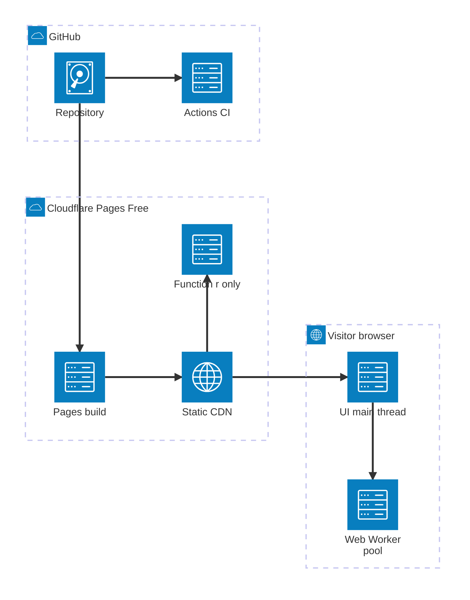
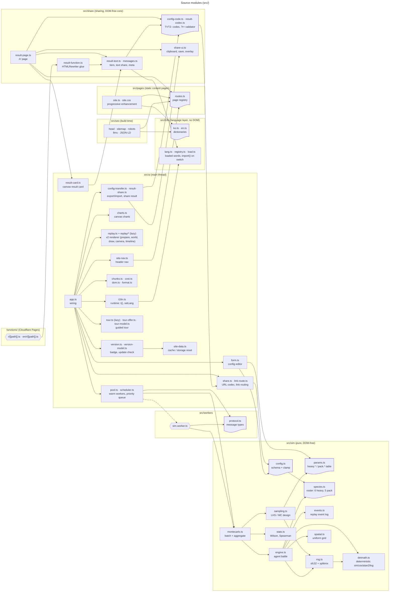
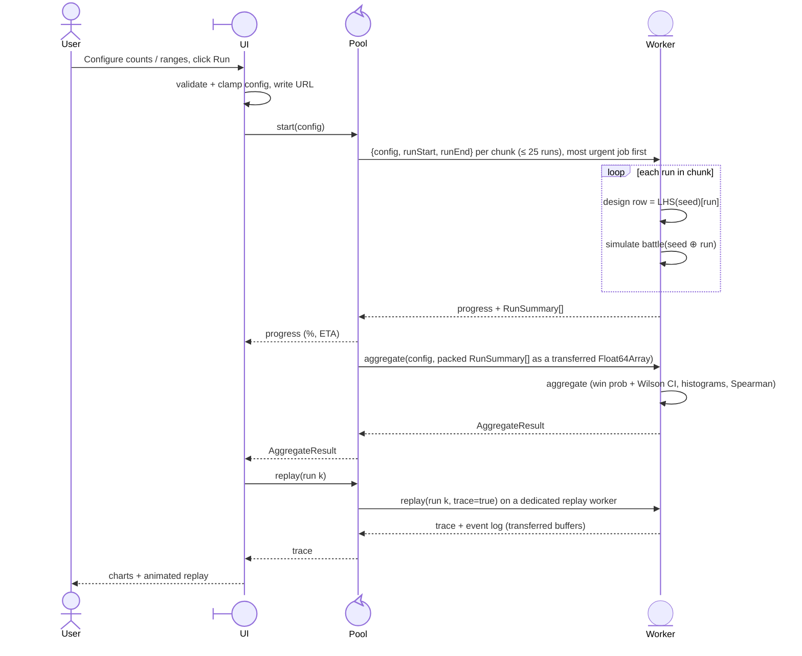
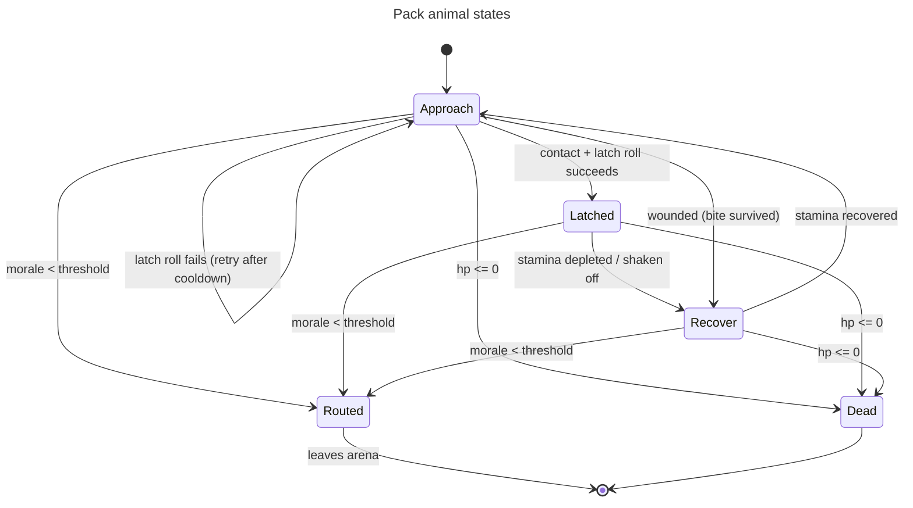
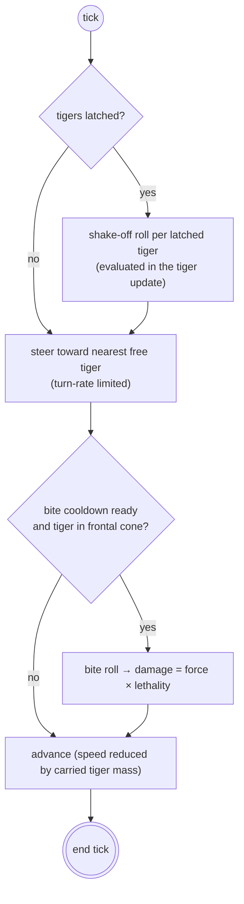
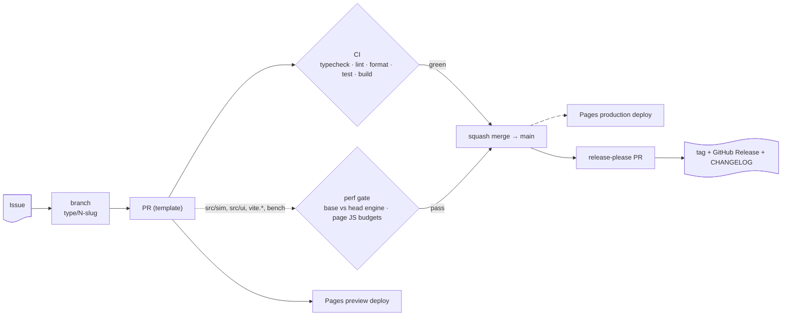

# Architecture

> Diagrams use Mermaid syntax supported by GitHub's renderer (Mermaid 11.16.x as of 2026-10): YAML frontmatter `config`, expanded node shapes (`id@{ shape: … }`), edge IDs/animation, `architecture-beta`, typed sequence participants. Mermaid 11.17+/12.x-only features are intentionally avoided.

## 1. System context

Everything runs in the visitor's browser. Cloudflare Pages serves static files built from `main`; the only server code is a tiny Pages Function that rewrites link-preview meta tags on `/r/` result links ([ADR-0006](docs/adr/0006-pages-function-share-previews.md)).

| Concern         | Where                              | Why                                                                                                                                     |
| --------------- | ---------------------------------- | --------------------------------------------------------------------------------------------------------------------------------------- |
| Compute         | Browser Web Workers                | Workers Free = 10 ms CPU/request; infeasible server-side ([ADR-0001](docs/adr/0001-client-side-compute.md))                             |
| Hosting         | Cloudflare Pages (Git integration) | Free, unlimited static requests ([ADR-0002](docs/adr/0002-cloudflare-pages-git-integration.md))                                         |
| State / sharing | URL fragment `#s=` on `/play/`     | No backend ([ADR-0003](docs/adr/0003-no-backend-url-sharing.md)); old `/#s=` links forward ([SHARING.md](docs/SHARING.md#link-routing)) |
| Result previews | Pages Function on `/r/*` only      | Meta rewrite for crawlers, no storage ([ADR-0006](docs/adr/0006-pages-function-share-previews.md))                                      |
| Runtime deps    | None                               | [ADR-0004](docs/adr/0004-no-runtime-dependencies.md)                                                                                    |

## 2. Module structure

Language layer (#67, #79): the words live in `src/i18n/ko.ts`, `src/i18n/en.ts` and `src/share/messages-<lang>.ts`; `src/i18n/lang.ts` (`Lang`, `interpolate`, `otherLang`) and `src/i18n/registry.ts` (the loaded words) import nothing from `src/ui`, so `src/seo`, `src/pages` and `src/share` depend on `src/i18n` instead of the app's runtime `src/ui/i18n.ts`. Browser code reads words only through the registry; a page entry registers its own language before it starts (`src/main-ko.ts`, `src/main-en.ts`, `src/share/result-page-ko.ts`, `-en.ts`), and the language switch loads the other one with `import()`. Build-time code (`src/seo`, `src/pages/site-header.ts`, `site-footer.ts`) and the tests use `src/i18n/dictionaries.ts` with both languages; the app's logo and nav items come from `src/pages/site-shell.ts`, which holds no words. Remaining cross-directory edges: `src/share` uses the config URL codec `src/ui/share.ts` and the canvas card `src/ui/result-card.ts`, and `src/ui` uses the sharing core; no module import cycle runs between `src/share` and `src/ui`.

Rule: `src/sim` has no DOM access, so it can be unit-tested in Node and run inside workers. The same holds for the sharing core (`src/share/config-code.ts`, `result-codec.ts`, `result-text.ts`), which the app, the `/r/` page and the Pages Function all import, so they accept exactly the same links ([SHARING.md](docs/SHARING.md)).

Testing rule (#61): every module with branching logic has a test that imports it. These modules are intentional **DOM shells**: they wire the DOM, events and timers around logic that lives in a tested module (in brackets), and are checked with Playwright instead of unit tests:

| DOM shell                                                    | Tested logic                                                                                                                          |
| ------------------------------------------------------------ | ------------------------------------------------------------------------------------------------------------------------------------- |
| `src/ui/app.ts`                                              | `app-model.ts`, `chunks.ts`, `cost.ts`, `verdict.ts`, `share.ts`, `share-free.ts`, `link-route.ts`, the charts' table and hit helpers |
| `src/ui/free-mode.ts`                                        | `src/sim/free/*`, `share-free.ts`                                                                                                     |
| `src/ui/simple-mode.ts`                                      | `simple-model.ts`, `free-form-model.ts`, `src/sim/free/presets.ts`                                                                    |
| `src/ui/replay.ts`, `replay/legend.ts`, `replay/strip.ts`    | `replay/prepare.ts`, `world.ts`, `camera.ts`, `timeline.ts`, `effects.ts`, `glyphs.ts`                                                |
| `src/ui/tour.ts`, `tour-offer.ts`                            | `tour-model.ts`                                                                                                                       |
| `src/ui/version.ts`                                          | `version-model.ts`                                                                                                                    |
| `src/ui/config-transfer.ts`                                  | `src/share/config-code.ts`                                                                                                            |
| `src/share/result-page.ts`                                   | `result-codec.ts`, `result-text.ts`                                                                                                   |
| `src/ui/dom.ts`, `src/ui/announce.ts`                        | (element factory and live region; no decisions)                                                                                       |
| `src/main*.ts`, `src/share/result-page-*.ts`, `src/reset.ts` | (entries: register the words, start the page)                                                                                         |

`src/ui/replay/free-events.ts` (battle events derived from free-trace frames: first contact, incapacitation and rout clusters, encirclement, morale break, still standing, the decisive moment; [REPLAY.md §14](docs/REPLAY.md#battle-events-derived-from-frames), #176) is pure and has no DOM shell yet; the live UI (#183) will read it.

### Entry points (multi-page build)

`vite.pages.ts` `findHtmlEntries()` turns every `index.html` in the repository into a build input, so a new page needs no config change ([docs/PAGES.md](docs/PAGES.md)).

| Entry                                                 | Script                                                                | Purpose                                                                                                                                                                                                                              |
| ----------------------------------------------------- | --------------------------------------------------------------------- | ------------------------------------------------------------------------------------------------------------------------------------------------------------------------------------------------------------------------------------ |
| `index.html`, `en/index.html`                         | inline forwarder, then `src/pages/site.ts`                            | The lobby in Korean (`/`) and English (`/en/`): play-first hero, crawlable intro and FAQ; forwards old links to the play page before rendering ([PAGES.md](docs/PAGES.md#the-lobby--en), [SHARING.md](docs/SHARING.md#link-routing)) |
| `play/index.html`, `en/play/index.html`               | `src/main-ko.ts` / `src/main-en.ts` → `src/main.ts` → `src/ui/app.ts` | The simulator app in Korean (`/play/`) and English (`/en/play/`), `noindex`; language comes from the URL ([PAGES.md](docs/PAGES.md#the-play-pages-play-enplay))                                                                      |
| `<page>/index.html`, `en/<page>/index.html`           | `src/pages/site.ts`                                                   | Static, crawlable guide, model, parameters, about and privacy pages in Korean and English ([PAGES.md](docs/PAGES.md))                                                                                                                |
| `patch-notes/index.html`, `en/patch-notes/index.html` | `src/pages/site.ts`                                                   | Patch notes board: one card per release, generated at build time from `src/content/patch-notes.ts` ([PAGES.md](docs/PAGES.md#patch-notes))                                                                                           |
| `reset/index.html`                                    | `src/reset.ts`                                                        | Cache and storage reset hand-off, served with `Clear-Site-Data` ([VERSIONING.md](docs/VERSIONING.md))                                                                                                                                |
| `license/index.html`, `en/license/index.html`         | `src/pages/site.ts`                                                   | MIT text and third-party notices                                                                                                                                                                                                     |
| `404.html`, `en/404.html`                             | `src/pages/site.ts`                                                   | Real 404 pages (disable the Pages SPA fallback)                                                                                                                                                                                      |
| `r/index.html`, `en/r/index.html`                     | `src/share/result-page.ts`                                            | Shared-result pages (`?r=`): noindex, not in the sitemap, never load the simulator ([SHARING.md](docs/SHARING.md))                                                                                                                   |

At build time `vite.seo.ts` (code in `src/seo/`) writes the head tags, JSON-LD, `sitemap.xml`, `robots.txt` and `llms*.txt` from the page registry ([SEO.md](docs/SEO.md)). Species presets and bounds live in `src/sim/species.ts` ([SPECIES.md](docs/SPECIES.md)); the free model's registry, `src/sim/free/species.ts`, reads them and adds the free traits, `era`, `adSafe` and a standalone constructor for species without a legacy entry (SPECIES.md §11), which builds the polar bear (#184), the first free-only species, the hippopotamus (#186) the raptor pack (#188, the first social one), the white rhinoceros (#187), _Spinosaurus_ (#185, land duel) and _Triceratops_ (#189); the replay renderer and its event log are described in [REPLAY.md](docs/REPLAY.md) and MODEL.md §2.6.

The build also emits `version.json` (version, commit SHA, build time), which open tabs poll to detect a newer deployment ([VERSIONING.md](docs/VERSIONING.md)). The guided tour is documented in [TUTORIAL.md](docs/TUTORIAL.md).

## 3. Run sequence

### Determinism

- Master seed `S` (uint32, in the URL).
- Sampling design (LHS permutation matrix) is generated from `S` and rebuilt identically in every worker; run `i` uses row `i`.
- Every random stream is seeded by `deriveSeed(S, stream, salt) = splitmix32(splitmix32(S ⊕ imul(salt + 1, 0x85ebca6b)) ⊕ stream)` (`src/sim/rng.ts`), where `stream` is usually the run index `i` and each purpose has its own salt:

  | Salt     | Purpose                                                                  | Where                                             |
  | -------- | ------------------------------------------------------------------------ | ------------------------------------------------- |
  | 1        | sampling design (`deriveSeed(S, 0, 1)`)                                  | `src/sim/sampling.ts`                             |
  | 2        | classic battle `i` (`deriveSeed(S, i, 2)`)                               | `src/sim/engine.ts`                               |
  | 3, 4     | the free engine's two sides, one stream each (`deriveSeed(S, i, 3)`/`4`) | `src/sim/free/engine.ts`                          |
  | 5        | reserved for randomized card effects (none use it yet)                   |                                                   |
  | 6 and up | live-chance branches (`BRANCH_SALT_MIN`)                                 | `src/sim/free/engine.ts`, `src/ui/live-chance.ts` |

  Card draws fold their inputs through `deriveSeed` separately: `cardDrawSeed` is `deriveSeed(deriveSeed(seed, matchIndex, pauseIndex), rerollCount)` (`src/sim/free/cards.ts`, [MODEL.md §3.9](docs/MODEL.md#39-variable-cards-free-model)).

- A run's seed depends only on `(S, i)`, not on which worker runs it, which chunk it falls in or what ran before it on that worker, and the design row `i` is rebuilt from `S` in every worker. Therefore, within one JavaScript engine, results are identical for a given URL regardless of the number of workers or chunk boundaries. The scheduler also returns the summaries in run order, whatever order the chunks finish in. Across engines, only model version 2 and later are bit-identical ([#197](https://github.com/VinylStage/trex_vs_tiger_sim/issues/197), [MODEL.md §2.2](docs/MODEL.md#22-random-numbers-and-determinism)).
- Free-model links also name the model version they run under (`mv`, absent means 1), so a link's results are identical per model version ([ADR-0008](docs/adr/0008-live-interventions-and-model-version.md), [SHARING.md](docs/SHARING.md#model-version-mv)).

### Workers and scheduling

`src/ui/scheduler.ts` (#175, [RENEWAL-1.0 §10.7](docs/design/RENEWAL-1.0.md#107-session-compute-ownership-scheduler-cpu)) owns the run workers: at most `poolSize()` of them (`hardwareConcurrency − 1`, 1–8), spawned on demand and then kept warm.

- **Jobs and priorities.** A job is a list of tasks, one worker message each: the chunks of a batch (`submitRuns`, `splitRuns` in `chunks.ts`, at most `MAX_CHUNK_RUNS` = 25 runs per chunk) or a single aggregate. Each job has a priority from P0 (live re-simulation) through P1 what-if, P2 live chance and P3 next-match batch to P4 speculative work. An idle worker always takes the next task of the most urgent job, the oldest first within a priority.
- **Preemption at chunk boundaries.** Nothing is interrupted. A more urgent job takes each worker as soon as that worker finishes its current chunk.
- **Cancel and supersede.** Cancelling drops the job's queued tasks and discards its in-flight answers when they arrive. No worker is terminated. Workers end only on unload (`dispose()`, or the page going away), after 5 minutes hidden (`setHidden`, wired to `visibilitychange` in `app.ts`; idle workers go at once, busy ones when they run out of work), or when one crashes (`onerror`; its job rejects and the other jobs move to a new worker). An `error` message from a task rejects only that job.
- **`SimPool`** (`pool.ts`) keeps today's interface for the Simple and Advanced batches: `run`/`runFree`/`aggregate` are the foreground job at P1, and a new one supersedes the previous one. With one job at a time this behaves like the old pool. Background jobs go to `pool.scheduler` directly and are not superseded. The replay worker is outside the scheduler and keeps its rule: a newer replay terminates the old replay worker and starts a fresh one, so a long replay never delays the next.
- **Live worker** (#178, [RENEWAL-1.0 §10.2](docs/design/RENEWAL-1.0.md#102-live-step-fork-and-re-simulate-10) points 1 and 6). `pool.live` is a second `Scheduler` of exactly one worker, used only at P0 by `SimPool.replayLive(config, run, interventions)`. It is dedicated, so a live re-simulation never waits behind batch chunks or a replay, and it is warm: a newer `replayLive` cancels the older one (CancelledError, its in-flight answer discarded) but never terminates the worker, which ends under the scheduler's rules (unload, long hide, crash). The answer is `{ trace, liveSimMs }`.
- **Live chance** (#179, §10.2 point 4). `submitLiveChance(pool.scheduler, …)` queues B branches per checkpoint as `branch-free` chunks (at most 25 branches each) at P2 on the batch workers, so a P1 what-if batch takes over within one chunk. `runLiveChance` adds the budget: past it, the job is cancelled and the bar falls back to the labelled 전력 비율 ([MODEL.md §3.9](docs/MODEL.md#39-variable-cards-free-model)).
- **Live battle mode** (#183, [PAGES.md](docs/PAGES.md#live-battle-mode)). `src/ui/live.ts` (a lazy chunk opened from the free form) drives one match: `replayLive` for the live run (its answer also carries the run's `summary`, which the result link shares), the live chance (#179) and what-if baseline (#182) during the prediction beat, the pause at the checkpoint closest to 50 % (`FreeReplayView.stopAt`), the gate plan (#181) for the pause work, and on a pick `replayLive` with the log, `spliceForkTrace` and `load(…, { startAt })`. The pure rules (pause point, auto speed, banners, captions) are `src/ui/live-model.ts`; the bar is `src/ui/chance-bar.ts`, the offer `src/ui/cards-ui.ts`.
- **What-if shift** (#182, §10.2 point 3). `src/ui/what-if.ts` runs each offered card at the pause tick in N fresh battles (`run` chunks with `interventions`, P1) and compares them with the same runs without it (the baseline, one job per match). The runs are 0 … N − 1 of the match's config with a fixed design size of 200, so the comparison is paired and a smaller N after degradation reuses the same runs; a one-side card splits its N between the two sides, so the pause holds 3 × N runs as gate (b) counts them.
- **Live-card gates** (#181, §10.2 point 5). `planLiveCards` in `src/ui/live-gates.ts` turns measured inputs (the live run's `liveSimMs`, the per-run cost, `c_obs`, the batch worker count, the pause and prediction windows) into a plan: live cards with N what-if runs per card and how many checkpoints to recompute, pre-battle cards, or none. It is pure, and the degradation order is in [PERFORMANCE.md](docs/PERFORMANCE.md#live-card-gates-181).

#### Worker messages (`src/workers/protocol.ts`)

| Request                                                                | Answer                                                  | Used by                                              |
| ---------------------------------------------------------------------- | ------------------------------------------------------- | ---------------------------------------------------- |
| `run {config, start, end, interventions?}` (classic or `mode: 'free'`) | `progress`…, then `result {summaries}`                  | scheduler chunks; with a log, what-if batches (#182) |
| `aggregate` / `aggregate-free {config, summaries}`                     | `aggregate` / `aggregate-free {agg}`                    | foreground job after a batch                         |
| `replay {config, run}`                                                 | `replay {trace}` (transferred buffers)                  | replay worker                                        |
| `replay-free {config, run, interventions?}`                            | `replay-free {trace, liveSimMs, summary}` (transferred) | replay worker (no log); live worker (with log)       |
| `branch-free {config, run, interventions?, branches}`                  | `branch-free {outcomes}` (one per branch)               | live-chance job (P2, `src/ui/live-chance.ts`)        |

Every request carries a `jobId` that its answer echoes, and a failure answers `error {message}`. The worker sanitizes every payload, because configs and logs can come from a shared link: the config with `sanitizeConfig` or `sanitizeFreeConfig`, the intervention log with `sanitizeInterventions` against the run's `maxSteps`, `mv` and morale switch (the engine sanitizes it again). An absent, empty or fully invalid log gives exactly the replay without interventions. `liveSimMs` is the worker's wall time for the simulation alone, without the message transfer; it feeds the re-simulation gate (a) of §10.2. To keep the frames before a card tick identical to what the viewer was watching even when the engine thinned the fork's frames differently ([REPLAY.md §14](docs/REPLAY.md#14-free-matchups)), the caller splices the fork onto the parent with `spliceForkTrace(parent, fork, tick)` (`src/sim/free/fork.ts`).

## 4. Simulation model (summary)

Full model, parameter ranges and literature: [docs/MODEL.md](docs/MODEL.md).

Two-level uncertainty:

1. **Epistemic (per run):** each species parameter is drawn from a triangular distribution `(min, mode, max)` using Latin Hypercube Sampling across runs.
2. **Aleatory (per individual):** each animal multiplies the run-level value by `N(1, CV)` truncated to `[0.5, 1.5]`.

Fixed time step `dt = 0.1 s`; open square arena; battle ends when one side is eliminated (dead or routed) or at `maxTime` (draw).

The play page opens in **Simple mode** (#146, [PAGES.md](docs/PAGES.md#simple-mode-and-the-advanced-switch)): `src/ui/simple-mode.ts` is a second view of the free mode (`free-mode.ts` keeps the config, the Run button, the run and the results panel) with preset chips, a species picker and a count per side, and in the results a win share bar and the still-standing / fled / incapacitated breakdown. On the first Simple Run the results panel shows a skeleton of those blocks at their final size, with invisible placeholders for the values, so the result renders without a layout shift (#251, [PERFORMANCE.md](docs/PERFORMANCE.md#layout-shift-when-simple-results-render-251)). Its pure part, `src/ui/simple-model.ts`, builds the config a Simple run uses (species and counts, a fresh seed, every hidden setting at its default). The app (`app.ts`) holds the view (`simple` or `advanced`) next to the engine (`classic` or `free`); one **Advanced** switch at the top of each config panel changes the view, and the existing classic / free radio group appears below it in Advanced mode.

The free model's matchup presets (`src/sim/free/presets.ts`) are pure data. A test measures each one on the free engine and checks it against a committed fixture and the rout check ([PRESETS.md](docs/PRESETS.md)).

**Model versions and deterministic math (#169, #197).** Both engines run every model version a link can name (`mv`, [ADR-0008](docs/adr/0008-live-interventions-and-model-version.md)); new links name version 2. Version 2 takes its `sin`, `cos`, `atan2` and `log` from `src/sim/detmath.ts` (fdlibm's algorithms from basic arithmetic and `Math.sqrt`), so a link gives the same battle in every JavaScript engine; version 1 keeps `Math` so old links reproduce. Each engine picks the set once per battle (`DET_MATH` or `NATIVE_MATH`), and `Rng` takes the same choice for `normal()`. The free species registry keeps version 1 in `FREE_SPECIES` and applies later versions' revisions through `freeSpeciesAt(id, mv)` (`SPECIES_REVISIONS`): version 2 adds per-species flight traits and the polar bear's researched behaviour rows ([SPECIES.md §11.6](docs/SPECIES.md#116-flight-traits-model-2-169)). Goldens pin each version: the older fixtures model 1, `tests/fixtures/mv2-golden.json` model 2, checked under V8 by vitest and under JavaScriptCore by `npm run test:jsc` (Bun, in CI).

**Flight mode (owner decision 2026-11-16).** From model 2 a free config also carries `flight` (`FreeConfig.flight`, `FLIGHT_MODES` in `src/sim/free/config.ts`): `allIn`, the default, or `realistic`. The engine reads the flight traits only when it is `realistic` (and morale is on), so `allIn` is model 2 without flight: deterministic math and the polar bear rows. `sanitizeFreeConfig` accepts the two strings under `mv` 2+ and forces `allIn` under model 1; the v3 payload writes `flight` only for `realistic` (`src/ui/share-free.ts`, [SHARING.md](docs/SHARING.md#flight-mode-flight)), so results, codes, result links and "Run it yourself" carry it through the same encoder. The free form shows it as a select under shared settings (`withFlightMode`, `src/ui/free-form-model.ts`); Simple drops it (`simpleRunConfig`), so every preset and the cold Simple page run `allIn`, and a `realistic` config is a hidden edit that opens in Advanced. The model 2 golden holds cases in both modes.

**Battle end, model 3 (#230).** Both engines' newest version (free `mv` 3, classic 3) ends a run only when one side has nobody left in play: incapacitated, or routed and across the arena edge (`Left`). A routed agent on the field stays in play and can be chased (the free engine's `nearestEnemy` falls back to it once no enemy is fighting); a routed agent keeps its first flight heading until it is across the edge (`escapeH`, `tEscape`), so it cannot be turned back and forth on the spot. Fleeing itself is unchanged (morale rout in both flight modes; owner decision 2026-11-18). The default `maxTime` is per version (`freeDefaultMaxTime`, `classicDefaultMaxTime`): 3,600 s from model 3, 1,200 s before, and both link encoders diff against the defaults of the config's own version (`defaultFreeConfig(mv)`, `defaultConfig(mv)`), so an older link's bytes and results do not move. Each run summary carries `endReason` (`EndReason` in `src/sim/engine.ts`, shared by both engines and packed with the summaries); `aggregateFree` counts them (`endReasons`), the free result snapshot carries them as `e` from model 3, and `src/ui/end-reason.ts` labels them for the result card, Simple's breakdown and the replay. Goldens: `tests/fixtures/mv3-golden.json` (V8 and JavaScriptCore), `preset-shares-mv3.json`; every older fixture is unchanged.

**Retreat step, free model 4 (#237).** The free engine's newest version (`mv` 4, `RETREAT_STEP_SINCE_MV`) lets an agent that wants to latch add its target's cruise step to its own when the target is in Recover, so it reaches contact instead of hovering one step short ([MODEL.md §3.10](docs/MODEL.md#310-retreat-step-free-model-4)). Classic stays at model 3, so from here the two engines' model numbers differ.

The free model's variable cards (`src/sim/free/cards.ts`, #173) are pure data too: append-only card ids whose index is the wire code, a catalogue per model version (`CARDS_BY_MV`, ADR-0008) and a seeded draw of 3 eligible cards per pause. `src/sim/free/interventions.ts` (#174) sanitizes an intervention log (`{tick, card, side}`) and compiles it. `simulateFreeBattle(…, { interventions })` applies it at the top of the tick loop: instant ops once, and trait multipliers recomputed from base copies on every start or expiry. An empty log changes nothing ([MODEL.md §3.9](docs/MODEL.md#39-variable-cards-free-model)). A link carries one live battle as `live: {run, iv}` beside the v3 config, never inside `FreeConfig`, and a free result link of that battle is version 3 (#180, [SHARING.md](docs/SHARING.md#live-battle-live)).

### Pack animal behaviour state machine

Applies to every pack species (tiger, lion, wolf, hyena, Homo erectus); the per-species numbers come from `species.ts`.

### Heavy animal behaviour

Applies to every heavy species (T. rex, elephant, buffalo, brown bear, woolly mammoth, Homo erectus). "Tiger" below stands for any pack animal.

## 5. Delivery pipeline

The perf gate (#241, `.github/workflows/perf.yml`) runs only on pull requests that touch the engine, the UI, the Vite config or `bench/`. It bundles the base commit's and the head's free engine with the same harness (`bench/harness.mjs`), runs a reduced fixed matrix on both alternately in one job, and fails when a scenario is more than 25% slower or a page's startup JavaScript is over its budget in `bench/budgets.json`; an intended slowdown passes by raising that budget in the same pull request. `npm run bench` runs the full matrix locally. See [PERFORMANCE.md](docs/PERFORMANCE.md#standing-performance-checks-241).

The release check (#241, `.github/workflows/release-perf.yml`) is run by hand on the release-please branch before the release pull request is merged (that pull request is opened with `GITHUB_TOKEN`, so no `pull_request` workflow starts for it on its own). It runs the full matrix, the page budgets and Chromium checks against `vite preview` (`bench/browser.mjs`, Playwright installed outside the project), and its job summary carries the version's History rows for [PERFORMANCE.md](docs/PERFORMANCE.md#release-check).

## 6. Security

- Static site; no secrets, no cookies of its own and no third-party requests. `localStorage` holds only the tour-seen flag (language comes from the URL); the version check fetches the same-origin `/version.json`.
- CSP in `public/_headers`: `default-src 'self'`; `script-src 'self'` plus the SHA-256 of one inline script, the lobby's link forwarder ([SHARING.md](docs/SHARING.md#link-routing)), and no other inline script; `worker-src 'self'`; `frame-ancestors 'none'`; Trusted Types with the single `sim-worker` policy. HTML responses carry `Cache-Control: no-cache, no-transform` so Cloudflare Bot Fight Mode does not inject an inline script (this also disables Cloudflare's compression of HTML; see [DEPLOYMENT.md](docs/DEPLOYMENT.md)).
- The reset page uses `Clear-Site-Data: "cache", "storage"` but never `"cookies"`, which would clear cookies for every `*.vinylims.com` site ([VERSIONING.md](docs/VERSIONING.md)).
- Result links (`/r/?r=`) are untrusted too: length cap 4096, base64url alphabet, `JSON.parse`, then a strict summary validator (integer counts, `h + p + d === n`, finite values in range). The Pages Function on `/r/*` uses the same validator, sets the page's security headers itself and stores and logs nothing ([ADR-0006](docs/adr/0006-pages-function-share-previews.md)).
- URL fragment input is untrusted → `JSON.parse` only, schema check, numeric clamping, unknown keys dropped (`src/sim/config.ts`).
- Resource limits (max agents, runs, time) are clamped to prevent a shared link from freezing a browser.
