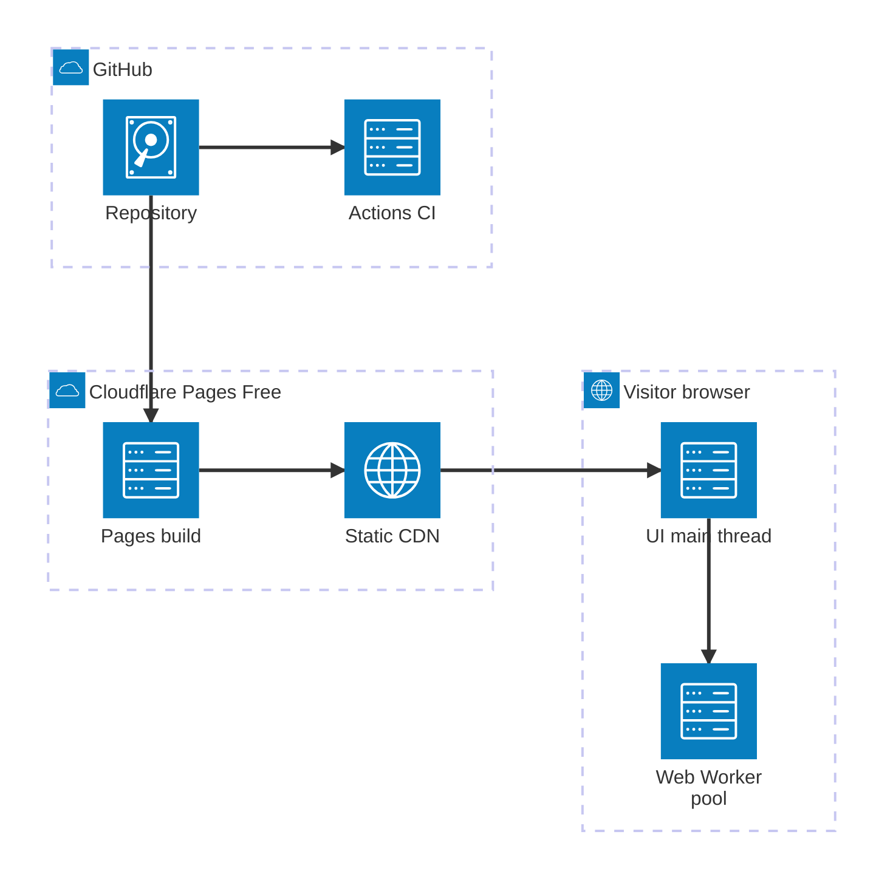
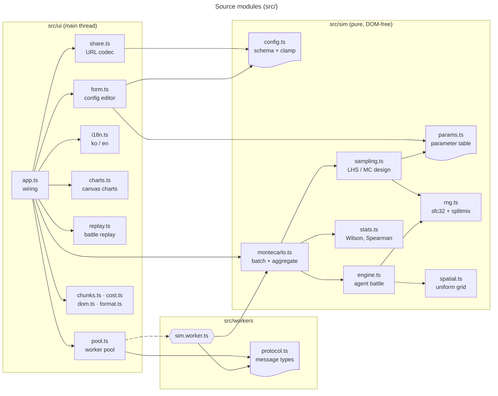
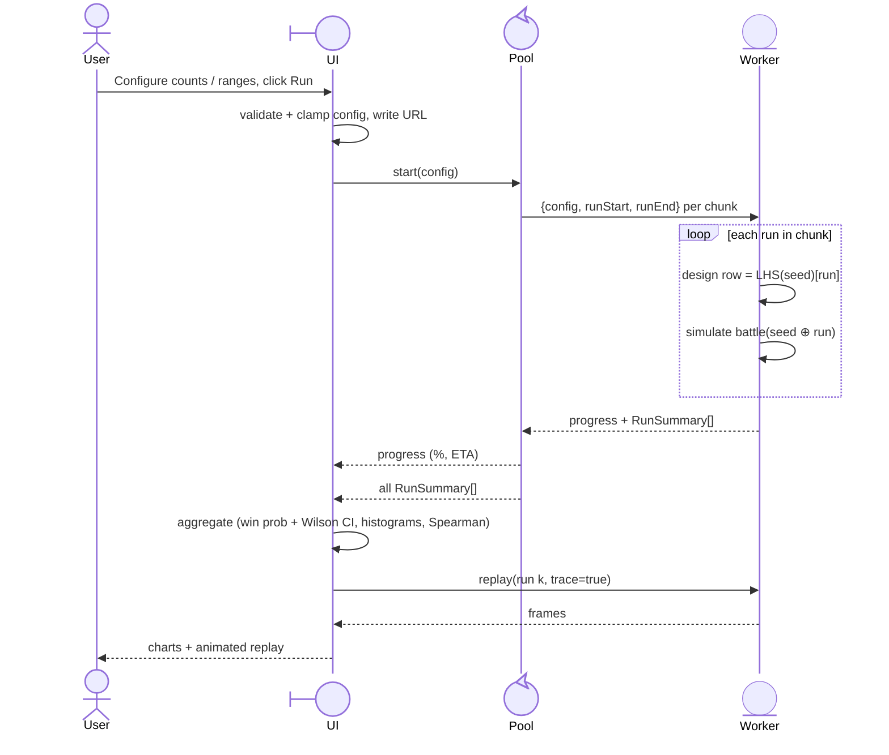
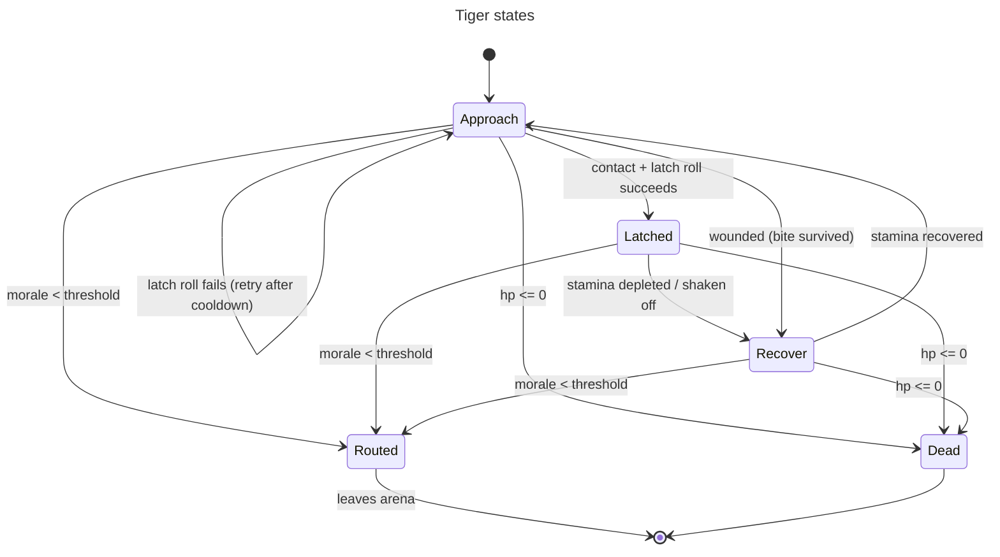
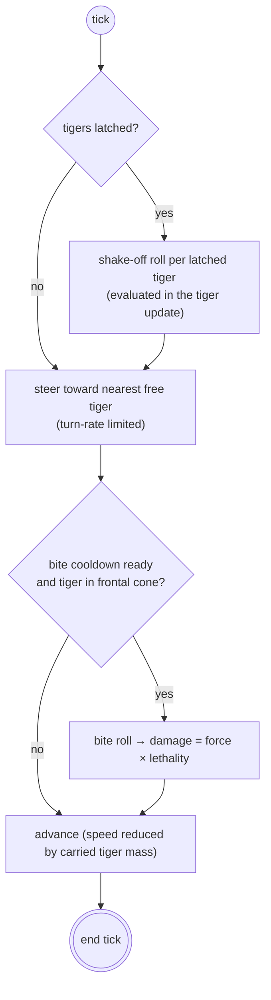

# Architecture

> Diagrams use Mermaid syntax supported by GitHub's renderer (Mermaid 11.16.x as of 2026-10): YAML frontmatter `config`, expanded node shapes (`id@{ shape: … }`), edge IDs/animation, `architecture-beta`, typed sequence participants. Mermaid 11.17+/12.x-only features are intentionally avoided.

## 1. System context

Everything runs in the visitor's browser. Cloudflare Pages only serves static files built from `main`.

| Concern         | Where                              | Why                                                                                                         |
| --------------- | ---------------------------------- | ----------------------------------------------------------------------------------------------------------- |
| Compute         | Browser Web Workers                | Workers Free = 10 ms CPU/request; infeasible server-side ([ADR-0001](docs/adr/0001-client-side-compute.md)) |
| Hosting         | Cloudflare Pages (Git integration) | Free, unlimited static requests ([ADR-0002](docs/adr/0002-cloudflare-pages-git-integration.md))             |
| State / sharing | URL fragment `#s=`                 | No backend ([ADR-0003](docs/adr/0003-no-backend-url-sharing.md))                                            |
| Runtime deps    | None                               | [ADR-0004](docs/adr/0004-no-runtime-dependencies.md)                                                        |

## 2. Module structure

Rule: `src/sim` has no DOM access, so it can be unit-tested in Node and run inside workers.

## 3. Run sequence

### Determinism

- Master seed `S` (uint32, in the URL).
- Sampling design (LHS permutation matrix) is generated from `S` and rebuilt identically in every worker; run `i` uses row `i`.
- Battle `i` uses PRNG seeded with `splitmix32(S ⊕ hash(i))`.
- Therefore results are identical for a given URL regardless of the number of workers or chunk boundaries.

## 4. Simulation model (summary)

Full model, parameter ranges and literature: [docs/MODEL.md](docs/MODEL.md).

Two-level uncertainty:

1. **Epistemic (per run):** each species parameter is drawn from a triangular distribution `(min, mode, max)` using Latin Hypercube Sampling across runs.
2. **Aleatory (per individual):** each animal multiplies the run-level value by `N(1, CV)` truncated to `[0.5, 1.5]`.

Fixed time step `dt = 0.1 s`; open square arena; battle ends when one side is eliminated (dead or routed) or at `maxTime` (draw).

### Tiger behaviour state machine

### T-Rex behaviour

## 5. Delivery pipeline

## 6. Security

- Static site; no secrets, cookies, storage of user data or third-party requests.
- CSP in `public/_headers`: `default-src 'self'`, no inline scripts, `worker-src 'self'`, `frame-ancestors 'none'`.
- URL fragment input is untrusted → `JSON.parse` only, schema check, numeric clamping, unknown keys dropped (`src/sim/config.ts`).
- Resource limits (max agents, runs, time) are clamped to prevent a shared link from freezing a browser.
