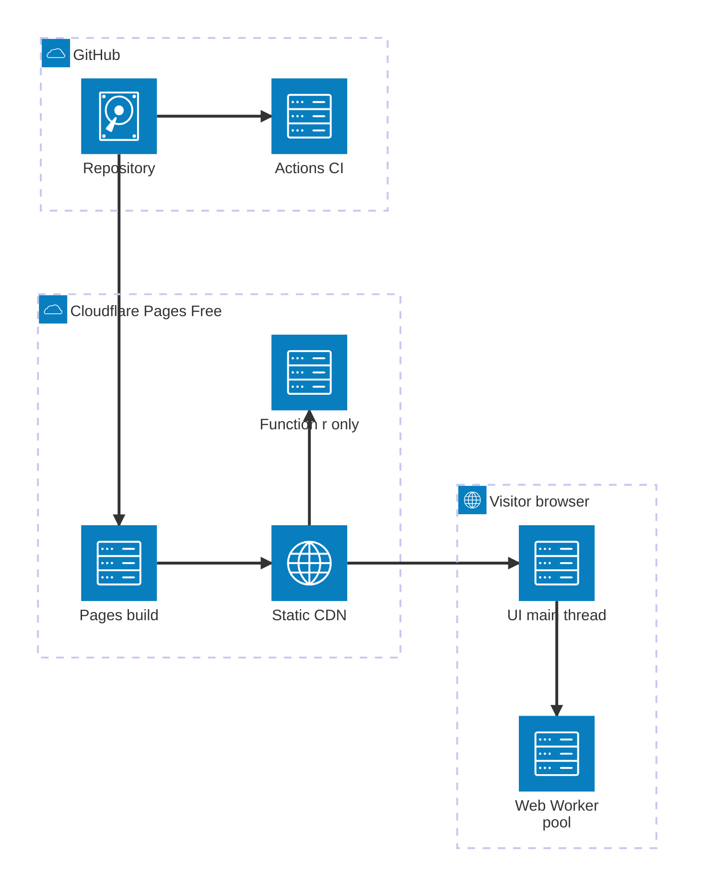
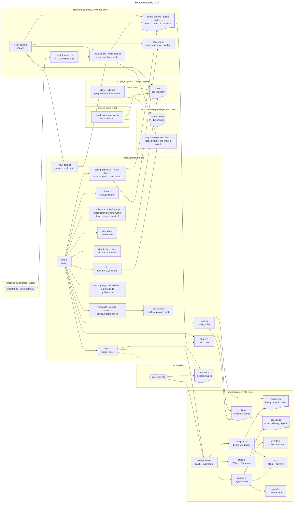
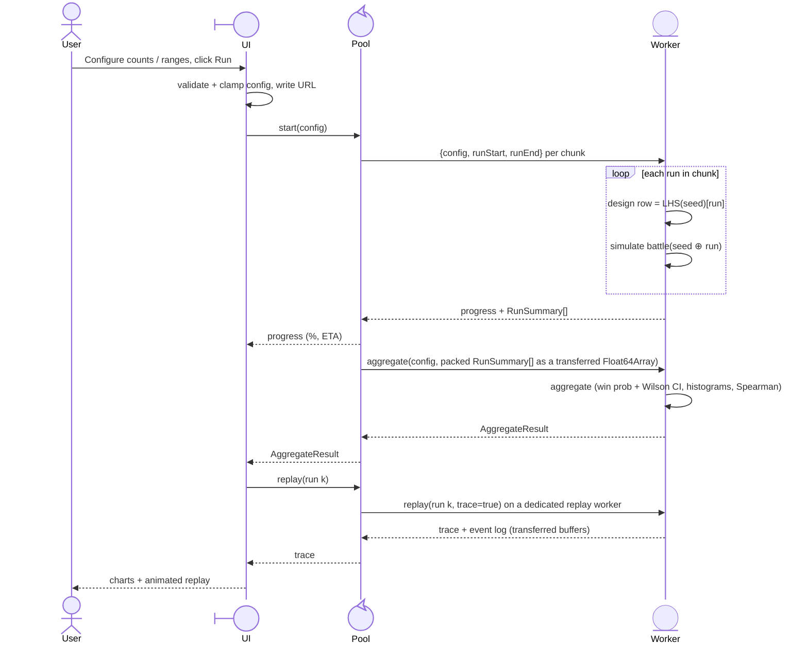
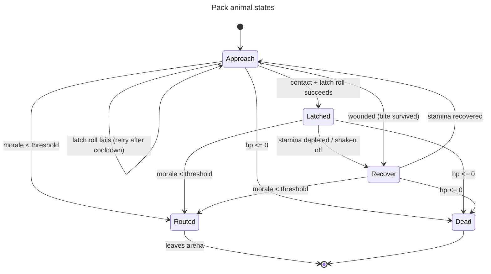
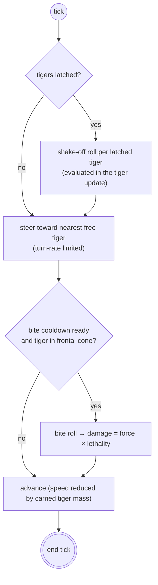
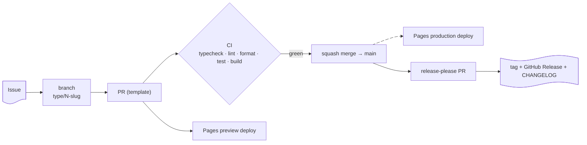

# Architecture

> Diagrams use Mermaid syntax supported by GitHub's renderer (Mermaid 11.16.x as of 2026-10): YAML frontmatter `config`, expanded node shapes (`id@{ shape: … }`), edge IDs/animation, `architecture-beta`, typed sequence participants. Mermaid 11.17+/12.x-only features are intentionally avoided.

## 1. System context

Everything runs in the visitor's browser. Cloudflare Pages serves static files built from `main`; the only server code is a tiny Pages Function that rewrites link-preview meta tags on `/r/` result links ([ADR-0006](docs/adr/0006-pages-function-share-previews.md)).

| Concern         | Where                              | Why                                                                                                         |
| --------------- | ---------------------------------- | ----------------------------------------------------------------------------------------------------------- |
| Compute         | Browser Web Workers                | Workers Free = 10 ms CPU/request; infeasible server-side ([ADR-0001](docs/adr/0001-client-side-compute.md)) |
| Hosting         | Cloudflare Pages (Git integration) | Free, unlimited static requests ([ADR-0002](docs/adr/0002-cloudflare-pages-git-integration.md))             |
| State / sharing | URL fragment `#s=`                 | No backend ([ADR-0003](docs/adr/0003-no-backend-url-sharing.md))                                            |
| Result previews | Pages Function on `/r/*` only      | Meta rewrite for crawlers, no storage ([ADR-0006](docs/adr/0006-pages-function-share-previews.md))          |
| Runtime deps    | None                               | [ADR-0004](docs/adr/0004-no-runtime-dependencies.md)                                                        |

## 2. Module structure

Language layer (#67, #79): the words live in `src/i18n/ko.ts`, `src/i18n/en.ts` and `src/share/messages-<lang>.ts`; `src/i18n/lang.ts` (`Lang`, `interpolate`, `otherLang`) and `src/i18n/registry.ts` (the loaded words) import nothing from `src/ui`, so `src/seo`, `src/pages` and `src/share` depend on `src/i18n` instead of the app's runtime `src/ui/i18n.ts`. Browser code reads words only through the registry; a page entry registers its own language before it starts (`src/main-ko.ts`, `src/main-en.ts`, `src/share/result-page-ko.ts`, `-en.ts`), and the language switch loads the other one with `import()`. Build-time code (`src/seo`, `src/pages/site-header.ts`, `site-footer.ts`) and the tests use `src/i18n/dictionaries.ts` with both languages; the app's logo and nav items come from `src/pages/site-shell.ts`, which holds no words. Remaining cross-directory edges: `src/share` uses the config URL codec `src/ui/share.ts` and the canvas card `src/ui/result-card.ts`, and `src/ui` uses the sharing core; no module import cycle runs between `src/share` and `src/ui`.

Rule: `src/sim` has no DOM access, so it can be unit-tested in Node and run inside workers. The same holds for the sharing core (`src/share/config-code.ts`, `result-codec.ts`, `result-text.ts`), which the app, the `/r/` page and the Pages Function all import, so they accept exactly the same links ([SHARING.md](docs/SHARING.md)).

Testing rule (#61): every module with branching logic has a test that imports it. These modules are intentional **DOM shells**: they wire the DOM, events and timers around logic that lives in a tested module (in brackets), and are checked with Playwright instead of unit tests:

| DOM shell                                                    | Tested logic                                                                                        |
| ------------------------------------------------------------ | --------------------------------------------------------------------------------------------------- |
| `src/ui/app.ts`                                              | `app-model.ts`, `chunks.ts`, `cost.ts`, `verdict.ts`, `share.ts`, the charts' table and hit helpers |
| `src/ui/free-mode.ts`                                        | `src/sim/free/*`, `share-free.ts`                                                                   |
| `src/ui/replay.ts`, `replay/legend.ts`, `replay/strip.ts`    | `replay/prepare.ts`, `world.ts`, `camera.ts`, `timeline.ts`, `effects.ts`, `glyphs.ts`              |
| `src/ui/tour.ts`, `tour-offer.ts`                            | `tour-model.ts`                                                                                     |
| `src/ui/version.ts`                                          | `version-model.ts`                                                                                  |
| `src/ui/config-transfer.ts`                                  | `src/share/config-code.ts`                                                                          |
| `src/share/result-page.ts`                                   | `result-codec.ts`, `result-text.ts`                                                                 |
| `src/ui/dom.ts`, `src/ui/announce.ts`                        | (element factory and live region; no decisions)                                                     |
| `src/main*.ts`, `src/share/result-page-*.ts`, `src/reset.ts` | (entries: register the words, start the page)                                                       |

### Entry points (multi-page build)

`vite.pages.ts` `findHtmlEntries()` turns every `index.html` in the repository into a build input, so a new page needs no config change ([docs/PAGES.md](docs/PAGES.md)).

| Entry                                                 | Script                                                                | Purpose                                                                                                                                    |
| ----------------------------------------------------- | --------------------------------------------------------------------- | ------------------------------------------------------------------------------------------------------------------------------------------ |
| `index.html`, `en/index.html`                         | `src/main-ko.ts` / `src/main-en.ts` → `src/main.ts` → `src/ui/app.ts` | The simulator in Korean (`/`) and English (`/en/`); language comes from the URL ([SEO.md](docs/SEO.md))                                    |
| `<page>/index.html`, `en/<page>/index.html`           | `src/pages/site.ts`                                                   | Static, crawlable guide, model, parameters, about and privacy pages in Korean and English ([PAGES.md](docs/PAGES.md))                      |
| `patch-notes/index.html`, `en/patch-notes/index.html` | `src/pages/site.ts`                                                   | Patch notes board: one card per release, generated at build time from `src/content/patch-notes.ts` ([PAGES.md](docs/PAGES.md#patch-notes)) |
| `reset/index.html`                                    | `src/reset.ts`                                                        | Cache and storage reset hand-off, served with `Clear-Site-Data` ([VERSIONING.md](docs/VERSIONING.md))                                      |
| `license/index.html`, `en/license/index.html`         | `src/pages/site.ts`                                                   | MIT text and third-party notices                                                                                                           |
| `404.html`, `en/404.html`                             | `src/pages/site.ts`                                                   | Real 404 pages (disable the Pages SPA fallback)                                                                                            |
| `r/index.html`, `en/r/index.html`                     | `src/share/result-page.ts`                                            | Shared-result pages (`?r=`): noindex, not in the sitemap, never load the simulator ([SHARING.md](docs/SHARING.md))                         |

At build time `vite.seo.ts` (code in `src/seo/`) writes the head tags, JSON-LD, `sitemap.xml`, `robots.txt` and `llms*.txt` from the page registry ([SEO.md](docs/SEO.md)). Species presets and bounds live in `src/sim/species.ts` ([SPECIES.md](docs/SPECIES.md)); the replay renderer and its event log are described in [REPLAY.md](docs/REPLAY.md) and MODEL.md §2.6.

The build also emits `version.json` (version, commit SHA, build time), which open tabs poll to detect a newer deployment ([VERSIONING.md](docs/VERSIONING.md)). The guided tour is documented in [TUTORIAL.md](docs/TUTORIAL.md).

## 3. Run sequence

### Determinism

- Master seed `S` (uint32, in the URL).
- Sampling design (LHS permutation matrix) is generated from `S` and rebuilt identically in every worker; run `i` uses row `i`.
- Battle `i` uses PRNG seeded with `splitmix32(S ⊕ hash(i))`.
- Therefore results are identical for a given URL regardless of the number of workers or chunk boundaries.

## 4. Simulation model (summary)

Full model, parameter ranges and literature: [docs/MODEL.md](docs/MODEL.md).

Two-level uncertainty:

1. **Epistemic (per run):** each species parameter is drawn from a triangular distribution `(min, mode, max)` using Latin Hypercube Sampling across runs.
2. **Aleatory (per individual):** each animal multiplies the run-level value by `N(1, CV)` truncated to `[0.5, 1.5]`.

Fixed time step `dt = 0.1 s`; open square arena; battle ends when one side is eliminated (dead or routed) or at `maxTime` (draw).

The free model's matchup presets (`src/sim/free/presets.ts`) are pure data. A test measures each one on the free engine and checks it against a committed fixture and the rout check ([PRESETS.md](docs/PRESETS.md)).

### Pack animal behaviour state machine

Applies to every pack species (tiger, lion, wolf, hyena, Homo erectus); the per-species numbers come from `species.ts`.

### Heavy animal behaviour

Applies to every heavy species (T. rex, elephant, buffalo, brown bear, woolly mammoth, Homo erectus). "Tiger" below stands for any pack animal.

## 5. Delivery pipeline

## 6. Security

- Static site; no secrets, no cookies of its own and no third-party requests. `localStorage` holds only the tour-seen flag (language comes from the URL); the version check fetches the same-origin `/version.json`.
- CSP in `public/_headers`: `default-src 'self'`, no inline scripts, `worker-src 'self'`, `frame-ancestors 'none'`. HTML responses carry `Cache-Control: no-cache, no-transform` so Cloudflare Bot Fight Mode does not inject an inline script (this also disables Cloudflare's compression of HTML; see [DEPLOYMENT.md](docs/DEPLOYMENT.md)).
- The reset page uses `Clear-Site-Data: "cache", "storage"` but never `"cookies"`, which would clear cookies for every `*.vinylims.com` site ([VERSIONING.md](docs/VERSIONING.md)).
- Result links (`/r/?r=`) are untrusted too: length cap 4096, base64url alphabet, `JSON.parse`, then a strict summary validator (integer counts, `h + p + d === n`, finite values in range). The Pages Function on `/r/*` uses the same validator, sets the page's security headers itself and stores and logs nothing ([ADR-0006](docs/adr/0006-pages-function-share-previews.md)).
- URL fragment input is untrusted → `JSON.parse` only, schema check, numeric clamping, unknown keys dropped (`src/sim/config.ts`).
- Resource limits (max agents, runs, time) are clamped to prevent a shared link from freezing a browser.
