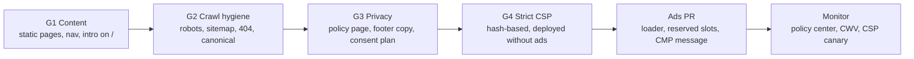

# Google AdSense readiness plan

> **한국어 요약**
>
> - 이 사이트(`trex-vs-tiger.vinylims.com`)는 별도 AdSense 사이트가 아니라 루트 도메인 `vinylims.com`(퍼블리셔 `pub-8355379467698162`)의 승인과 설정을 공유합니다. 새 계정이나 하위 도메인 `ads.txt`를 만들지 않습니다.
> - 광고 코드는 아래 **게이트 G1–G4**를 모두 통과한 뒤에만 넣습니다. 지금 단계에서는 콘텐츠 페이지, 크롤링 위생, 개인정보처리방침, 표현 규칙을 먼저 갖춥니다.
> - CSP는 빌드 시 해시를 계산하는 **정적 strict CSP(옵션 A)**로 옮깁니다. 광고 없이 먼저 배포해 검증하고, 그다음 광고 PR을 엽니다.
> - 표현 규칙(추상 도형만, 유혈·고어 금지, 반려·가축 동물과 사람 금지, 중립적 용어)은 [CONTRIBUTING.md](../CONTRIBUTING.md#content-framing-rules)에 있으며 모든 PR에 적용됩니다.
> - 근거와 출처는 [docs/research/ADSENSE.md](research/ADSENSE.md)에 있습니다. 이 문서는 실행 계획과 진행 상태만 관리합니다.

Status date: 2026-10-19. Tracking issue: [#27](https://github.com/VinylStage/trex_vs_tiger_sim/issues/27), epic [#20](https://github.com/VinylStage/trex_vs_tiger_sim/issues/20).

This document is the operational plan. Every claim about Google or Cloudflare policy, with its source, is in [docs/research/ADSENSE.md](research/ADSENSE.md); section numbers below (§) refer to that report.

## 1. Decisions

| Decision                                                                                                                         | Why                                                                                                                                                      | Research |
| -------------------------------------------------------------------------------------------------------------------------------- | -------------------------------------------------------------------------------------------------------------------------------------------------------- | -------- |
| Use the existing AdSense account and the domain-level site `vinylims.com`. No new account, no subdomain `ads.txt`.               | Since March 2023 AdSense manages sites per domain; one account per publisher. The root `ads.txt` already lists `pub-8355379467698162`.                   | §1, §4   |
| Ship content, crawl hygiene and privacy before any ad code.                                                                      | "Not enough unique content" is the main rejection class; a form-only, JS-rendered single screen is high risk.                                            | §3.2, §5 |
| Migrate to a **hash-based strict CSP generated at build time** (option A) in its own PR without ads, then add ads.               | Google supports only strict CSP (nonce or hash + `'strict-dynamic'`). Static `_headers` cannot mint nonces; Pages Functions would consume Workers quota. | §6.1–6.2 |
| Use AdSense **Privacy & messaging** (Google CMP) for EEA/UK/CH consent. No Consent Mode unless GA4 or Google Ads tags are added. | Google-certified CMP, free, writes TCF v2.3 strings.                                                                                                     | §7.1     |
| Manual ad units on `/`; Auto ads only on long-form content pages, if at all.                                                     | The simulator UI is dense; anchors and vignettes can cover controls or interrupt the tutorial.                                                           | §8.2     |
| Abstract, non-gory presentation; no domestic animals, pets or humans; neutral vocabulary.                                        | Animal-cruelty policy and the shocking-content restriction. Also the owner's rule against character-like animal shapes.                                  | §3.3     |

## 2. Gates

Ads go live only when every gate is green. Each gate is verified on production, not on a preview.

| Gate             | Pass criteria                                                                                                                                                                                                                                        | Tracked in                                                                                                                                                                                                                                                             | State                                         |
| ---------------- | ---------------------------------------------------------------------------------------------------------------------------------------------------------------------------------------------------------------------------------------------------- | ---------------------------------------------------------------------------------------------------------------------------------------------------------------------------------------------------------------------------------------------------------------------- | --------------------------------------------- |
| G1 Content       | Guide, model, parameters, about and privacy exist as prerendered HTML in ko and en; the tutorial is reachable; persistent header nav and footer on every page; `/` has a crawlable intro outside the JS app.                                         | [#21](https://github.com/VinylStage/trex_vs_tiger_sim/issues/21), [#22](https://github.com/VinylStage/trex_vs_tiger_sim/issues/22), [#28](https://github.com/VinylStage/trex_vs_tiger_sim/issues/28), [#30](https://github.com/VinylStage/trex_vs_tiger_sim/issues/30) | In progress                                   |
| G2 Crawl hygiene | `/robots.txt` and `/sitemap.xml` return their own content types; a top-level `404.html` returns 404 for unknown paths (no SPA soft-404); canonical and hreflang on every page; the `*.pages.dev` host redirects or is `noindex`; Lighthouse SEO 100. | [#21](https://github.com/VinylStage/trex_vs_tiger_sim/issues/21), [#28](https://github.com/VinylStage/trex_vs_tiger_sim/issues/28), [#30](https://github.com/VinylStage/trex_vs_tiger_sim/issues/30)                                                                   | In progress                                   |
| G3 Privacy       | Privacy page lists: what the site stores, Cloudflare cookies and logs, Google as a third party once ads exist, the PIPA items (자동 수집 장치의 설치·운영 및 거부, 행태정보 처리), contact, effective date. Footer no longer claims "no tracking".   | [#21](https://github.com/VinylStage/trex_vs_tiger_sim/issues/21) (base page), ads PR (ad disclosures)                                                                                                                                                                  | Base page in progress; ad clauses not started |
| G4 Strict CSP    | Every HTML page carries the same hashed inline loader; `_headers` lists its SHA-256 with `'strict-dynamic'`; app, worker, fonts and charts run with zero CSP violations on production for at least one release; a report-only canary is in place.    | new issue when G1–G3 are green                                                                                                                                                                                                                                         | Not started                                   |

## 3. Owner actions (cannot be done from the repository)

1. AdSense → **Sites**: confirm `vinylims.com` shows **Ready** and the ads.txt column is "Authorized". If it shows "Getting ready" or "Requires review", the simulator's content now counts towards that review.
2. AdSense → **Privacy & messaging**: check whether a European regulations message exists for `vinylims.com`; if not, create one before ads go live (test with `?fc=alwaysshow`).
3. AdSense → **Blocking controls** and **Auto ads**: these are per domain and already apply to the blog. Decide whether to exclude `trex-vs-tiger.vinylims.com/` from Auto ads (research §5 step 8 notes that subdomain path exclusions are unverified).
4. Cloudflare: keep Bot Fight Mode on unless the AdSense **crawler errors** report shows blocked fetches; then turn it off for the zone (free plan cannot allowlist verified bots).

## 4. Implementation checklist

Content and navigation (G1)

- [ ] Static guide, model, parameters, about, privacy pages in ko/en ([#21](https://github.com/VinylStage/trex_vs_tiger_sim/issues/21)).
- [ ] Guided tour on the simulator plus a link from the guide ([#22](https://github.com/VinylStage/trex_vs_tiger_sim/issues/22)).
- [ ] Footer on every page with source code, license, Linktree and blog links ([#28](https://github.com/VinylStage/trex_vs_tiger_sim/issues/28)).
- [ ] Crawlable intro on `/` and `/en/` outside `#app` ([#30](https://github.com/VinylStage/trex_vs_tiger_sim/issues/30)).

Crawl hygiene (G2)

- [ ] `robots.txt`, auto-generated `sitemap.xml`, top-level `404.html` ([#21](https://github.com/VinylStage/trex_vs_tiger_sim/issues/21), [#28](https://github.com/VinylStage/trex_vs_tiger_sim/issues/28)).
- [ ] Canonical, hreflang (`x-default` → en), JSON-LD, `llms.txt` ([#30](https://github.com/VinylStage/trex_vs_tiger_sim/issues/30)).
- [ ] `*.pages.dev` bulk redirect to the custom domain (owner, Cloudflare dashboard; see [DEPLOYMENT.md](DEPLOYMENT.md)).

Privacy (G3)

- [ ] Footer copy: replace "서버 전송 · 추적 없음 / No server, no tracking" with wording that stays true once ads load, linked to the privacy page.
- [ ] Privacy page sections ready to extend with: Google as a third-party vendor, cookies and identifiers used for ads, how to opt out (Google Ads Settings, the CMP revocation link), PIPA 행태정보 items, and the recommendation not to target behavioural ads at users under 14.

Strict CSP (G4)

- [ ] Build step that injects one identical loader into every HTML page and writes its SHA-256 into `dist/_headers` (research §6.2). No `unsafe-inline` reliance; keep `'unsafe-eval'` only if Google's policy still lists it.
- [ ] Remove `autoplay=()` from `Permissions-Policy` in the ads PR (it blocks muted video ads). Keep COOP `same-origin`; never add COEP.
- [ ] Report-only canary header for one release before enforcing.

Ads PR (after G1–G4)

- [ ] Loader module gated to the production hostname (no ads on previews or `localhost`).
- [ ] Reserved, labelled slots with fixed per-breakpoint sizes (zero CLS, research §8.3). Labels: "광고" / "Advertisement" only.
- [ ] Simulator page: at most two manual units — S1 above the footer (all viewports), S2 in the desktop left column below the scenario card with ≥ 150 px from Run/Cancel. Never inside result cards, chart legends, presets, replay canvas or controls, progress states, modals or the tutorial overlay. Never refresh ads on Run.
- [ ] No ads on `/privacy/`, `/en/privacy/` or the 404 page.

## 5. Ongoing maintenance rules

Re-check this plan whenever a PR adds a page type, an animal, a visual effect or a third-party request.

- **Every release:** CLS < 0.1, LCP < 2.5 s, INP ≤ 200 ms on mobile (PageSpeed Insights); zero CSP violations in the console; sitemap lists every page.
- **After ads are live:** AdSense Policy center, Sites ads.txt status, crawler errors report, and the CSP report-only canary.
- **Content:** follow the [content framing rules](../CONTRIBUTING.md#content-framing-rules). New animals go through [docs/research/SPECIES.md](research/SPECIES.md) and the same rules; new replay effects stay abstract and non-red.
