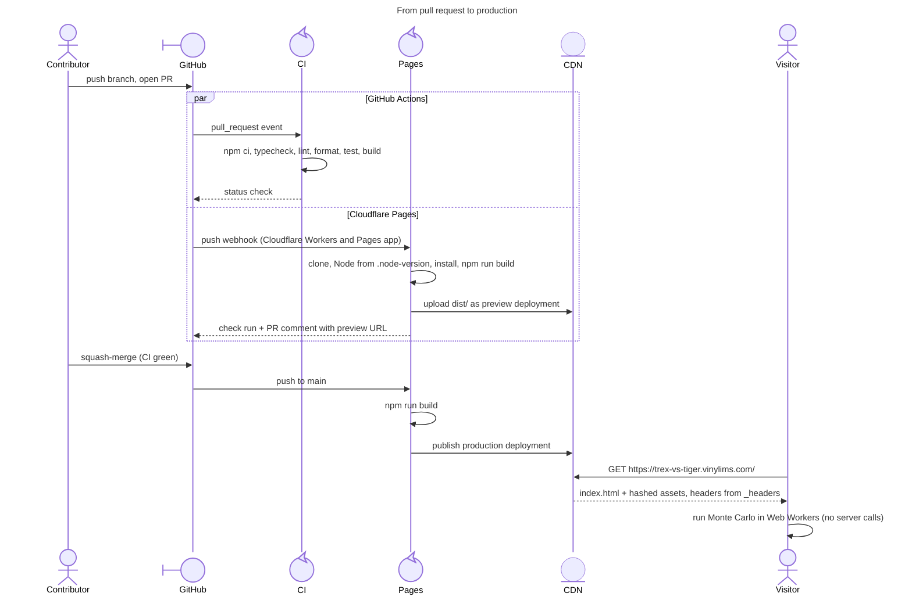
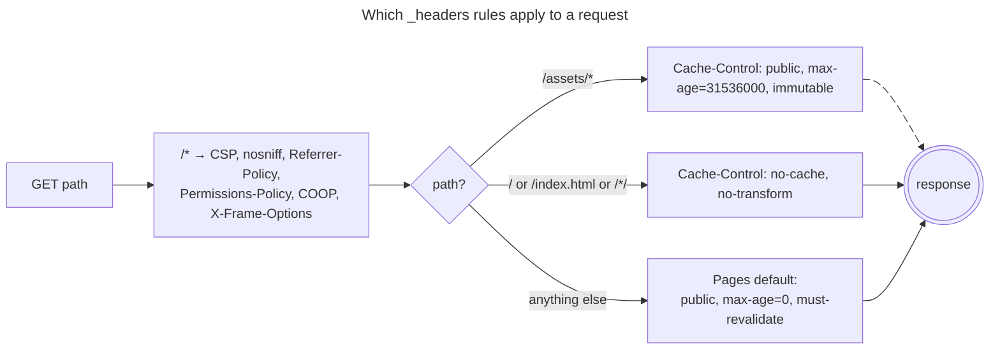

# Deployment (Cloudflare Pages)

> **한국어 요약**
>
> - 이 사이트는 **정적 파일만** 배포합니다. 시뮬레이션은 방문자 브라우저의 Web Worker에서 실행되며 서버 코드(Pages Functions)는 없습니다.
> - Cloudflare Pages **Git 연동**으로 `main` 브랜치에 push하면 프로덕션이, 그 외 브랜치/PR에 push하면 프리뷰가 자동 배포됩니다.
> - 프로덕션 주소: **<https://trex-vs-tiger.vinylims.com/>** (커스텀 도메인, Cloudflare 관리 TLS). `https://trex-vs-tiger-sim.pages.dev`도 같은 배포를 제공합니다.
> - 빌드 설정: 프레임워크 프리셋 `None`, 빌드 명령 `npm run build`, 출력 디렉터리 `dist`, 루트 디렉터리 비움. Node 버전은 `.node-version`(24)에서 읽습니다.
> - 보안/캐시 헤더는 `public/_headers`에 있습니다. 이 파일에는 주석을 넣지 않으므로 각 줄의 의미는 [아래 표](#_headers-explained)에서 설명합니다.
> - `vinylims.com` 존의 Bot Fight Mode가 HTML에 인라인 스크립트(JavaScript Detections)를 주입하면 엄격한 CSP와 충돌합니다. 그래서 HTML 응답에 `Cache-Control: no-cache, no-transform`을 지정해 주입을 끕니다([설명](#bot-fight-mode-and-javascript-detections)).
> - 무료 플랜 한도(월 500회 빌드, 파일 20,000개, 파일당 25 MiB) 대비 사용량은 매우 작고, Functions가 없으므로 Workers 요청 한도도 소비하지 않습니다.
> - 배포 확인: `curl -sI https://trex-vs-tiger.vinylims.com/ | grep -i content-security`. 롤백: 대시보드 → Deployments → 이전 배포 → **Rollback to this deployment**.

## Contents

- [Production URLs](#production-urls)
- [Architecture](#architecture)
- [One-time setup (owner)](#one-time-setup-owner)
- [Deploy pipeline](#deploy-pipeline)
- [Node.js version](#nodejs-version)
- [`_headers` explained](#_headers-explained)
- [CSP and the Vite dev server](#csp-and-the-vite-dev-server)
- [Bot Fight Mode and JavaScript Detections](#bot-fight-mode-and-javascript-detections)
- [Free-plan budget](#free-plan-budget)
- [Verify a deployment](#verify-a-deployment)
- [Rollback](#rollback)
- [Custom domain](#custom-domain)
- [Troubleshooting](#troubleshooting)
- [Sources](#sources)

## Production URLs

| URL                                            | Role                                                                              |
| ---------------------------------------------- | --------------------------------------------------------------------------------- |
| **<https://trex-vs-tiger.vinylims.com/>**      | **Production** (custom domain on the `vinylims.com` zone, Cloudflare-managed TLS) |
| <https://trex-vs-tiger-sim.pages.dev>          | Same production deployment on the project's `pages.dev` subdomain                 |
| `https://<branch>.trex-vs-tiger-sim.pages.dev` | Preview deployments (see [below](#one-time-setup-owner))                          |

## Architecture

The deployed site is static. Cloudflare Pages only serves the files Vite writes to `dist/`:

| File                                                                                                        | Origin                                                                                                                                                                   |
| ----------------------------------------------------------------------------------------------------------- | ------------------------------------------------------------------------------------------------------------------------------------------------------------------------ |
| `index.html`                                                                                                | Vite entry, rewritten to reference hashed assets                                                                                                                         |
| `assets/index-<hash>.js`                                                                                    | Main-thread bundle (UI)                                                                                                                                                  |
| `assets/index-<hash>.css`                                                                                   | Extracted stylesheet (emitted as a file, never inlined)                                                                                                                  |
| `assets/*-<hash>.js`                                                                                        | Module Web Worker bundle(s), same origin, loaded with `{ type: 'module' }`                                                                                               |
| `_headers`                                                                                                  | Copied verbatim from `public/_headers`                                                                                                                                   |
| `<page>/index.html`, `en/<page>/index.html`                                                                 | Static content pages (guide, model, parameters, about, privacy), see [PAGES.md](PAGES.md)                                                                                |
| `assets/site-<hash>.js`, `assets/site-<hash>.css`                                                           | Shared script and stylesheet of the content pages                                                                                                                        |
| `assets/pretendard-variable-dynamic-subset-<hash>.css`, `assets/PretendardVariable.subset.<n>-<hash>.woff2` | Self-hosted Pretendard ([ADR-0005](adr/0005-self-hosted-pretendard.md)): one `@font-face` stylesheet linked by the app and every content page, and its subset font files |
| `robots.txt`, `sitemap.xml`                                                                                 | Copied verbatim from `public/`; crawler rules and the page list with hreflang alternates                                                                                 |

Nothing else is deployed:

- There is no `functions/` directory and no `_worker.js`, so no request runs server-side code.
- There are no API calls, cookies, analytics or third-party origins.
- All Monte Carlo compute happens in the visitor's browser. [ADR-0001](adr/0001-client-side-compute.md) explains why: Workers Free allows 10 ms of CPU per request, and one battle takes longer than that.
- The hosting choice is in [ADR-0002](adr/0002-cloudflare-pages-git-integration.md). It also covers Cloudflare's 2026 advice to start new projects on Workers static assets. Pages keeps working and has no announced end-of-life, so this project stays on Pages.

## One-time setup (owner)

This is tracked in issue #6. You need a Cloudflare account and admin rights on the GitHub repository.

1. In the Cloudflare dashboard, open **Workers & Pages**.
2. Select **Create application** → **Pages** → **Connect to Git**.
3. When prompted, install and authorize the **Cloudflare Workers and Pages** GitHub app. Grant it access to `VinylStage/trex_vs_tiger_sim`. Granting access to only this repository is enough.
4. Select the repository `trex_vs_tiger_sim` and continue to **Set up builds and deployments**.
5. Enter these settings:

   | Setting                   | Value                                                                        |
   | ------------------------- | ---------------------------------------------------------------------------- |
   | Project name              | `trex-vs-tiger-sim` (gives `https://trex-vs-tiger-sim.pages.dev`)            |
   | Production branch         | `main`                                                                       |
   | Framework preset          | `None`                                                                       |
   | Build command             | `npm run build`                                                              |
   | Build output directory    | `dist`                                                                       |
   | Root directory (advanced) | _(empty, the repository root)_                                               |
   | Environment variables     | none required. Node comes from `.node-version`, see [below](#nodejs-version) |

6. Select **Save and Deploy**. The first production build starts immediately from `main`.

Pages installs dependencies itself from `package-lock.json`, so there is no separate install step. The build command `npm run build` runs `tsc --noEmit && vite build`, which means a type error fails the Pages build as well as CI.

> **First build on an empty `main`.** If the project is connected while `main` has no `package.json`, the first build fails because `npm run build` has nothing to run. That is no longer the case: the scaffold (#2, merged as #7) put `package.json`, `.node-version` and the Vite config on `main`. If a build failed earlier for this reason, select **Retry deployment** on it, or push any commit to `main`.

After setup:

- **Preview deployments.** Every push to a branch other than `main` gets its own preview deployment. Each preview has a permanent hash URL `https://<hash>.trex-vs-tiger-sim.pages.dev` and a moving branch alias `https://<branch>.trex-vs-tiger-sim.pages.dev`. In the alias, the branch name is lowercased and `/` and other non-alphanumerics become `-`, so `docs/5-deploy-model` becomes `docs-5-deploy-model`. Pages adds `X-Robots-Tag: noindex` to preview URLs.
- **Pull requests.** For PRs opened from this repository (not from forks), Cloudflare posts the preview URL as a PR comment and reports the build as a GitHub check run.
- **Production.** Every push to `main` (the squash merge of a PR) builds and deploys to production. Production is served at `https://trex-vs-tiger.vinylims.com/` and at `https://trex-vs-tiger-sim.pages.dev`.
- **Skipping a build.** Start the commit message with `[CI Skip]`, `[CI-Skip]`, `[Skip CI]`, `[Skip-CI]` or `[CF-Pages-Skip]`; the match is case-insensitive. Use this only on intermediate branch commits. The squash-merge title on `main` must stay a Conventional Commit so that release-please can parse it.
- **CI does not gate the Pages build.** Pages builds independently of GitHub Actions. `main` is still protected because every change arrives through a PR, and CI must be green before squash-merge.

## Deploy pipeline



## Node.js version

- The Pages **v3 build image** picks the Node.js version from a `.node-version` or `.nvmrc` file in the repository root, or from a `NODE_VERSION` environment variable set in the project. Without one of these it uses the image default, which is Node 22.16.0 at the time of writing.
- The v3 image does **not** read `package.json` `engines`.
- This repository pins `.node-version` to `24`, and CI reads the same file (`actions/setup-node` `node-version-file`). That makes it the single source of truth.
- To test another version without a commit, set `NODE_VERSION` under **Settings → Environment variables** for the Preview environment and retry a preview build. Remove the override afterwards so `.node-version` stays authoritative.
- `package.json` `engines` (`>=22.12.0`) documents the floor that Vite 8, Vitest 5 and ESLint 10 need for local development.

## `_headers` explained

`public/_headers` is copied to `dist/_headers`, and Pages applies it to every response. Project rule: config files carry no comments, so the explanation lives here.

Syntax: a path pattern starts at column 0, followed by indented `Name: value` lines. A `*` splat matches any characters. When several rules match a request, all of them apply. If the same header is set by two matching rules, the values are joined with a comma. `! Name` removes a header. Limits: 100 rules, 2,000 characters per line. This file uses 5 rules, and its longest line is about 260 characters.

### Rule `/*` (every response)

| Header                                                 | Why                                                                                                                                                                                                                                                                                                                                        |
| ------------------------------------------------------ | ------------------------------------------------------------------------------------------------------------------------------------------------------------------------------------------------------------------------------------------------------------------------------------------------------------------------------------------ |
| `Content-Security-Policy: default-src 'self'`          | Fallback for every fetch directive that is not listed: only this origin.                                                                                                                                                                                                                                                                   |
| `script-src 'self'`                                    | Only same-origin script files. No inline `<script>`, no `eval` / `new Function`, no CDNs. Vite emits scripts as files under `assets/`.                                                                                                                                                                                                     |
| `style-src 'self'`                                     | Only same-origin stylesheets. `<style>` blocks, `style="…"` attributes and `setAttribute('style', …)` are blocked. Setting individual properties through the CSSOM (`el.style.width = …`) is allowed.                                                                                                                                      |
| `img-src 'self' data:`                                 | Same-origin images plus `data:` URIs (inline SVG icons or a canvas snapshot shown as an ``). Canvas drawing itself needs no permission.                                                                                                                                                                                               |
| `font-src 'self'`                                      | Only self-hosted fonts: Pretendard from `assets/` ([ADR-0005](adr/0005-self-hosted-pretendard.md)).                                                                                                                                                                                                                                        |
| `connect-src 'self'`                                   | `fetch` / XHR / WebSocket only to this origin. The app makes no network calls, so this is defence in depth against exfiltration.                                                                                                                                                                                                           |
| `worker-src 'self'`                                    | Web Workers may only load from this origin. Vite's `new Worker(new URL(…, import.meta.url), { type: 'module' })` emits a same-origin file under `assets/`. `blob:` workers (Vite `?worker&inline`) would be blocked, so do not use them.                                                                                                   |
| `object-src 'none'`                                    | No `<object>` / `<embed>` plugins.                                                                                                                                                                                                                                                                                                         |
| `base-uri 'self'`                                      | A `<base>` tag cannot point relative URLs at another origin.                                                                                                                                                                                                                                                                               |
| `form-action 'self'`                                   | Forms cannot submit to another origin. The UI's forms are never submitted, because the config lives in the URL fragment.                                                                                                                                                                                                                   |
| `frame-ancestors 'none'`                               | The site cannot be embedded in any frame (clickjacking).                                                                                                                                                                                                                                                                                   |
| `upgrade-insecure-requests`                            | Any accidental `http:` sub-resource URL is upgraded to `https:`.                                                                                                                                                                                                                                                                           |
| `X-Content-Type-Options: nosniff`                      | Browsers must honour `Content-Type`; this matters for module scripts and workers. Pages already sends it by default, and setting it here keeps it independent of the platform default.                                                                                                                                                     |
| `Referrer-Policy: strict-origin-when-cross-origin`     | Only the origin, never the path or `#s=` fragment, is sent cross-origin. Fragments are never sent in `Referer` anyway. This value is also the Pages default.                                                                                                                                                                               |
| `Permissions-Policy: accelerometer=(), autoplay=(), …` | Disables powerful features the app never uses: sensors, autoplay, the Topics API (`browsing-topics`), camera, screen capture, geolocation, HID, microphone, MIDI, payment, serial, USB and XR. The list only names features Chromium recognises, to avoid console warnings. Fullscreen is not restricted, so a replay could go fullscreen. |
| `Cross-Origin-Opener-Policy: same-origin`              | Puts the page in its own browsing-context group, so cross-origin windows it opens, or that open it, cannot script it. `Cross-Origin-Embedder-Policy` is not set because the app does not need `SharedArrayBuffer`.                                                                                                                         |
| `X-Frame-Options: DENY`                                | Legacy equivalent of `frame-ancestors 'none'` for old browsers.                                                                                                                                                                                                                                                                            |

The CSP on `/*` also applies to the worker script responses under `/assets/`. A dedicated worker's own CSP comes from its script response, so workers run under the same policy as the page.

Pages also adds `Access-Control-Allow-Origin: *` by default. It is harmless here because every file is public. If needed it could be removed with `! Access-Control-Allow-Origin` under `/*`.

### Rule `/assets/*`

| Header                                               | Why                                                                                                                                                                                                                                                                                                                                 |
| ---------------------------------------------------- | ----------------------------------------------------------------------------------------------------------------------------------------------------------------------------------------------------------------------------------------------------------------------------------------------------------------------------------- |
| `Cache-Control: public, max-age=31536000, immutable` | Vite puts a content hash in every file name under `assets/`, so a file at a given URL never changes. Browsers may keep these files for one year without revalidating. A new build produces new names, and the uncached `index.html` points at them. Old deployments keep their own files, because every Pages deployment is atomic. |

### Rules `/` and `/index.html`

| Directive      | Why                                                                                                                                                                                                                                                                                                                                                                             |
| -------------- | ------------------------------------------------------------------------------------------------------------------------------------------------------------------------------------------------------------------------------------------------------------------------------------------------------------------------------------------------------------------------------- |
| `no-cache`     | The HTML entry point must always be revalidated (`ETag` → `304`) so visitors pick up a new deployment immediately. Pages already defaults to `public, max-age=0, must-revalidate`, which behaves the same; the explicit rule documents the intent.                                                                                                                              |
| `no-transform` | Tells Cloudflare not to modify the HTML body. On the custom domain this stops Bot Fight Mode from injecting its inline JavaScript Detections script, which the strict CSP would block. See [Bot Fight Mode and JavaScript Detections](#bot-fight-mode-and-javascript-detections). It also stops other edge rewrites of the HTML, which do not matter for a file of under 1 KiB. |

Pages redirects `/index.html` to `/`, so the `/` rule is the one that applies in practice. The `/index.html` rule is a guard.

### Rule `/*/` (content pages)

| Directive                               | Why                                                                                                                                                                                                                                                                                                                                                                                                                                                                                                                                                                                    |
| --------------------------------------- | -------------------------------------------------------------------------------------------------------------------------------------------------------------------------------------------------------------------------------------------------------------------------------------------------------------------------------------------------------------------------------------------------------------------------------------------------------------------------------------------------------------------------------------------------------------------------------------- |
| `Cache-Control: no-cache, no-transform` | The same policy as `/` for every directory-style HTML page (`/guide/`, `/en/guide/`, a future `/reset/` and so on), so new deployments show up at once and Bot Fight Mode never injects its inline script into them. The splat matches any characters, so `/*/` matches every path that ends in `/` except `/` itself, which keeps exactly one `Cache-Control` per page. Hashed files under `/assets/` never end in `/`. Pages redirects `/guide` and `/guide/index.html` to `/guide/`. New pages need no extra rule; `tests/pages.test.ts` checks each page gets exactly this header. |

All other paths keep the Pages default `public, max-age=0, must-revalidate`. That includes future files in `public/` such as a `favicon.svg`. It also includes the single-page-app fallback: there is no `404.html`, so Pages serves `index.html` for unknown paths.



## CSP and the Vite dev server

- `_headers` is only applied by Cloudflare Pages. `npm run dev` and `npm run preview` do not apply it.
- In **dev mode** Vite injects CSS through `<style>` tags created by its HMR client. This would violate `style-src 'self'`, but it is harmless because the dev server never sends this CSP.
- The **production build** must not depend on inline code. Vite extracts CSS to `assets/*.css`, bundles its module-preload helper into the entry chunk, and emits workers as separate files. Contributors must keep it that way:
  - no inline `<script>` or `<style>` in `index.html`;
  - no `style="…"` in HTML strings and no `setAttribute('style', …)`. Use classes, or CSSOM properties such as `el.style.setProperty(…)`;
  - no `eval`, `new Function` or string `setTimeout`;
  - no `?worker&inline` or `blob:` workers;
  - no third-party CDN scripts, styles or fonts.
- To test the real headers locally, run `npm run build && npx wrangler pages dev dist`. Wrangler serves `dist/` with `_headers` applied. Wrangler is not a project dependency; `npx` downloads it on demand. Then open the browser DevTools console and confirm there are no CSP violation messages.

## Bot Fight Mode and JavaScript Detections

**What happens.**

- The `vinylims.com` zone, which hosts the custom domain, has **Bot Fight Mode** enabled.
- For Bot Fight Mode, Cloudflare force-enables **JavaScript Detections** (JSD). It cannot be disabled separately.
- JSD injects an **inline** `<script>` bootstrap into HTML responses. The bootstrap loads `/cdn-cgi/challenge-platform/scripts/jsd/main.js`.
- This only affects the custom domain. `*.pages.dev` is not in the `vinylims.com` zone.

**Why it conflicts with our CSP.**

- The external script under `/cdn-cgi/challenge-platform/` is same-origin, so `script-src 'self'` already allows it.
- The problem is the inline bootstrap. `script-src 'self'` has no `'unsafe-inline'` and no nonce, so the browser blocks it with `Refused to execute inline script …`.
- Cloudflare can add a nonce to its injected script only if our CSP header carries one. A per-request nonce is impossible with static `_headers`, and a fixed nonce would defeat the purpose of a nonce.

**What we do.**

- `_headers` sends `Cache-Control: no-cache, no-transform` on the HTML entry points (`/`, `/index.html`) and on every content page (`/*/`, for example `/guide/` and `/en/guide/`).
- Cloudflare does not inject the JSD script when the origin response has `Cache-Control: no-transform`.
- The strict CSP stays intact. The site has no forms, logins or APIs that would benefit from JSD.
- Side effect: for these requests the WAF field `cf.bot_management.js_detection.passed` reads `missing`, so do not write WAF rules that require it on this hostname.

**Alternative.** Turn off Bot Fight Mode for the zone under **Security → Settings** in the `vinylims.com` dashboard. This affects every hostname in the zone, so the `no-transform` opt-out is the narrower fix.

**Post-deploy check.** The command must print `0`:

```bash
curl -s https://trex-vs-tiger.vinylims.com/ | grep -c challenge-platform
curl -s https://trex-vs-tiger.vinylims.com/guide/ | grep -c challenge-platform
```

## Free-plan budget

Limits are from the Cloudflare Pages and Workers limits pages (see [Sources](#sources)) as of 2026-10.

| Resource                     | Free limit                                                     | This project                                                                                                    | Headroom     |
| ---------------------------- | -------------------------------------------------------------- | --------------------------------------------------------------------------------------------------------------- | ------------ |
| Builds                       | 500 / month                                                    | ~100–150 in a busy month (see the estimate below)                                                               | ≥ 3×         |
| Concurrent builds            | 1                                                              | Builds queue. Pages skips a queued build that a newer push to the same branch supersedes (changelog 2026-08-11) | n/a          |
| Build timeout                | 20 min                                                         | Install + `tsc` + `vite build`, typically 1–2 min                                                               | ~10×         |
| Files per site               | 20,000                                                         | < 40 (11 HTML pages, `_headers`, `robots.txt`, `sitemap.xml`, a handful of hashed JS/CSS files)                 | ~1,000×      |
| Max file size                | 25 MiB                                                         | Largest file is the JS bundle, tens to hundreds of KiB                                                          | ≫ 100×       |
| Custom domains               | 100 / project                                                  | 1 (`trex-vs-tiger.vinylims.com`)                                                                                | n/a          |
| Preview deployments          | Unlimited                                                      | One per branch push                                                                                             | n/a          |
| Static requests & bandwidth  | Free, unlimited                                                | All traffic                                                                                                     | n/a          |
| Workers requests (Functions) | 100,000 / day, 10 ms CPU per request (only if Functions exist) | **0**: no `functions/`, no `_worker.js`                                                                         | Not consumed |

**Build estimate for a busy month.** Every push to any branch triggers a build.

| Source                                                        | Assumption                   | Builds       |
| ------------------------------------------------------------- | ---------------------------- | ------------ |
| Feature / fix PR branches                                     | 20 PRs × ~3 pushes           | ~60          |
| Squash merges to `main` (production)                          | 20 merges                    | ~20          |
| release-please PR branch (updated after each merge to `main`) | ~20 updates                  | ~20          |
| Dependabot (npm + github-actions, weekly, grouped)            | ~8 PRs × 1–2 pushes + merges | ~15–25       |
| **Total**                                                     |                              | **~115–125** |

Even three times this activity stays under 500. If the budget ever gets tight:

- **Settings → Builds → Branch control.** Set preview branches to custom and exclude `dependabot/*` and `release-please--*`, so those branches stop building previews. Their CI still runs on GitHub.
- Prefix intermediate WIP commits with `[CI Skip]`.

## Verify a deployment

Run these against production. You can also replace the host with `trex-vs-tiger-sim.pages.dev` or a preview alias:

```bash
# CSP present on the HTML
curl -sI https://trex-vs-tiger.vinylims.com/ | grep -i content-security

# All security headers + caching on the HTML
curl -sI https://trex-vs-tiger.vinylims.com/ | grep -iE '^(content-security-policy|x-content-type-options|referrer-policy|permissions-policy|cross-origin-opener-policy|x-frame-options|cache-control):'

# Long-lived caching on a hashed asset
asset=$(curl -s https://trex-vs-tiger.vinylims.com/ | grep -oE 'assets/[^"]+\.js' | head -n1)
curl -sI "https://trex-vs-tiger.vinylims.com/$asset" | grep -i cache-control

# No JavaScript Detections injection (each must print 0)
curl -s https://trex-vs-tiger.vinylims.com/ | grep -c challenge-platform
curl -s https://trex-vs-tiger.vinylims.com/en/model/ | grep -c challenge-platform
```

Expected results:

- The first command prints the full `content-security-policy:` line.
- The HTML has `cache-control: no-cache, no-transform`.
- The asset has `cache-control: public, max-age=31536000, immutable`.
- The `challenge-platform` count is `0`.
- Each header appears once.

Then open the site and check:

- The DevTools console shows no CSP violation messages.
- A simulation run starts its workers. In DevTools, the worker scripts load from `/assets/`.
- The run completes and the replay plays.

## Rollback

- **Instant (dashboard).** Open **Workers & Pages** → `trex-vs-tiger-sim` → **Deployments**. Find the last good **Production** deployment, open its `⋯` menu and select **Rollback to this deployment**. This switches traffic to that existing build without rebuilding.
- **Permanent (Git).** Revert the bad commit on `main` through a normal PR (`git revert <sha>`). The merge triggers a fresh production build.
- After a dashboard rollback, the next push to `main` deploys again, so land the Git revert or a fix before merging anything else.

## Custom domain

**Configured.** **<https://trex-vs-tiger.vinylims.com/>** is attached under Pages project → **Custom domains** → `trex-vs-tiger.vinylims.com`.

- It is served over Cloudflare-managed TLS; Pages issues and renews the certificate.
- The `vinylims.com` zone is on Cloudflare, so Pages created the DNS record itself.
- It serves the same production deployment as `https://trex-vs-tiger-sim.pages.dev`.
- Zone-level settings of `vinylims.com` apply to this hostname only, not to `pages.dev`. In particular, Bot Fight Mode applies; see [above](#bot-fight-mode-and-javascript-detections).
- Nothing in the app or `_headers` is domain-specific. Every CSP source is `'self'`, and Vite's `base: './'` makes asset URLs relative.

To add another hostname later:

1. Open **Custom domains** → **Set up a custom domain**, enter the hostname, and select **Continue**.
2. If the zone is on Cloudflare, Pages creates the DNS record. An apex domain requires the zone to be on Cloudflare.
3. On external DNS (subdomains only), create a `CNAME` to `trex-vs-tiger-sim.pages.dev` **after** adding the domain in Pages. A CNAME to `pages.dev` without that association does not serve the site.
4. Wait for the status to become **Active**.

## Troubleshooting

| Symptom                                                                                                                 | Cause / fix                                                                                                                                                                                                                                                                     |
| ----------------------------------------------------------------------------------------------------------------------- | ------------------------------------------------------------------------------------------------------------------------------------------------------------------------------------------------------------------------------------------------------------------------------- |
| Build log shows Node 22.x instead of 24.x                                                                               | `.node-version` is missing from the build root, or the **Root directory** setting is not empty. Check the setting, or set `NODE_VERSION=24` as an override.                                                                                                                     |
| `npm ERR! Missing script: "build"`                                                                                      | The commit being built has no `package.json` or no `build` script (see "First build on an empty `main`").                                                                                                                                                                       |
| Page blank, console shows `Refused to execute inline script` / `Refused to apply inline style`                          | On `pages.dev`: inline code got into the build. Look in `dist/index.html` for `<script>` tags without `src`, `<style>` blocks or `style=` attributes, and move them to files. On the custom domain, see the next row first.                                                     |
| Console shows `Refused to create a worker from 'blob:…'`                                                                | A worker is being inlined (`?worker&inline`). Use `new Worker(new URL('./x.ts', import.meta.url), { type: 'module' })`.                                                                                                                                                         |
| Console on the custom domain shows `Refused to execute inline script` and the page source contains `challenge-platform` | JavaScript Detections was injected, which means `no-transform` is missing from the HTML response. Check `curl -sI https://trex-vs-tiger.vinylims.com/ \| grep -i cache-control`, and see [Bot Fight Mode and JavaScript Detections](#bot-fight-mode-and-javascript-detections). |
| Old UI after a deploy                                                                                                   | The HTML must revalidate. Confirm `cache-control: no-cache, no-transform` on `/`. Hashed assets never go stale by design.                                                                                                                                                       |
| Preview URL not posted on a PR                                                                                          | PRs from forks do not get previews. Otherwise check the GitHub app installation: **Settings → Builds → Git repository → Manage**.                                                                                                                                               |

## Sources

- Pages limits: <https://developers.cloudflare.com/pages/platform/limits/>
- `_headers` syntax and limits: <https://developers.cloudflare.com/pages/configuration/headers/>
- Default response headers: <https://developers.cloudflare.com/pages/configuration/serving-pages/>
- Build image and Node.js version selection: <https://developers.cloudflare.com/pages/configuration/build-image/>
- GitHub integration, preview URLs, check runs, skipping builds: <https://developers.cloudflare.com/pages/configuration/git-integration/github-integration/>
- Preview deployments and branch aliases: <https://developers.cloudflare.com/pages/configuration/preview-deployments/>
- Branch build controls: <https://developers.cloudflare.com/pages/configuration/branch-build-controls/>
- Rollbacks: <https://developers.cloudflare.com/pages/configuration/rollbacks/>
- Custom domains: <https://developers.cloudflare.com/pages/configuration/custom-domains/>
- JavaScript Detections (CSP, `no-transform` opt-out): <https://developers.cloudflare.com/cloudflare-challenges/challenge-types/javascript-detections/>
- Bot Fight Mode (JSD always on): <https://developers.cloudflare.com/bots/get-started/bot-fight-mode/>
- Workers limits (Free CPU time, request quota): <https://developers.cloudflare.com/workers/platform/limits/>
- Pages skips superseded queued builds (2026-08-11): <https://developers.cloudflare.com/changelog/post/2026-08-11-skip-superseded-builds/>
- Migrating Pages to Workers static assets: <https://developers.cloudflare.com/workers/static-assets/migration-guides/migrate-from-pages/>
