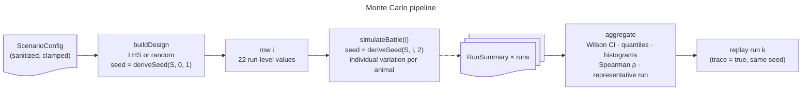
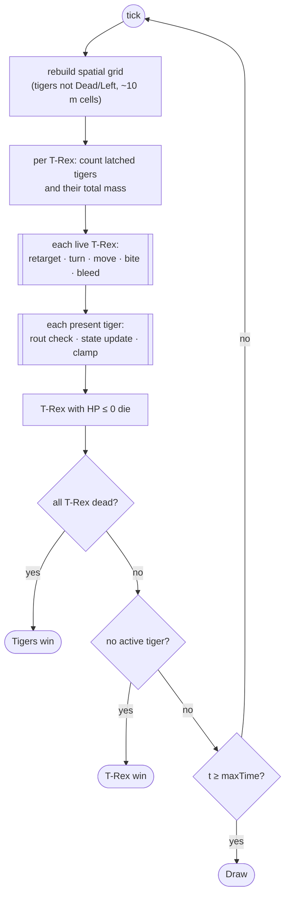
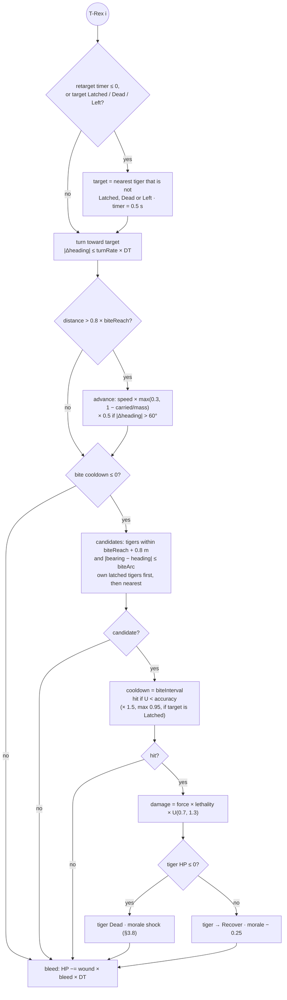
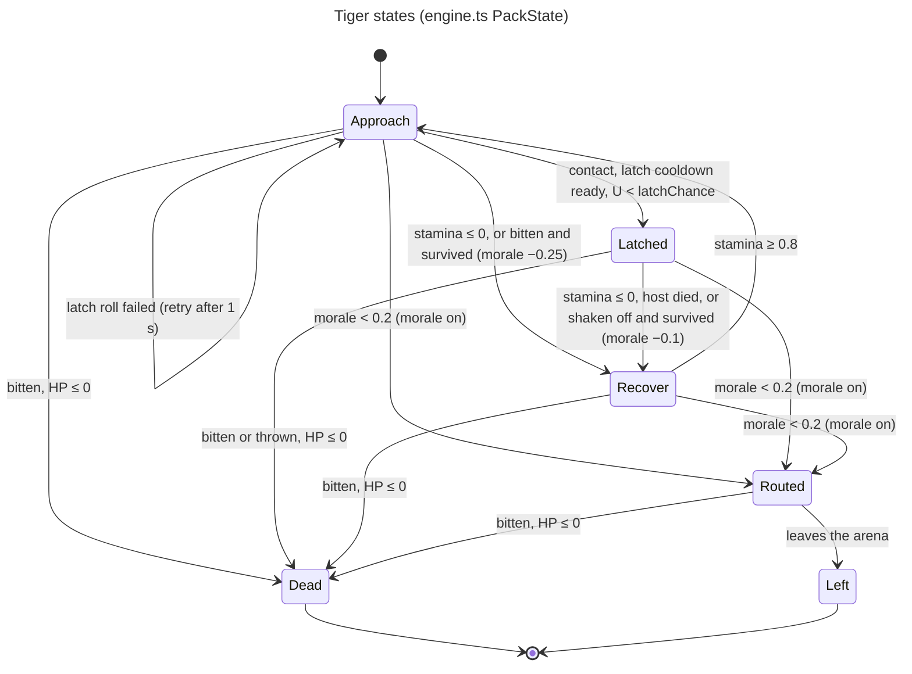

# Simulation Model

> **한국어 요약**
>
> - 이 문서는 `src/sim/`의 시뮬레이션 엔진이 **실제로 하는 일**을 그대로 설명합니다. 이 모델은 교육용 장난감 모델입니다. 티라노사우루스와 호랑이는 같은 시대에 살지 않았고, 상호작용 규칙은 모두 가정입니다.
> - 엔진은 대형 동물(`heavy.*`)과 무리 동물(`pack.*`) 두 역할로 여러 종을 다룹니다(§2.7). 아래 설명과 표는 기본 종인 티라노사우루스와 호랑이 기준이고, 다른 종의 값과 근거는 SPECIES.md에 있습니다.
> - 몬테카를로 설계는 두 층의 불확실성을 씁니다. 실행(run)마다 각 파라미터를 삼각분포 `(min, mode, max)`에서 LHS 또는 단순 무작위로 뽑고, 개체마다 `N(1, CV)`(구간 `[0.5, 1.5]`로 절단) 배율을 곱합니다.
> - 체력(HP)은 두 종 모두 체중 1 kg당 1 HP입니다. T-Rex 한 번의 물기 피해는 `교합력(kN) × 치명도(HP/kN) × U(0.7, 1.3)`입니다. 호랑이는 T-Rex에 매달린(latched) 동안 초당 `dps`의 피해를 주고, 누적 상처에 비례해 T-Rex가 출혈합니다.
> - 기본 가정(T-Rex 10 vs 호랑이 100, 사기 ON)에서는 T-Rex가 사실상 100% 이깁니다(전투 시간 중앙값 약 26초). 호랑이 약 14마리가 죽고 약 86마리가 도주합니다. 사기를 끄면(죽을 때까지 싸움) 전투가 140–330초로 길어지지만 T-Rex 승률은 여전히 약 99–100%입니다.
> - 호랑이가 이기려면 사기를 끈 상태에서 dps를 기본값의 수 배로 올리거나, 출혈 계수를 크게 하거나, T-Rex 한 마리당 호랑이 수를 30마리 이상으로 늘려야 합니다. 이 결과는 예측이 아니라 **불확실한 가정에 대한 민감도**를 보여줍니다. UI에서 직접 범위를 바꿔 보세요.

Source of truth: `src/sim/engine.ts`, `params.ts`, `species.ts`, `config.ts`, `sampling.ts`, `distributions.ts`, `montecarlo.ts`, `stats.ts` and `rng.ts`. If this document and the code disagree, the code wins. Please open an issue in that case.

## Contents

1. [Purpose and disclaimer](#1-purpose-and-disclaimer)
2. [Monte Carlo design](#2-monte-carlo-design)
3. [Battle model](#3-battle-model)
4. [Constants](#4-constants)
5. [Parameters](#5-parameters)
6. [Preliminary results](#6-preliminary-results)
7. [What would make the tigers win?](#7-what-would-make-the-tigers-win)
8. [Limitations and future work](#8-limitations-and-future-work)
9. [References](#9-references)

## 1. Purpose and disclaimer

The simulator asks a playground question: _N_ _Tyrannosaurus rex_ against _M_ tigers on an open field, who wins? It answers with a Monte Carlo, agent-based model. The goal is to make every assumption explicit and show **how the outcome depends on uncertain inputs**. It is not a prediction.

- _T. rex_ (Late Cretaceous, about 68–66 Ma) and tigers (Pleistocene to present) **never coexisted**. No fight between them has ever happened.
- Every interaction rule is an assumption: latching, shake-off, bleeding, morale and group tactics. Section 5 marks each parameter as sourced or **[speculative]**.
- Tigers are solitary ambush predators. **Coordinated attacks by many adult tigers are not documented**, so both tiger "tactics" in the model are hypothetical.
- Match-ups with _Homo erectus_, an extinct human species, are a **thought experiment on physical capability**: unclothed, no tools, weapons, fire or trained skill. They do not depict or endorse real violence; no modern humans are modelled.
- Treat the win probabilities as statements about the model under its assumptions. Changing the assumptions changes the answer, and the UI exists to explore exactly that.

## 2. Monte Carlo design



### 2.1 Two-level uncertainty

**Level 1, run-level (epistemic).** We do not know the true value of, for example, _T. rex_ bite force. Each of the 22 parameters therefore has a triangular distribution `(min, mode, max)`, and each run draws one value per parameter. `buildDesign` produces a `runs × 22` matrix:

- **`lhs` (default): Latin Hypercube Sampling.** For each parameter column, the strata `0 … runs−1` are shuffled with Fisher–Yates. Run `i` then gets `u = (perm[i] + U(0,1)) / runs`. Columns are permuted independently, so there is no correlation control between parameters.
- **`random`:** `u = U(0,1)` independently for every cell.
- In both cases `u` is mapped through the triangular inverse CDF, with `a = min`, `c = mode`, `b = max`:
  - `x = a + √(u·(b−a)·(c−a))` if `u < (c−a)/(b−a)`
  - `x = b − √((1−u)·(b−a)·(b−c))` otherwise
  - If `max ≤ min`, the value is `min`.

**Level 2, individual (aleatory).** Animals differ. For every parameter flagged `individual` (see §5), each animal gets its own multiplier, drawn independently per parameter and per animal at spawn:

```text
f ~ N(1, CV), resampled until 0.5 ≤ f ≤ 1.5 (at most 16 tries, else f = 1)
value = clamp(runValue × f, bounds)
```

- `CV` is `individualCV` (default 0.08, allowed range 0–0.3). With `CV = 0`, every animal uses the run value exactly.
- Three parameters are **run-level only** (`individual = false`): `heavy.biteLethality`, `heavy.bodyRadius` and `pack.bleed`. All animals in a run share them.
- For tigers, `cruiseSpeed` is additionally capped at the same tiger's `sprintSpeed`.

### 2.2 Random numbers and determinism

- **PRNG:** `sfc32`, seeded by chaining `splitmix32` four times, followed by 12 warm-up draws. Normal deviates come from Box–Muller, with the spare value cached.
- **Seed derivation:** `deriveSeed(master, stream, salt) = splitmix32(splitmix32(master ⊕ imul(salt + 1, 0x85ebca6b)) ⊕ stream)`.
  - Design matrix: `deriveSeed(seed, 0, 1)`.
  - Battle `i`: `deriveSeed(seed, i, 2)`. All in-battle randomness comes from this stream: spawn positions, individual factors, initial timers, flank side, latch and shake-off rolls, bite hits and damage.
- **Consequences:**
  - A run's result depends only on `(config, i)`. Splitting runs across any number of Web Workers gives identical results.
  - Results are bit-identical within the same JavaScript engine. Across engines (e.g. V8 vs JavaScriptCore) they agree statistically but may differ run-by-run, because `Math.atan2/sin/cos/log` are not required to be correctly rounded. Distances use `Math.sqrt` (correctly rounded) rather than `Math.hypot`.
  - Re-running battle `i` with `trace = true` (the replay) reproduces the same battle, because tracing, including the event log (§2.6), consumes no random numbers.
  - The design depends on `runs`. Changing the run count changes every row, so run 7 of a 100-run batch is not run 7 of a 500-run batch.

### 2.3 Scenario settings

Untrusted input, such as the URL fragment, goes through `sanitizeConfig`:

- unknown keys are dropped;
- only JSON numbers are accepted (numeric strings fall back to the default); numbers are clamped to the limits below, counts and the seed are rounded to integers, and `maxTime` is snapped to the 0.1 s step;
- each triangular `(min, mode, max)` must supply all three numbers (a partial range falls back to the default triangle); values are clamped to the parameter's bounds and sorted so that `min ≤ mode ≤ max`;
- **work budget:** `runs × (maxTime / 0.1) × (heavyCount + packCount)` must not exceed `MAX_WORK = 5·10¹⁰` agent-steps; otherwise `runs` is lowered to fit. This stops a shared link from requesting an effectively unbounded amount of CPU.

| Setting        | Default        | Allowed                                                                     |
| -------------- | -------------- | --------------------------------------------------------------------------- |
| `heavySpecies` | `trex`         | `trex`, `elephant`, `buffalo`, `brownBear`, `mammoth`, `homoErectus` (§2.7) |
| `packSpecies`  | `tiger`        | `tiger`, `lion`, `wolf`, `hyena`, `homoErectus` (§2.7)                      |
| `heavyCount`   | 10             | 1–500                                                                       |
| `packCount`    | 100            | 1–5,000                                                                     |
| `runs`         | 500            | 1–20,000, and within the work budget                                        |
| `seed`         | 20261019       | 0–2³²−1                                                                     |
| `arenaSize`    | 600 m (square) | 100–5,000 m                                                                 |
| `maxTime`      | 1,200 s        | 30–3,600 s                                                                  |
| `sampling`     | `lhs`          | `lhs`, `random`                                                             |
| `individualCV` | 0.08           | 0–0.3                                                                       |
| `packTactic`   | `flank`        | `flank`, `direct` (§3.6)                                                    |
| `morale`       | `true`         | `true` / `false` (§3.8)                                                     |
| `params`       | §5 table       | each `(min, mode, max)` within the listed bounds                            |

Species fall back to `trex`/`tiger` when unknown. Missing parameters take the **selected species'** presets, and parameter values are clamped with that species' bounds (§2.7). Share links store the species as `heavy`/`pack` in a `v: 2` payload; `v: 1` links (`trexCount`, `trex.*`, …) are upgraded through an alias map and reproduce bit-identically (`tests/v1-golden.test.ts`).

### 2.4 Outcomes

A battle ends at the end of the first tick in which one of these holds. The checks run in this order:

1. **Tigers win:** every T-Rex is dead (HP ≤ 0). If the last T-Rex and the last active tiger fall in the same tick, the tigers win.
2. **T-Rex win:** no tiger is _active_. Active means in state Approach, Latched or Recover, so every tiger is Dead, Routed or has Left the arena. A T-Rex win therefore includes battles that end because the tigers fled.
3. **Draw:** `maxTime` is reached (`maxTime / 0.1` ticks; `maxTime` is already on the 0.1 s grid).

Each run returns a `RunSummary`:

- `outcome` and `duration` (ticks × 0.1 s);
- `heavyAlive`;
- `packKilled`;
- `packRouted`, which counts Routed plus Left;
- `packActive`;
- `heavyHpFrac`: the summed HP of surviving T-Rex divided by the summed max HP of all T-Rex;
- `heavyAdvantage = heavyHpFrac − packActive / packCount`, which lies in [−1, 1].

### 2.5 Aggregate metrics

| Metric                       | Definition (`montecarlo.ts`, `stats.ts`)                                                                                                                                                                               |
| ---------------------------- | ---------------------------------------------------------------------------------------------------------------------------------------------------------------------------------------------------------------------- |
| P(T-Rex), P(tigers), P(draw) | Proportion of runs, with a **Wilson score 95% interval** (`z = 1.95996`).                                                                                                                                              |
| Duration, T-Rex survivors    | Mean, p5, p50 and p95, using linearly interpolated quantiles. Histograms: duration in ≤ 30 bins over `[0, maxTime]`, each bin a whole number of 0.1 s steps (no aliasing); survivors in `heavyCount + 1` integer bins. |
| Tigers killed, tigers routed | Mean, p5, p50 and p95.                                                                                                                                                                                                 |
| Exchange ratio               | Σ tigers killed ÷ Σ T-Rex lost over all runs (a ratio of totals). `Infinity` if tigers died but no T-Rex did; `NaN` if nobody died.                                                                                    |
| Sensitivity                  | For each parameter, the **Spearman rank correlation ρ** (average ranks for ties) between its _run-level_ design value and `heavyAdvantage`. Sorted by \|ρ\|; a non-finite ρ becomes 0.                                 |
| Representative run           | The run whose `heavyAdvantage` is closest to the median `heavyAdvantage`, with ties going to the lowest run index. The UI replays this run.                                                                            |

How to read the sensitivity:

- When the T-Rex win every run, `packActive = 0` at the end, so `heavyAdvantage` equals `heavyHpFrac`. ρ then measures what drives the HP the T-Rex lose.
- Spearman ρ captures monotonic one-at-a-time association only. Interactions are not captured; Sobol indices are on the roadmap.
- As a rough guide, the standard error is about `1/√(runs−1)`, which is ≈ 0.045 at 500 runs. Treat \|ρ\| ≲ 0.1 as noise.

### 2.6 Replay trace and event log

The UI replays the representative run (§2.5) by simulating it again with `trace = true` in a Web Worker. Only that run records a trace. Monte Carlo runs use `trace = false` and record nothing.

**Trace contents** (`BattleTrace` in `engine.ts`, `version: 2`):

| Field                                  | Content                                                                                                                                                                                                                                                                                                                                                                  |
| -------------------------------------- | ------------------------------------------------------------------------------------------------------------------------------------------------------------------------------------------------------------------------------------------------------------------------------------------------------------------------------------------------------------------------ |
| `frames`                               | State samples `{ t, heavy, pack }`. Per T-Rex: x, y, heading and HP fraction (0 = dead) as `Float32Array`. Per tiger: x, y and state code. One frame at t = 0, then one every `traceMinEvery` ticks (0.5 s), plus a final frame at the end of the battle. When the frames would exceed `traceFloatBudget` floats, every other frame is dropped and the interval doubles. |
| `events`                               | The event log described below (`Uint16Array`).                                                                                                                                                                                                                                                                                                                           |
| `eventsCompleteUntilStep`              | Every event with stamp ≤ this value is in `events`. It equals the battle's tick count (`duration / 0.1`) unless the budget stopped the log.                                                                                                                                                                                                                              |
| `eventStats`                           | Stored P0 and P1 counts, plus P1 events coalesced or dropped and P0 events dropped.                                                                                                                                                                                                                                                                                      |
| `meta`                                 | `dt`, `bodyRadius`, `packRadius`, and per-T-Rex `reach` (m) and `arc` (bite half-angle, rad) as `Float32Array`. This is what a renderer needs to draw bite cones and to place latched tigers.                                                                                                                                                                            |
| `arenaSize`, `heavyCount`, `packCount` | Scenario geometry.                                                                                                                                                                                                                                                                                                                                                       |

**Event format.** Each event is four unsigned 16-bit integers (8 bytes): `[stamp, type << 8 | v, a, b]`.

- `stamp` is the tick that produced the event, counted from 1. The update from t = (s − 1) × 0.1 s to t = s × 0.1 s has stamp s, the same index as a frame recorded at s × 0.1 s. Event time = stamp × `DT`.
- `a` and `b` are agent indices; `0xFFFF` means "none". `v` is a type-specific byte.
- Events are stored in emission order, which is the engine's tick order (§3.2): T-Rex bites, then each tiger's update in index order, then T-Rex deaths. The log is therefore sorted by stamp and can be binary-searched by time.

| Code | Event        | a     | b                                 | v                                                          | Class | Tiger state afterwards                      |
| ---- | ------------ | ----- | --------------------------------- | ---------------------------------------------------------- | ----- | ------------------------------------------- |
| 1    | `BiteHit`    | T-Rex | tiger                             | damage ÷ tiger max HP × 255, clamped to 255                | P0    | Recover (Dead if a `PackDeath` follows)     |
| 2    | `BiteMiss`   | T-Rex | tiger                             | 0                                                          | P1    | unchanged                                   |
| 3    | `Latch`      | tiger | host T-Rex                        | latch angle relative to the host's heading, 256 steps/turn | P0    | Latched                                     |
| 4    | `LatchFail`  | tiger | T-Rex                             | 0                                                          | P1    | unchanged                                   |
| 5    | `Throw`      | tiger | host                              | 0                                                          | P0    | Recover (Dead if a `PackDeath` follows)     |
| 6    | `Release`    | tiger | host, or none                     | 0 = stamina ran out, 1 = host died                         | P0    | Recover                                     |
| 7    | `PackDeath`  | tiger | killer T-Rex                      | 0 = bite, 1 = throw                                        | P0    | Dead                                        |
| 8    | `Rout`       | tiger | host if it was latched, else none | 0                                                          | P0    | Routed                                      |
| 9    | `Exit`       | tiger | none                              | 0                                                          | P0    | Left                                        |
| 10   | `HeavyDeath` | T-Rex | none                              | 0                                                          | P0    | — (the T-Rex is dead from this stamp on)    |
| 11   | `Exhausted`  | tiger | target T-Rex                      | 0                                                          | P0    | Recover (stamina ran out while approaching) |
| 12   | `Resume`     | tiger | none                              | 0                                                          | P0    | Approach                                    |

**Reconstruction.** P0 events cover every tiger state change and every T-Rex death; P1 events are cosmetic.

- Start from "every tiger in Approach, every T-Rex alive" and apply the events with stamp ≤ s in log order. The result is exactly the state stored in a frame at s × 0.1 s (`packStateAfter` and `eventTiger` in `events.ts`).
- Several events of one tiger in one tick stay in order. For example, a bitten Routed tiger gets `BiteHit` (→ Recover) and then `Rout` (→ Routed) in its own update. A `PackDeath` always directly follows the `BiteHit` or `Throw` that caused it.
- A latched tiger sits at `bodyRadius + packRadius` from its host's centre, at the latch angle relative to the host's heading. Its position is recomputed from the host's pose every tick and is then clamped to the arena like every non-routed tiger, so next to a wall it can sit closer than that distance. On the tick it latches it is still at its contact position: on the same bearing, but anywhere within `bodyRadius + packRadius + 0.5` m of the host's centre (the flank tactic can bring it nearer than the ride distance). The first pinned position is the next tick's.
- Leaving the host: a `Throw` and a stamina `Release` come after the latched position update of their tick, so at the event's stamp the tiger is still on its host (a thrown tiger is then moved 3 m farther out on the same bearing). A `Rout`, a `BiteHit` and a `Release` because the host died come before that update, so the tiger was last pinned one tick earlier; a routed or bitten tiger also takes its first fleeing or recovering step in the event's tick. The replay uses these rules for its ride timing ([REPLAY.md §3](REPLAY.md#3-world-states-and-motion)).

**Budget.**

- **P0 (state-changing):** at most `eventP0Cap` = 262,144 events (2 MiB). When the cap is reached the log **stops**. The events of the current tick are discarded, so the log ends on a tick boundary, and `eventsCompleteUntilStep` is set to the last complete tick. Later events are only counted (`p0Dropped`).
- **P1 (cosmetic: `BiteMiss`, `LatchFail`):** at most `eventP1Cap` = 32,768 events (256 KiB); later ones are dropped and counted. Before that, at most one `BiteMiss` per T-Rex per `biteMissCoalesce` (1 s) and one `LatchFail` per tiger per `latchFailCoalesce` (2 s) are stored; the rest are counted in `p1Coalesced`.
- The worst case is therefore 2.25 MiB of events, next to at most 24 MB of frames (`traceFloatBudget`).
- **Fallback:** a renderer uses event-exact states up to `eventsCompleteUntilStep × DT` and frame-sampled states after it (the last frame at or before t, as the version 1 replay did). It should tell the viewer that detail is reduced after that time.
- `eventsCompleteUntilStep` is 0 when the log is turned off (`TraceOptions.events = false`, used by tests). The log also stops itself if a stamp or an agent index would not fit in 16 bits. The limits in §2.3 keep both out of reach: at most 36,000 ticks and 5,000 agents.

**Observed volumes.** Default parameters with the agent counts shown, runs 0 … n−1 of an n-run batch:

| Scenario                                    | Runs | Events (mean / max) | Largest log | P0 dropped |
| ------------------------------------------- | ---- | ------------------- | ----------- | ---------- |
| 1 vs 1                                      | 100  | 16 / 47             | 0.4 KiB     | 0          |
| 1 vs 10                                     | 100  | 229 / 686           | 5.4 KiB     | 0          |
| 1 vs 100                                    | 100  | 712 / 1,622         | 12.7 KiB    | 0          |
| 10 vs 100 (default scenario)                | 100  | 303 / 1,120         | 8.8 KiB     | 0          |
| 10 vs 1,000                                 | 2    | 2,445 / 3,394       | 26.5 KiB    | 0          |
| 50 vs 1,000                                 | 2    | 2,638 / 3,808       | 29.8 KiB    | 0          |
| 500 vs 5,000                                | 2    | 6,149 / 6,921       | 54.1 KiB    | 0          |
| 1 vs 5,000, `maxTime` 3,600 s               | 2    | 2,394 / 4,004       | 31.3 KiB    | 0          |
| Stress: 1 vs 5,000, 3,600 s, latch chance 0 | 1    | 294,900             | 2,304 KiB   | 291,241    |

The stress case is a 3,600 s draw in which no tiger can ever latch, so tigers cycle through approach, failed latch and exhaustion. It produces about 2.85 million events. The log keeps 262,132 P0 and 32,768 P1 events (2.25 MiB) and stops at tick 17,227 (t = 1,722.7 s). By the end of the battle the frames are 16 s apart, so the fallback is coarse there.

**Determinism guarantees.**

- The log exists only when `trace = true`. Otherwise it is `null`, and each of the 12 emission points costs one null check; argument expressions are not evaluated.
- Emission code only reads state. It never draws a random number, never reorders a loop and never changes control flow.
- Tests (`tests/events.test.ts`, `tests/events-determinism.test.ts`) check, over a scaled-down scenario matrix:
  - summaries and frames are bit-identical with the log on, with it off, and against golden values captured from the engine before the log existed;
  - the number of random draws is identical with and without the log;
  - the reconstructed states equal every frame sample, latched tigers sit on their hosts, and T-Rex deaths agree with frame HP;
  - stamps and indices fit in 16 bits for every value `LIMITS` allows;
  - a log stopped by the budget holds exactly the uncapped log's P0 events up to `eventsCompleteUntilStep`.

**Transport.** The worker transfers every buffer of the trace (frames, events and meta) to the main thread without copying (`traceTransferList` in `src/workers/protocol.ts`).

### 2.7 Species and roles

The engine has two roles. The **heavy** side (`heavy.*` parameters) is the large animal that fights alone: turn-limited, with a frontal attack cone, shake-off and carry slowdown. The **pack** side (`pack.*`) attacks in numbers: sprint and cruise, stamina, latching with damage per second, morale and rout. The rest of this document describes the rules with the default species, _T. rex_ and the tiger; the rules are the same for every species.

`src/sim/species.ts` registers the phase-1 catalog (heavy `trex`, `elephant`, `buffalo`, `brownBear`; pack `tiger`, `lion`, `wolf`, `hyena`) plus the woolly mammoth (heavy `mammoth`) and _Homo erectus_ on both sides (`homoErectus`, [#47](https://github.com/VinylStage/trex_vs_tiger_sim/issues/47)). Each species carries:

- preset triangles for its role's eleven parameters, each with an evidence tag (L literature, D derived, S speculative, U unverified);
- its own **hard bounds**. _T. rex_ and the tiger keep exactly the v1 bounds of §5; the other species widen heavy mass to 100 kg, heavy weapon force to 0.1 kN and pack mass to 5–1,000 kg; the heavy _Homo erectus_ alone widens further (mass from 20 kg, reach from 0.3 m, body radius from 0.1 m). The per-animal clamp in the engine uses the selected species' bounds;
- an era (for the matchup badge) and, for heavies, a weapon kind that only relabels the `biteForce` family (tusk/trample, horn, bite/paw, bare hands);
- two flags: `adSafe` (read through `matchupAdSafe`, see [ADSENSE.md](ADSENSE.md)) and `hominin`, which adds the thought-experiment note to the matchup badge;
- non-sampled constants: `intimidation` for heavies (multiplier on the morale a pack animal loses to the heavy's hits and throws, and on the minimum recovery after a hit: 1 for every species except _H. erectus_, 0.02; `x × 1` is exact, so earlier results do not change), `hide` for heavies (multiplier on pack damage taken: woolly mammoth 0.25, elephant 0.3, buffalo 0.5, brown bear 0.5, _T. rex_ and _H. erectus_ 1) and `radius` for packs (body contact radius: tiger and lion 0.8 m, hyena 0.6 m, wolf 0.5 m, _H. erectus_ 0.3 m). `radius` replaces the former engine constant `tigerRadius` wherever it was used (contact distance, bite reach padding, latched offset, trace `meta.packRadius`).

The constants draw no random numbers, and their _T. rex_/tiger values are exact identities (`x × 1`, 0.8 m), so every run with the default species is bit-identical to the engine before species existed. The values, sources and calibration notes are in [SPECIES.md](SPECIES.md).

## 3. Battle model

### 3.1 Arena and spawn

- The arena is an open square of side `L = arenaSize`. Both species are clamped to `[0, L]`, except Routed tigers, which may leave.
- `sep = min(200, 0.4 L)`.
- **T-Rex** stand in a vertical line at `x = L/2 − sep/2`, spaced `min(15, 0.8 L / N)` m apart and centred on `y = L/2`. All face +x, toward the tigers.
- **Tigers** are placed uniformly in a disc of radius `min(0.2 L, 3 √M)` centred at `(L/2 + sep/2, L/2)`. Each tiger gets a random flank side ±1.
- Defaults (L = 600, N = 10, M = 100): T-Rex at x = 200 m, y = 232.5…367.5 m; tigers within 30 m of (400, 300). The lines start about 200 m apart.
- Initial bite cooldowns are `U(0, biteInterval)`. Initial retarget timers are `U(0, 0.5 s)` for T-Rex and `U(0, 1 s)` for tigers.

### 3.2 Time step and tick order

The engine uses a fixed step `DT = 0.1 s` with explicit (Euler) updates. T-Rex and tigers are updated sequentially in index order within a tick.



When a tiger dies it is removed immediately. A T-Rex whose HP drops to 0 or below is only marked dead at the end of the tick.

### 3.3 Health and damage

- **HP = body mass in kg (1 HP/kg) for both species.** A tiger's HP equals its individual mass, and so does a T-Rex's. Damage is expressed in the same "kg-equivalent" units, so the bite and claw rates below are calibrated against body mass.
- **T-Rex bite damage per hit:** `biteForce (kN) × biteLethality (HP/kN) × U(0.7, 1.3)`.
- **Tiger damage:** `dps × DT × hide` per tick while latched, where `hide` is the heavy species constant (§2.7; 1 for T. rex, an exact identity). It is applied to the host's HP and also added to the host's accumulated **wound** total.
- **Bleeding:** each tick, every live T-Rex loses `wound × pack.bleed × DT` HP. The bleed loss rate grows with the total tiger damage the T-Rex has ever received. Wounds never close, and bleeding does not add to `wound`.

Example: with `bleed = 0.002 /s`, a T-Rex that has taken 1,000 HP of tiger damage bleeds 2 HP/s from then on.

### 3.4 T-Rex behaviour



**Targeting.**

- A T-Rex steers toward the nearest tiger that is not latched onto anyone and not Dead or Left. Routed and recovering tigers can be targets.
- It re-evaluates every 0.5 s, and immediately when its target latches onto someone or dies.

**Turning and movement.**

- Heading changes by at most `turnRate × DT` per tick.
- The T-Rex advances only while the target is farther than `0.8 × biteReach`.
- Speed is multiplied by a **carried-mass factor** `max(0.3, 1 − Σ latched tiger mass / own mass)`. Example: five 180 kg tigers on an 8,000 kg T-Rex give 0.89. The 0.3 floor is reached at 70% of own mass.
- Speed is halved while the heading error exceeds 60° (the **turn penalty**).

**Bite.** When the cooldown has expired, the T-Rex looks for a target inside a **frontal cone**:

- distance ≤ `biteReach + 0.8 m` (tiger radius);
- \|bearing − heading\| ≤ `biteArc`. `biteArc` is the cone's **half-angle**, so the full cone is `2 × biteArc`.

Tigers latched onto **this** T-Rex get top priority; otherwise the nearest candidate is chosen. If there is no candidate, the cooldown stays expired and the search repeats next tick.

An attempt resets the cooldown to `biteInterval` and hits with probability `biteAccuracy`. Against any latched tiger, accuracy is `min(0.95, 1.5 × biteAccuracy)` (the **latched accuracy bonus**).

A tiger that survives a hit goes to Recover and loses 0.25 morale.

**Geometric consequence.** A latched tiger keeps a fixed position relative to its host's heading. A tiger latched outside its host's frontal cone, for example on the flank or rear, **cannot be bitten by its host**. It can only be removed by shake-off, by its own stamina running out, or by a bite from another T-Rex whose cone covers it.

**Shake-off.**

- Each latched tiger independently rolls `P = host.shakeRate × DT` per tick, so the expected time to being thrown is `1/shakeRate`.
- A thrown tiger loses 10% of its own max HP. If it survives, it goes to Recover with −0.1 morale and is pushed 3 m outward.
- The roll is evaluated in the tiger update.

The T-Rex has no stamina, no morale and no arm attack. The arms are about 1 m long and judged useless in combat [Padian 2022; Carpenter & Smith 2001].

### 3.5 Tiger behaviour



A Routed tiger that is bitten and survives is set to Recover. Its morale is already below 0.2, so it routs again in the same tick.

**Approach.**

- Retarget every 1 s, or immediately if the target T-Rex died. `direct` picks the nearest live T-Rex; `flank` uses the score described in §3.6.
- **Speed and stamina:**
  - Farther than 60 m from the target, the tiger **cruises** at `cruiseSpeed` and regains stamina at `0.25 × DT / recoveryTime`.
  - Within 60 m it **sprints** at `sprintSpeed` and loses `DT / sprintEndurance` stamina per tick.
  - At stamina ≤ 0 it goes to Recover, with no morale loss.
- **Contact** means centre distance ≤ `bodyRadius + 0.8 + 0.5` m (3.8 m at the default radius). On contact, with the latch cooldown expired, the tiger latches with probability `latchChance`. If the roll fails, it retries after 1 s.

**Latched.**

- The tiger is pinned to the host at distance `bodyRadius + 0.8` m and a fixed angle relative to the host's heading, so it rotates with the host.
- It deals `dps × DT` per tick (see §3.3) and loses `DT / latchEndurance` stamina per tick.
- It leaves the Latched state when stamina runs out, when the host dies, on shake-off (§3.4), on rout, or on death.

**Recover.**

- Stamina regenerates at `DT / recoveryTime` per tick, four times the cruise rate.
- If the tiger is within 40 m of the nearest T-Rex, it moves directly away at cruise speed.
- It returns to Approach with no target when stamina ≥ 0.8 **and** its minimum recovery time has elapsed.
- A tiger that is bitten and survives, or shaken off, must stay in Recover for at least `recoverMinTime` (5 s) whatever its stamina, so it actually disengages before re-latching. Recover entered because stamina ran out has no minimum time.

**Routed.**

- The tiger flees directly away from the nearest T-Rex. It sprints while stamina > 0 (draining it) and then cruises. Stamina does not regenerate while routed.
- A routed tiger is not clamped to the arena. Once outside, it becomes **Left** and plays no further part.
- Routed tigers can still be bitten if they are inside a T-Rex's cone and reach.

### 3.6 Tiger tactics

| Tactic            | Target choice                                                                                                      | Movement                                                                                                                                                                                                                                                                                                                                                                                                                                          |
| ----------------- | ------------------------------------------------------------------------------------------------------------------ | ------------------------------------------------------------------------------------------------------------------------------------------------------------------------------------------------------------------------------------------------------------------------------------------------------------------------------------------------------------------------------------------------------------------------------------------------- |
| `direct`          | Nearest live T-Rex.                                                                                                | Straight at the T-Rex centre. The step is limited so that the tiger stops at contact distance.                                                                                                                                                                                                                                                                                                                                                    |
| `flank` (default) | Live T-Rex minimising `distance + 20 m × (tigers already latched on it)`. This spreads the attackers across T-Rex. | Aim point: on the T-Rex body circle, behind it, offset by ±0.6 rad (≈ 34°) to the tiger's own side. Danger zone: closer than `biteReach + 4 m` **and** within `biteArc + 20°` of the T-Rex heading. Inside the danger zone the tiger moves perpendicular to the T-Rex heading, toward the side of the T-Rex it is already on, to get out of the cone; otherwise it heads for the aim point. The step is limited to the distance to the aim point. |

Both tactics are **hypothetical**. Adult tigers hunt alone, and no coordinated multi-tiger attack on large prey is documented [Schaller 1967].

### 3.7 Bleeding

See §3.3. `pack.bleed` is a run-level constant in `1/s`. The default mode `0.002` means 0.2% of accumulated wound HP is lost per second.

Bleeding matters most in long, no-morale battles, where wounds accumulate for minutes. Over T seconds after accumulating wound W, bleeding removes about `W × bleed × T` HP. For example, W = 1,000 HP, bleed = 0.002 /s and T = 300 s gives about 600 HP.

### 3.8 Morale and rout

Morale applies to tigers only and starts at the individual `pack.morale`.

| Event                                   | Morale change                                                           | Applies when `morale = false`? |
| --------------------------------------- | ----------------------------------------------------------------------- | ------------------------------ |
| Bitten and survived                     | −0.25                                                                   | Yes, but has no effect         |
| Shaken off and survived                 | −0.10                                                                   | Yes, but has no effect         |
| Another tiger dies within 40 m          | −`moraleLoss` (each tiger's own value) for every present tiger in range | No (no shock)                  |
| Morale < 0.2 at the start of its update | → Routed (detaches if latched)                                          | No (never routs)               |

Examples with defaults:

- A tiger with morale 0.6 routs after two survived bites (0.6 → 0.35 → 0.10).
- One survived bite plus two nearby deaths at 0.08 each also routs it (0.6 → 0.35 → 0.19).

This models the observation that tigers avoid injurious fights. The thresholds are **[speculative]**.

## 4. Constants

These are fixed in `engine.ts`. They are not sampled and not editable in the UI. The pack contact radius is a species constant (§2.7; 0.8 m for the tiger).

| Constant                          | Value           | Meaning                                                                                                                              |
| --------------------------------- | --------------- | ------------------------------------------------------------------------------------------------------------------------------------ |
| `DT`                              | 0.1 s           | Integration time step                                                                                                                |
| `latchRetry`                      | 1 s             | Latch cooldown after a failed latch roll                                                                                             |
| `moraleRadius`                    | 40 m            | Morale-shock radius around a killed tiger                                                                                            |
| `routThreshold`                   | 0.2             | Morale below which a tiger routs (morale on)                                                                                         |
| `woundMoraleLoss`                 | 0.25            | Morale lost when bitten and surviving                                                                                                |
| `throwMoraleLoss`                 | 0.1             | Morale lost when shaken off and surviving                                                                                            |
| `throwDamageFrac`                 | 0.1             | Fraction of own max HP a tiger loses when shaken off                                                                                 |
| `throwDistance`                   | 3 m             | Outward displacement when shaken off                                                                                                 |
| `recoverDistance`                 | 40 m            | Recovering tigers closer than this to a T-Rex move away at cruise speed                                                              |
| `resumeStamina`                   | 0.8             | Stamina at which a recovering tiger re-engages                                                                                       |
| `sprintTriggerDistance`           | 60 m            | Tigers sprint (and drain stamina) within this distance of their target                                                               |
| `cruiseRegenFactor`               | 0.25            | Stamina regeneration while cruising, relative to resting                                                                             |
| `heavyRetarget`                   | 0.5 s           | T-Rex retarget interval                                                                                                              |
| `packRetarget`                    | 1 s             | Tiger retarget interval                                                                                                              |
| `minCarrySpeedFactor`             | 0.3             | Floor of the carried-mass speed factor                                                                                               |
| `latchedAccuracyBonus`            | 1.5             | Bite-accuracy multiplier against latched tigers                                                                                      |
| `maxAccuracy`                     | 0.95            | Cap on the boosted accuracy                                                                                                          |
| `dangerMargin`                    | 4 m             | Flank: distance beyond `biteReach` treated as dangerous                                                                              |
| `dangerArcPad`                    | 20°             | Flank: angle beyond `biteArc` treated as dangerous                                                                                   |
| `flankOffset`                     | 0.6 rad (≈ 34°) | Flank: aim-point offset from directly behind                                                                                         |
| `biteDamageMin`, `biteDamageSpan` | 0.7, 0.6        | Bite damage multiplier `U(0.7, 1.3)`                                                                                                 |
| `flankLoadPenalty`                | 20 m            | Flank: target-score penalty per tiger already latched                                                                                |
| `traceFloatBudget`                | 6,000,000       | Replay: when a trace would exceed this many floats, every other frame is dropped and the interval doubles                            |
| `traceMinEvery`                   | 5 ticks (0.5 s) | Replay: starting interval between recorded frames                                                                                    |
| `eventP0Cap`                      | 262,144         | Replay: most state-changing events in the log (2 MiB); reaching it stops the log (§2.6)                                              |
| `eventP1Cap`                      | 32,768          | Replay: most cosmetic events (bite misses, failed latches) in the log (256 KiB)                                                      |
| `biteMissCoalesce`                | 1 s             | Replay: at most one logged bite miss per T-Rex per interval                                                                          |
| `latchFailCoalesce`               | 2 s             | Replay: at most one logged failed latch per tiger per interval                                                                       |
| `recoverMinTime`                  | 5 s             | Minimum time in Recover after a wound or a throw                                                                                     |
| `shockPad`                        | 6.5 m           | Morale-shock grid query padding (max per-tick displacement: 35 m/s × 0.1 s + 3 m throw); the exact 40 m distance check still applies |

Hard-coded values in the code that are not in `CONSTANTS`:

- contact margin 0.5 m;
- T-Rex movement threshold `0.8 × biteReach`;
- turn penalty ×0.5 above 60°;
- flank sidestep ±90°;
- spawn geometry (§3.1);
- individual factor bounds [0.5, 1.5] with 16 tries;
- spatial-grid cell size `L / min(128, ceil(L/10))`.

## 5. Parameters

Columns:

- **min / mode / max:** the default triangular distribution of the default species (_T. rex_, tiger); other species: [SPECIES.md](SPECIES.md).
- **Bounds:** the _T. rex_/tiger hard limits (identical to v1) enforced by `sanitizeConfig` and by the clamping of individual values.
- **Ind.:** whether per-animal variation applies.

**[speculative]** means no direct data exists, and the range is the author's judgement, chosen to be wide.

### 5.1 _Tyrannosaurus rex_

| Parameter             | Unit  | min  | mode | max  | Bounds     | Ind. | Source / rationale                                                                                                                                                                                                                                                                                                                                           |
| --------------------- | ----- | ---- | ---- | ---- | ---------- | ---- | ------------------------------------------------------------------------------------------------------------------------------------------------------------------------------------------------------------------------------------------------------------------------------------------------------------------------------------------------------------ |
| `heavy.mass`          | kg    | 5650 | 8000 | 9500 | 1000–20000 | yes  | Min ≈ Sue, 5,654 kg [Erickson 2004]. Scotty ≈ 8,870 kg [Persons 2019]. Volumetric models of large adults exceed 9 t [Hutchinson 2011]. The mode of 8 t is a central adult value. It also sets HP.                                                                                                                                                            |
| `heavy.speed`         | m/s   | 3.4  | 5.5  | 8    | 0.5–25     | yes  | Fast running is ruled out [Hutchinson & Garcia 2002]. Stress-constrained models allow walking gaits only, about 5 m/s maximum [Sellers 2017], which motivates the mode. Preferred walking is 1.28 m/s [van Bijlert 2021], so the minimum is a brisk walk. The maximum of 8 m/s leaves room for less conservative estimates. The exact numbers are judgement. |
| `heavy.turnRate`      | deg/s | 22   | 30   | 45   | 5–360      | yes  | Large rotational inertia means slow turning, about 1–2 s per 45° [Hutchinson, Ng-Thow-Hing & Anderson 2007], i.e. 22.5–45 °/s.                                                                                                                                                                                                                               |
| `heavy.biteForce`     | kN    | 8.5  | 35   | 57   | 1–150      | yes  | 8,526–34,522 N [Gignac & Erickson 2017]; 35–57 kN maximum [Bates & Falkingham 2012]. The minimum and mode follow the first study, and the maximum follows the second.                                                                                                                                                                                        |
| `heavy.biteLethality` | HP/kN | 4    | 8    | 12   | 0.1–100    | no   | **[speculative]** No data maps bite force to damage. See the calibration in §5.3.                                                                                                                                                                                                                                                                            |
| `heavy.biteInterval`  | s     | 1.5  | 2.5  | 4    | 0.2–30     | yes  | **[speculative]** Time between bite attempts: jaw cycle plus repositioning the head.                                                                                                                                                                                                                                                                         |
| `heavy.biteReach`     | m     | 4.5  | 5.5  | 6.5  | 1–15       | yes  | **[speculative geometry]** Distance from the body centre to the jaws. The skull is about 1.5 m long [Padian 2022; Carpenter & Smith 2001]. With a 2.5 m body radius, the default puts the jaws about 3 m beyond the body circle, covering skull and neck.                                                                                                    |
| `heavy.biteArc`       | deg   | 30   | 45   | 70   | 5–180      | yes  | **[speculative]** Half-angle of the frontal bite cone (§3.4). The bite is the only modelled weapon. Fossil evidence of tyrannosaur attacks is bite evidence: a healed bite on a hadrosaur [DePalma 2013] and face-biting between tyrannosaurs [Peterson 2009].                                                                                               |
| `heavy.biteAccuracy`  | p     | 0.3  | 0.5  | 0.7  | 0–1        | yes  | **[speculative]** Chance an attempt connects with a small, agile target.                                                                                                                                                                                                                                                                                     |
| `heavy.shakeRate`     | 1/s   | 0.05 | 0.12 | 0.25 | 0–10       | yes  | **[speculative]** Rate of throwing off each latched tiger; mean hold time `1/rate` is 4–20 s. There are no skin-thickness data: preserved skin shows only small scales [Bell 2017].                                                                                                                                                                          |
| `heavy.bodyRadius`    | m     | 2    | 2.5  | 3    | 0.5–8      | no   | **[speculative geometry]** The roughly 12 m long animal is modelled as a contact circle. The radius sets contact distance, the latched offset and the flank aim point.                                                                                                                                                                                       |

### 5.2 Tiger (_Panthera tigris_)

| Parameter              | Unit | min  | mode  | max   | Bounds | Ind. | Source / rationale                                                                                                                                                                                                                                  |
| ---------------------- | ---- | ---- | ----- | ----- | ------ | ---- | --------------------------------------------------------------------------------------------------------------------------------------------------------------------------------------------------------------------------------------------------- |
| `pack.mass`            | kg   | 100  | 180   | 260   | 30–500 | yes  | Bengal males are about 167–261 kg and females about 116–164 kg (Chitwan data of Sunquist and Smith, via [Wikipedia: Bengal tiger], a secondary source). Wild Amur males average 176 kg [Slaght 2005]. The range covers both sexes. It also sets HP. |
| `pack.sprintSpeed`     | m/s  | 11   | 14    | 18    | 2–35   | yes  | **[speculative]** There is no peer-reviewed measurement of tiger sprint speed. Popular figures of 48–65 km/h (13–18 m/s) are unsourced. The range is set by analogy with measured wild lion locomotion [Wilson 2018].                               |
| `pack.cruiseSpeed`     | m/s  | 4    | 6     | 8     | 0.5–20 | yes  | **[speculative]** Trot or canter used beyond 60 m. It is capped at the individual's sprint speed.                                                                                                                                                   |
| `pack.sprintEndurance` | s    | 10   | 20    | 40    | 1–600  | yes  | **[speculative]** Tigers are ambush predators that make short charges [Schaller 1967]. This is the time from full stamina to exhaustion at sprint speed.                                                                                            |
| `pack.latchEndurance`  | s    | 15   | 30    | 60    | 1–1200 | yes  | **[speculative]** How long a tiger can hold on to a moving animal 20–95× its mass.                                                                                                                                                                  |
| `pack.recoveryTime`    | s    | 30   | 60    | 120   | 1–3600 | yes  | **[speculative]** Time to regain full stamina while resting. Re-engaging needs 80% of it.                                                                                                                                                           |
| `pack.latchChance`     | p    | 0.15 | 0.35  | 0.6   | 0–1    | yes  | **[speculative]** Chance a contact becomes a hold. Tiger hunting success of about 5–50% [Schaller 1967] is only a loose analogue.                                                                                                                   |
| `pack.dps`             | HP/s | 2    | 6     | 12    | 0–200  | yes  | **[speculative]** Damage rate while latched. See the calibration in §5.3.                                                                                                                                                                           |
| `pack.bleed`           | 1/s  | 0    | 0.002 | 0.005 | 0–0.1  | no   | **[speculative]** Fraction of accumulated wound HP lost per second (§3.3). Canines of about 5–7.5 cm and claws of about 8–10 cm [SDZWA] make shallow wounds relative to an animal of several tonnes, so the range starts at 0 (no bleeding).        |
| `pack.morale`          | 0–1  | 0.4  | 0.6   | 0.85  | 0–1    | yes  | **[speculative]** Initial morale. Tigers avoid injurious fights, and their usual prey is about 60–250 kg, occasionally gaur of about 1 t [Hayward 2012]. An 8 t animal is far outside that range.                                                   |
| `pack.moraleLoss`      | 0–1  | 0.03 | 0.08  | 0.15  | 0–1    | yes  | **[speculative]** Morale lost per tiger death within 40 m.                                                                                                                                                                                          |

### 5.3 Calibration notes

**Bite lethality (`heavy.biteLethality`, 4–12 HP/kN).**

- With the mode values, one bite deals `35 kN × 8 HP/kN × U(0.7, 1.3)` = 196–364 HP. A 180 kg tiger has 180 HP, so a typical hit at typical force is lethal.
- At the low end, `8.5 kN × 4 HP/kN` = 24–44 HP per hit, so several hits are needed.
- The range deliberately spans "one bite kills" to "one bite wounds". The mapping itself is **[speculative]**.

**Tiger damage rate (`pack.dps`, 2–12 HP/s).**

- Tiger bite force is about 1.2–1.5 kN [Wroe 2005; Christiansen & Wroe 2007]. Using the same lethality mapping as the T-Rex (4–12 HP/kN), one tiger bite is worth about 5–18 HP.
- At roughly one bite or claw strike every 1–2 s, that gives about 2.4–18 HP/s.
- The default triangle 2/6/12 puts the mode at a mid-lethality bite (about 11 HP) every ~1.8 s. It trims the upper tail because the wounds are shallow relative to a T-Rex.
- **[speculative]**

**Time to kill, for intuition.**

- An 8,000 HP T-Rex needs about 1,330 s of latched time from one tiger at 6 HP/s.
- With 10 tigers latched at once, that drops to about 133 s, ignoring bleeding and shake-off.
- Most tigers never achieve sustained holds, which is why tiger damage is so sensitive to `dps`, `latchChance` and `shakeRate`.

## 6. Preliminary results

These results are **indicative only**. They come from a local check of the engine (`src/sim`, `feat/3-sim-engine` at `c4d55a8`) with all defaults: seed 20261019, 500 runs, LHS, 10 T-Rex vs 100 tigers, arena 600 m, maxTime 1,200 s and CV 0.08. Different seeds or run counts will move the numbers slightly.

| Scenario                   | T-Rex win (Wilson 95%) | Tigers win | Draw | Duration p5 / p50 / p95 (s) | Tigers killed (mean) | Tigers routed (mean) | T-Rex survivors (mean) |
| -------------------------- | ---------------------- | ---------- | ---- | --------------------------- | -------------------- | -------------------- | ---------------------- |
| Morale on, flank (default) | 100% (99.2–100%)       | 0%         | 0%   | 19 / 26 / 130               | 14.1                 | 85.9                 | 10.0                   |
| Morale on, direct          | 100% (99.2–100%)       | 0%         | 0%   | 18 / 23 / 89                | 14.8                 | 85.2                 | 10.0                   |
| Morale off, flank          | 100% (99.2–100%)       | 0%         | 0%   | 155 / 332 / 672             | 100                  | 0                    | 9.99                   |
| Morale off, direct         | 100% (99.2–100%)       | 0%         | 0%   | 79 / 139 / 248              | 100                  | 0                    | 10.0                   |

- **With morale on (default)**, the T-Rex win every run, with a median battle of about 26 s. About 14 tigers are killed. The other ~86 are routed (morale shock from nearby kills plus survived bites) and leave the field. No T-Rex dies.
- **With morale off**, the tigers fight to the death and battles last a median of 140–330 s, depending on tactic. All 100 tigers die. Across 500 runs only 6 T-Rex (flank) or 2 T-Rex (direct) died in total, out of 5,000.
- `flank` lasts longer than `direct` without morale. Flankers spend more time out of bite cones, which also means more time not being killed.

Top Spearman ρ against `heavyAdvantage` (flank, 500 runs):

| Rank | Morale on (default)         | Morale off                 |
| ---- | --------------------------- | -------------------------- |
| 1    | `heavy.biteForce` +0.43     | `pack.dps` −0.50           |
| 2    | `pack.moraleLoss` +0.36     | `heavy.biteAccuracy` +0.33 |
| 3    | `heavy.biteAccuracy` +0.29  | `heavy.biteForce` +0.26    |
| 4    | `pack.dps` −0.27            | `pack.cruiseSpeed` −0.22   |
| 5    | `heavy.biteLethality` +0.26 | `pack.bleed` −0.22         |
| 6    | `pack.morale` −0.18         | `heavy.shakeRate` +0.21    |
| 7    | `pack.mass` −0.15           | `heavy.biteInterval` −0.18 |

With morale on, the remaining T-Rex HP is driven by how fast tigers are killed (bite force, accuracy, lethality) and how quickly the rest break (morale parameters). With morale off, the tiger damage rate dominates (ρ ≈ −0.5), followed by T-Rex killing efficiency. In a separate 100-run check, `pack.dps` reached ρ ≈ −0.6.

**Bottom line: under the default assumptions, 10 T-Rex beat 100 tigers essentially every time.** This follows from the assumptions in §5, mainly the large mass and HP gap, a lethal bite and a modest tiger damage rate. It is not a forecast.

## 7. What would make the tigers win?

Single-change what-if checks used 100 runs each, seed 20261019, the flank tactic and otherwise default settings. They are indicative only, with confidence intervals of about ±10 percentage points.

| Change from defaults            | Morale | T-Rex win | Tigers win | Draw | Median duration | T-Rex survivors (mean) |
| ------------------------------- | ------ | --------- | ---------- | ---- | --------------- | ---------------------- |
| none                            | off    | 99%       | 0%         | 1%   | 333 s           | 9.97                   |
| `pack.dps` 10 / 20 / 40         | off    | 92%       | 8%         | 0%   | 326 s           | 8.4                    |
| `pack.dps` 20 / 40 / 80         | off    | 54%       | 46%        | 0%   | 241 s           | 4.1                    |
| `pack.bleed` 0.01 / 0.02 / 0.04 | off    | 84%       | 16%        | 0%   | 322 s           | 7.1                    |
| 300 tigers                      | off    | 78%       | 21%        | 1%   | 419 s           | 7.1                    |
| 1,000 tigers                    | off    | 0%        | 100%       | 0%   | 106 s           | 0                      |
| 1,000 tigers                    | on     | 97%       | 3%         | 0%   | 50 s            | 9.7                    |
| `pack.dps` 20 / 40 / 80         | on     | 100%      | 0%         | 0%   | 28 s            | 9.9                    |

For the tigers to have a real chance, **several** assumptions have to move together:

1. **No morale.** The tigers must fight to the death. With morale on, even 1,000 tigers rout and lose 97% of the time.
2. **And** one of the following:
   - a **much higher damage rate**, roughly 3–7× the default `dps`. That gave 8–46% tiger wins in the checks above;
   - **much stronger bleeding**, about 10× the default `bleed`;
   - **many more tigers per T-Rex**. The tigers start winning some battles at about 30 per T-Rex, and won every check run at 100 per T-Rex.
3. Lower T-Rex killing power helps the tigers as well: lower `biteForce`, `biteLethality` or `biteAccuracy`, or a longer `biteInterval`.

Everything in this section can be explored in the UI. Edit any `(min, mode, max)`, switch tactic and morale, and look at the tornado chart to see which assumption your result hinges on.

## 8. Limitations and future work

**Geometry and physics**

- 2D open field with no terrain, obstacles or vertical dimension. Tigers cannot climb or target the neck specifically.
- Bodies are circles. There is no collision between animals, so tigers can overlap each other, and so can T-Rex.
- Tigers have no facing direction. The T-Rex tail and arms play no role.

**Damage model**

- HP is a single pool per animal. Damage has no location and does not cripple: a wounded T-Rex does not slow down, and a wounded tiger fights at full strength once recovered.
- 1 HP/kg makes damage scale with mass for both species. This is a modelling convention, not a physiological law.
- Bleeding is linear in accumulated wound and never clots.

**Behaviour**

- The T-Rex has no stamina, fatigue or morale, and never flees.
- Tiger tactics are scripted heuristics with no communication or learning. Group hunting by tigers is undocumented.
- Bite accuracy, cone and interval are constant over the battle.

**Statistics**

- Individual multipliers are independent across parameters: a heavier tiger is not automatically stronger.
- LHS columns are independent. There is no correlation between, for example, T-Rex mass and bite force.
- Spearman ρ is a marginal, monotonic measure and misses interactions.
- Results for the speculative parameters (lethality, accuracy, `dps`, bleed, morale) are only as good as those guesses.

**Numerics**

- Explicit 0.1 s steps.
- Agents are updated sequentially within a tick, so index order can matter slightly.
- Nearest-neighbour searches (T-Rex → nearest free tiger, tiger → nearest T-Rex) use an expanding-ring search on uniform grids sized by area and population. Flank-mode target scoring is still a linear scan over T-Rex, once per tiger per second.
- A latched tiger's position for the bite-cone test is derived from its host's current pose, so a host that turns this tick sees its riders where they are now.

**Future work** (see also [ROADMAP.md](../ROADMAP.md))

- Sobol variance-based sensitivity indices.
- Terrain and obstacles.
- Injury effects on speed and bite.
- T-Rex fatigue.
- Correlated parameter sampling.
- Juvenile T-Rex and other predator presets.
- Calibrating `dps` and `latchChance` against documented big-cat attacks on large prey.
- A WebAssembly engine if very large battles become a bottleneck.

## 9. References

_T. rex_

- **[Erickson 2004]** Erickson G.M. et al. (2004). Gigantism and comparative life-history parameters of tyrannosaurid dinosaurs. _Nature_ 430, 772–775. <https://doi.org/10.1038/nature02699>
- **[Persons 2019]** Persons W.S., Currie P.J., Erickson G.M. (2019). An older and exceptionally large adult specimen of _Tyrannosaurus rex_. _The Anatomical Record_. <https://doi.org/10.1002/ar.24118>
- **[Hutchinson 2011]** Hutchinson J.R. et al. (2011). A computational analysis of limb and body dimensions in _Tyrannosaurus rex_ with implications for locomotion, ontogeny, and growth. _PLoS ONE_ 6(10), e26037. <https://doi.org/10.1371/journal.pone.0026037>
- **[Hutchinson & Garcia 2002]** Hutchinson J.R., Garcia M. (2002). _Tyrannosaurus_ was not a fast runner. _Nature_ 415, 1018–1021. <https://doi.org/10.1038/4151018a>
- **[Sellers 2017]** Sellers W.I. et al. (2017). Investigating the running abilities of _Tyrannosaurus rex_ using stress-constrained multibody dynamic analysis. _PeerJ_ 5, e3420. <https://peerj.com/articles/3420/>
- **[van Bijlert 2021]** van Bijlert P.A., van Soest A.J.K., Schulp A.S. (2021). Natural frequency method: estimating the preferred walking speed of _Tyrannosaurus rex_ based on tail natural frequency. _Royal Society Open Science_ 8, 201441. <https://doi.org/10.1098/rsos.201441>
- **[Hutchinson, Ng-Thow-Hing & Anderson 2007]** Hutchinson J.R., Ng-Thow-Hing V., Anderson F.C. (2007). A 3D interactive method for estimating body segmental parameters in animals: application to the turning and running performance of _Tyrannosaurus rex_. _Journal of Theoretical Biology_ 246, 660–680. <https://doi.org/10.1016/j.jtbi.2007.01.023>
- **[Gignac & Erickson 2017]** Gignac P.M., Erickson G.M. (2017). The biomechanics behind extreme osteophagy in _Tyrannosaurus rex_. _Scientific Reports_ 7, 2012. <https://doi.org/10.1038/s41598-017-02161-w>
- **[Bates & Falkingham 2012]** Bates K.T., Falkingham P.L. (2012). Estimating maximum bite performance in _Tyrannosaurus rex_ using multi-body dynamics. _Biology Letters_ 8, 660–664. <https://doi.org/10.1098/rsbl.2012.0056>
- **[Padian 2022]** Padian K. (2022). Why tyrannosaurid forelimbs were so short: An integrative hypothesis. _Acta Palaeontologica Polonica_ 67(1). <https://www.app.pan.pl/archive/published/app67/app009212021.html>
- **[Carpenter & Smith 2001]** Carpenter K., Smith M. (2001). Forelimb osteology and biomechanics of _Tyrannosaurus rex_. In Tanke D.H., Carpenter K. (eds), _Mesozoic Vertebrate Life_, Indiana University Press.
- **[Bell 2017]** Bell P.R. et al. (2017). Tyrannosauroid integument reveals conflicting patterns of gigantism and feather evolution. _Biology Letters_ 13, 20170092. <https://doi.org/10.1098/rsbl.2017.0092>
- **[DePalma 2013]** DePalma R.A. et al. (2013). Physical evidence of predatory behavior in _Tyrannosaurus rex_. _PNAS_ 110(31), 12560–12564. <https://doi.org/10.1073/pnas.1216534110>
- **[Peterson 2009]** Peterson J.E. et al. (2009). Face biting on a juvenile tyrannosaurid and behavioral implications. _PALAIOS_ 24, 780–784. <https://doi.org/10.2110/palo.2009.p09-056r>

Tiger

- **[Wikipedia: Bengal tiger]** Secondary compilation of Chitwan body-mass data (Sunquist; Smith). <https://en.wikipedia.org/wiki/Bengal_tiger>
- **[Slaght 2005]** Slaght J.C. et al. (2005). Who's king of the beasts? Historical and recent body weights of wild and captive Amur tigers, with comparisons to other subspecies. In _Tigers of Sikhote-Alin Zapovednik: Ecology and Conservation_.
- **[Wilson 2018]** Wilson A.M. et al. (2018). Biomechanics of predator–prey arms race in lion, zebra, cheetah and impala. _Nature_ 554, 183–188. <https://doi.org/10.1038/nature25479>
- **[Schaller 1967]** Schaller G.B. (1967). _The Deer and the Tiger: A Study of Wildlife in India_. University of Chicago Press.
- **[Wroe 2005]** Wroe S., McHenry C., Thomason J. (2005). Bite club: comparative bite force in big biting mammals and the prediction of predatory behaviour in fossil taxa. _Proc. R. Soc. B_ 272, 619–625. <https://doi.org/10.1098/rspb.2004.2986>
- **[Christiansen & Wroe 2007]** Christiansen P., Wroe S. (2007). Bite forces and evolutionary adaptations to feeding ecology in carnivores. _Ecology_ 88(2), 347–358.
- **[SDZWA]** San Diego Zoo Wildlife Alliance Library. Tiger fact sheet: characteristics. <https://ielc.libguides.com/sdzg/factsheets/tiger/characteristics>
- **[Hayward 2012]** Hayward M.W., Jędrzejewski W., Jędrzejewska B. (2012). Prey preferences of the tiger _Panthera tigris_. _Journal of Zoology_ 286, 221–231. <https://doi.org/10.1111/j.1469-7998.2011.00871.x>
