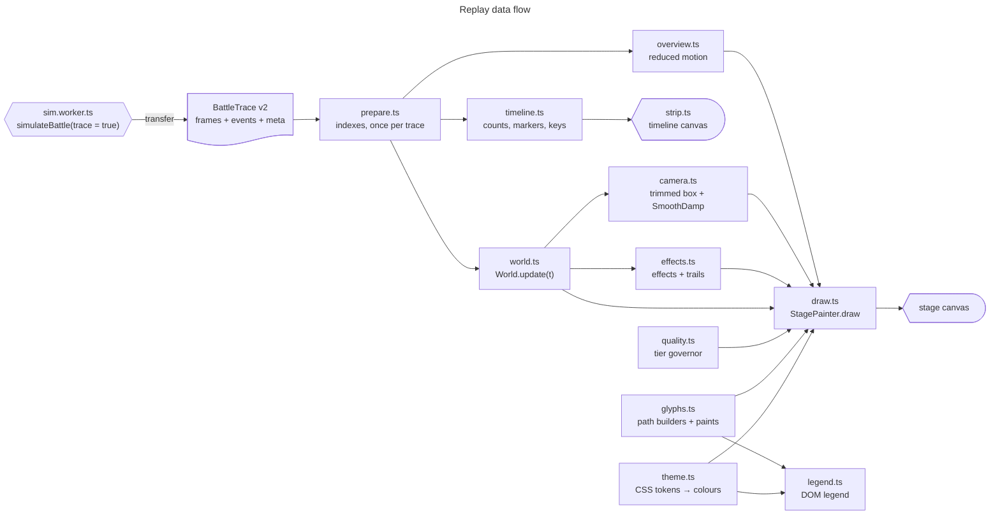

# Battle replay renderer

The replay re-simulates one battle with `trace = true` in a worker and animates it on a canvas. This document describes the renderer: how it turns a trace into positions and states at any time, the visual language, and how to extend it. The trace and its event log are specified in [MODEL.md §2.6](MODEL.md#26-replay-trace-and-event-log); the design research behind every choice is [research/ANIMATION.md](research/ANIMATION.md) (§5–6 and the acceptance criteria in §7).

**Hard rule.** Agents are abstract glyphs only: triangles, dots, diamonds, rings, arrows, crosses, wedges, lines and squares. Nothing animal-like, no faces or limbs, no blood. A kill is a grey cross.

Status (issue #26): all three stages of the rollout (ANIMATION.md §8, steps 1–5) are in place: event-exact states, Catmull-Rom motion, latched riding, the v2 glyphs, HP gauge, LOD, colour tokens and the DOM legend; the SmoothDamp camera, the cached timeline strip with event markers, skip-to-contact, event jumps, the speed table and keyboard shortcuts; event effects and trails under flash and size budgets; adaptive quality; the reduced-motion overview; and DPR tracking. Measurements below are from headless Chromium with software raster in a sandbox. Real-device checks (ANIMATION.md §7 P3) are a manual follow-up.

## Contents

- [1. Architecture](#1-architecture)
- [2. prepare()](#2-prepare)
- [3. World: states and motion](#3-world-states-and-motion)
- [4. Visual language](#4-visual-language)
- [5. Colour tokens](#5-colour-tokens)
- [6. Layers, batching and LOD](#6-layers-batching-and-lod)
- [7. Legend and notes](#7-legend-and-notes)
- [8. Camera, timeline and controls](#8-camera-timeline-and-controls)
- [9. Effects and trails](#9-effects-and-trails)
- [10. Adaptive quality](#10-adaptive-quality)
- [11. Reduced motion, accessibility and DPR](#11-reduced-motion-accessibility-and-dpr)
- [12. Tests and measurements](#12-tests-and-measurements)
- [13. How to add a glyph](#13-how-to-add-a-glyph)

## 1. Architecture

`src/ui/replay.ts` is the entry the app uses (`ReplayView`, unchanged public API: `el`, `load`, `clear`, `refresh`, `destroy`). The app loads it with `import()` when Run is pressed (or when a replay is requested), not at startup, and mounts the view into `.replay-slot` (#80). Run is a user input, so the mount right after it is not counted as a layout shift; measured CLS is the same as before (0.0169 at 1366×900, 0.0002 at 390×800, both from earlier font work). Everything else lives in `src/ui/replay/`. Only `replay.ts`, `legend.ts`, `strip.ts`, the `paintOverview` helper in `draw.ts` and `theme.ts#readReplayTheme` touch the DOM; `prepare`, `World`, `interp`, `camera`, `timeline`, `effects`, `quality`, `overview` and `glyphs` are pure and unit-tested in Node.

| Module        | Role                                                                                                                      |
| ------------- | ------------------------------------------------------------------------------------------------------------------------- |
| `replay.ts`   | `ReplayView`: controls, keyboard, rAF loop (only while playing and visible), canvas sizing and DPR, notes, announcements. |
| `prepare.ts`  | `prepare(trace)`: decodes the event log and builds per-agent indexes. Pure; allocates only here.                          |
| `world.ts`    | `World.update(t)`: every agent's position, heading, state and host at time t, into arrays allocated once. `trexPose`.     |
| `interp.ts`   | Binary searches, shortest-arc angles, centripetal Catmull-Rom (Barry–Goldman form).                                       |
| `camera.ts`   | View modes (auto trimmed box, whole arena, n× on the T-Rex centroid), `CameraRig` (SmoothDamp, log-zoom, hysteresis).     |
| `timeline.ts` | Speed table, timeline counts, event markers and stops, skip-to-contact time, scene counts, keyboard map.                  |
| `strip.ts`    | `TimelineStrip`: the cached strip canvas above the slider, pointer seeking.                                               |
| `effects.ts`  | Event effects (wedges, rings, bursts) with the flash rule and per-frame cap; trails with their budgets.                   |
| `quality.ts`  | `QualityGovernor`: adaptive quality tiers from frame timings.                                                             |
| `overview.ts` | The static whole-battle overview shown under reduced motion.                                                              |
| `glyphs.ts`   | Glyph geometry (`GLYPH`), path builders that write to any `PathSink`, and the paint table (`PAINTS`, `BUCKET_ORDER`).     |
| `draw.ts`     | `StagePainter`: arena, grid, layers, LOD squares, trails and effects, scale bar; `paintOverview`.                         |
| `theme.ts`    | Reads the `--replay-*` tokens, pre-blends translucent paints (including trail tones), contrast helpers.                   |
| `legend.ts`   | The DOM legend; each swatch is a small canvas painted by the same builders and paint table as the stage.                  |

## 2. prepare()

Runs once per trace, linear in events and agents. Measured in Node on the representative runs of the presets: 0.3 ms (10v100, 290 events), 0.2 ms (1v10), 1.2 ms (50v1000, 2,338 events), 1.2 ms (500v5000, 6,921 events), well under the 20 ms budget (ANIMATION.md P2). The browser showed no long task within 2 s of the trace arriving.

It builds, all as typed arrays:

- the decoded events (structure of arrays), plus for each bite the time since the same T-Rex's previous bite (`evGap`, used by the flash limit);
- per-tiger **state transitions** (CSR: `trOff`, `trStep`, `trState`), from `packStateAfter` in `events.ts`;
- per-tiger **latch intervals** (`liStart`, `liEnd`, host, angle, ending event), with `liRide` and `liDetach` (§3);
- for each tiger that died or left: the stamp and the position it stays at (`goneStep`, `goneX/Y`);
- T-Rex death times and the frame that holds each final pose;
- the first contact time (first bite or latch attempt), and whether the log stopped early (`reduced`, `completeTime`).

Events with a stamp after `eventsCompleteUntilStep` are ignored for states.

## 3. World: states and motion

`World.update(t)` binary-searches the frame interval [a, b] around t and fills the agent arrays. No allocation.

**States.** A tiger's state is the last transition with stamp ≤ t / dt, so a change shows at its exact event time instead of at the next 0.5 s frame. A T-Rex dies at its `HeavyDeath` time. After `completeTime` (log budget reached, ANIMATION.md C5) the state comes from frame a, or from the last event state while frame a is still before the boundary, and the note under the legend says detail is reduced from that time on.

**T-Rex motion.** Position: centripetal Catmull-Rom through frames a−1, a, b, b+1, clamped to the arena. At the first and last frame the missing neighbour is mirrored (2a − b), so the curve keeps its speed instead of easing in and out. Heading: the recorded heading, shortest-arc interpolated (a T-Rex can turn on the spot). HP: linear. A T-Rex that dies inside a frame interval moves straight to its final pose at the death time.

**Latched tigers ride their host.** Position = host's interpolated pose + (bodyRadius + packRadius) at the recorded latch angle, clamped to the arena like the engine clamps it. A tether is drawn to the host's centre. The timing follows the engine's tick order (MODEL.md §2.6, Reconstruction):

- Riding starts at `liRide` = one tick after the `Latch` event: the engine pins a tiger to its host in the tick after it latches, and on the latch tick it is still at its contact point (up to bodyRadius away from the ride position). During that tick the diamond moves onto the host along a straight line.
- Riding ends at `liDetach`. A `Throw` or a stamina `Release` happens after the latched position update, so riding lasts until the event's time; a thrown tiger is then anchored 3 m farther out on the same bearing (the one intended jump). A `Rout`, a `BiteHit` or a `Release` because the host died happens before that update, so riding ends one tick earlier and the event's tick is spent moving off.
- An interval that ends before `liRide` (latched, then bitten on the next tick) never rides; the tiger stays at its frame positions.
- An interval still open when the log stopped (C5 fallback) has no end event. It rides only while the frames confirm it: `prepare()` walks the frames after `completeTime` and records in `liFrameEnd` the last one in which the tiger is still Latched within 0.5 m of its drawn ride position. From then on the tiger leaves from that ride position on a straight line to the next frame and follows the frames, so a detach, or a re-latch onto another host or at another angle, that only the frames saw does not make it ride the stale latch (that had shown jumps of up to 40 m). The anchors that come from the log (detach, ride start, death) also hold in the frame interval that straddles `completeTime`, so the switch to frame states does not jump either.

**Free tigers** (approaching, recovering, routed) move between anchors: frame samples, plus exact anchors where a tiger leaves a host (`liDetach`), starts riding one (`liRide`), or stops for good (death or exit, at the `goneX/Y` position). With no anchor and no state change anywhere in frames a−1 … b+1 they follow the centripetal Catmull-Rom curve, otherwise a straight line between the anchors. Non-routed tigers are clamped to the arena. The heading (approach tick, rout arrow) is the curve's tangent (finite difference), or the anchor-to-anchor direction.

**Dead tigers** stay where they died: the frame position, or, if they were killed while riding, the position they were drawn at when riding ended (at most one host tick away from the engine's).

Known approximations, all within one simulation tick (0.1 s): the latch-tick move onto the host, the death mark of a tiger killed while riding, and the latch angle quantised to 1/256 turn (≤ 4 cm at the ride radius). Catmull-Rom speed varies inside a segment; the largest effect seen in the test matrix was a tiger shown at about 1.3× its frame-to-frame speed between two samples.

## 4. Visual language

Rule: **hue = side, shape = state, grey = out of the fight.** r = pack-animal radius on screen = max(2.2 px, `meta.packRadius` × scale), so the dot follows the species constant (tiger and lion 0.8 m, hyena 0.6 m, wolf 0.5 m, _Homo erectus_ 0.3 m; MODEL.md §2.7); len = heavy length = max(11 px, L × scale), where L = 7 m × (species modal `bodyRadius` / 2.5 m): exactly 7 m for T. rex, about 4.8 m for the elephant, 4.5 m for the woolly mammoth, 2.4 m for the buffalo, 2.1 m for the brown bear and 0.7 m for _Homo erectus_, so latched pack animals stay outside the triangle (`heavyLengthForRadius`). Pack animals switch to LOD squares when a reference 0.8 m radius would be below 3 px, the same zoom threshold for every species. Sizes are `GLYPH` in `glyphs.ts`.

| Entity or state    | Glyph                                            | Size                                                       | Paint                                                                    |
| ------------------ | ------------------------------------------------ | ---------------------------------------------------------- | ------------------------------------------------------------------------ |
| T-Rex, full HP     | Isosceles triangle, nose along the heading       | len long, base 0.64·len (nose 0.6·len ahead of the centre) | `--replay-heavy`; 1.25 px surface outline when ≤ 50 T-Rex or len ≥ 18 px |
| T-Rex, damaged     | Same triangle, hollow, with an HP gauge          | gauge fills tail → nose, **area = HP** (h = 1 − √(1 − HP)) | 16 % tint, 1.5 px `--replay-heavy` outline, gauge in `--replay-heavy`    |
| T-Rex, dead        | Outline triangle                                 | same                                                       | `--muted` at 60 %                                                        |
| Tiger, approaching | Dot plus heading tick                            | dot 0.8r; tick from r to 2.3r along the motion             | `--replay-pack`, tick 1.2 px                                             |
| Tiger, latched     | **Diamond** plus tether to the host's centre     | half-diagonal 1.6r                                         | `--replay-pack`, 1.2 px surface halo outside; tether 1.25 px at 85 %     |
| Tiger, recovering  | Ring                                             | radius 0.9r                                                | 1.4 px `--replay-pack`                                                   |
| Tiger, routed      | Hollow-backed chevron along the flight direction | tip 1.6r ahead, wings 0.96r back and 1.1r out, notch 0.32r | `--replay-out`                                                           |
| Tiger, dead        | ×                                                | half-size 0.8r                                             | 1.2 px `--replay-dead` at 50 %                                           |
| Tiger, left        | not drawn                                        |                                                            |                                                                          |
| Bite (event)       | Wedge: reach × ±half-arc around the biting T-Rex | per-T-Rex `meta.reach` and `meta.arc`                      | hit: fill `--replay-heavy` at 20 % + outline; miss: outline only (55 %)  |

Bite cones are timed in real seconds (hit 320 ms, miss 220 ms) so they stay readable at 16×, and follow the biting T-Rex. Flash safety (WCAG 2.3.1, ANIMATION.md §3.4): a hit is filled only if the same T-Rex's previous bite was at least 0.34 s of real time earlier (≤ 3 fills per second), at speeds up to 4×, for wedges up to 4,000 px², and while the frame's filled area stays under 20,000 CSS px². Otherwise it is an outline.

Deviations from the ANIMATION.md §6.2 sizes, chosen to pass the V1 shape test with margin (pairwise mask IoU ≤ 0.50, limit 0.6): the approach dot is 0.8r instead of r, the diamond 1.6r instead of 1.35r with its halo drawn outside the fill, and the chevron's notch sits 0.32r ahead of the centre so it no longer covers the dot's pixels. Latched diamonds are drawn above the T-Rex so riders stay visible.

## 5. Colour tokens

The replay has its own tokens in `src/ui/styles.css` (`:root` and the dark-scheme block), so the brand colours (`--c-heavy`, `--c-pack`, used by the charts, the OG cards and `src/pages/site.css`) stay unchanged. Agent colours come from the Okabe-Ito colour-blind-safe set, except the dark-theme T-Rex blue, which is the brand blue: Okabe-Ito sky blue has the same lightness as the dark-theme orange and would merge with it in greyscale.

| Token             | Light     | Dark      | Contrast vs arena (light / dark) | Use                                          |
| ----------------- | --------- | --------- | -------------------------------- | -------------------------------------------- |
| `--replay-arena`  | `#f3f2ee` | `#252523` | —                                | Arena floor, legend swatch background        |
| `--replay-grid`   | `#e4e3de` | `#30302d` | —                                | Grid lines                                   |
| `--replay-border` | `#b9b8b2` | `#4a4a46` | —                                | Arena border                                 |
| `--replay-heavy`  | `#0072b2` | `#3987e5` | 4.63 / 4.22                      | T-Rex glyphs, HP gauge, bite cones           |
| `--replay-pack`   | `#d55e00` | `#e69f00` | 3.45 / 6.82                      | Approaching, latched and recovering tigers   |
| `--replay-out`    | `#767676` | `#9a9993` | 4.05 / 5.38                      | Routed tigers                                |
| `--replay-dead`   | `#8d8c87` | `#8d8c87` | 3.01 / 4.56                      | Dead-tiger crosses, drawn at 50 % on purpose |

T-Rex vs tiger lightness contrast is 1.34 (light) and 1.62 (dark), so the sides stay apart under achromatopsia. Translucent paints (hollow tint, tether, bite outline, dead marks, LOD tones) are pre-blended over the arena once per theme (`deriveTheme`), so drawing never builds colour strings. The theme is re-read when the colour scheme changes.

## 6. Layers, batching and LOD

One stage canvas (`alpha: false`), drawn back to front:

1. Surface, arena floor, adaptive grid (10/25/50/100/250/500 m, the finest with cells ≥ 48 px), border; lines snapped to device pixels.
2. Dead tigers (×) and dead T-Rex (outlines).
3. Trails (oldest age bucket first), then tethers.
4. Tigers: routed → recovering → approaching (dot, then tick).
5. T-Rex: hollow tint → HP gauge → hollow outline → solid triangles (with halo).
6. Latched diamonds.
7. Bite cones, then effect rings and bursts (oldest alpha step first).
8. Scale bar (canvas text in `--font-sans`, Pretendard).

Each layer is one or two buckets in `BUCKET_ORDER`; every bucket is one `Path2D` per frame painted with its entry in `PAINTS`. Agents outside the view are culled. `draw()` allocates no typed arrays.

**LOD.** When r < 3 CSS px, tigers are drawn as `fillRect` squares grouped by state and snapped to device pixels (the fastest primitive on CPU raster, ANIMATION.md §3.6): side 1.6r (at least 2 device px); latched 1.2× in `--replay-pack` (drawn above the T-Rex), recovering in tiger orange at 45 %, routed 0.8× in grey at 75 %, dead as 2-device-px grey dots. Shape coding then degrades to tone and size, and a hint overlaid on the stage says so.

**Backing store.** See §11.

## 7. Legend and notes

The legend is a DOM list (translatable, crisp, CSP-safe) with labels from the `replay.*` and `state.*` i18n keys, in three groups: the heavy species, the pack species (states) and events (bite cone, latch ring, rout or death ring, throw burst, trail). Each swatch is a 30 × 18 px canvas painted by the stage's own builders and `PAINTS` on an arena-coloured background (`LEGEND_ITEMS` in `legend.ts`), so legend and stage cannot drift apart. Labels name the species of the shown results through the `{Heavy}`/`{PackPl}` placeholders (`speciesVars` in `i18n.ts`), and the app re-applies them whenever results are rendered; the glyphs keep the role colours and shapes for every species. Under it, one paragraph with three reserved lines (`min-height: 4.5em` at line-height 1.5) shows the overview notice (reduced motion) and, for a trace whose event log stopped early, from which time detail is reduced. Both only change when a trace loads, and each fits in three lines at a 360 px viewport in both languages. The LOD hint, which the auto camera can switch on and off during playback, is an overlay at the bottom of the stage (`.replay-lod`, absolutely positioned), so it never moves the page.

## 8. Camera, timeline and controls

**Camera** (`camera.ts`, ANIMATION.md §3.3). The view select has four modes: auto (follow the fight), whole arena, and 2× or 4× on the living T-Rex centroid. **F** toggles between auto and whole arena.

- Auto target: the **trimmed box** of living T-Rex plus tigers that are approaching, latched or recovering (at most 1,500 tigers, evenly strided; the 2 % outliers on each side are trimmed above 40 points), plus a 20 m margin, at least 60 m and at most the arena. The sort uses preallocated buffers, so nothing is allocated per frame.
- `CameraRig` follows the target with **SmoothDamp** (critically damped spring): 0.45 s on the centre, 0.6 s on **log(view)**, so zooming in and out feel symmetric. It uses the exact `exp(−ωΔt)` instead of the polynomial approximation, so each step is the exact solution: 30, 60 and 144 Hz agree to better than 0.1 % (tested), and it never overshoots.
- **Hysteresis**: the zoom goal only moves when the target is more than 6 % wider or 12 % narrower than the current goal.
- Seeks, scrubs and redraws while paused **snap** the camera.

**Timeline strip** (`strip.ts`, `timeline.ts`). A 40 px canvas above the slider, reserved in CSS before any trace loads. Its static part is drawn once per size and theme into an offscreen canvas; each frame only blits it and draws the playhead.

- Stacked tiger counts by state (bottom to top: dead, fled or left, latched, other fighters) and a line for the living T-Rex.
- Markers: **▼** first contact, tall blue ticks for T-Rex deaths, short grey ticks for kills and routs, and a dotted line where detail becomes reduced (§3).
- Counts come from `buildTimeline` at 480 evenly spaced times: event-exact up to the end of the event log (tested equal to `World` at every bin), from the frames after it.
- Click or drag on the strip seeks (`touch-action: pan-y` keeps vertical scrolling). The strip is `aria-hidden`; the native slider is the accessible control.

**Markers and stops** (`extractMarkers`, `eventStops`): first contact, each T-Rex death, and clusters of tiger kills and of routs. A cluster continues while the next event is within 2 s and is cut after 5 s, so a long continuous fight still gets a stop every few seconds (without the cut, 500v5000 had a single kill marker). Each marker gives a stop 1 s before it, so the event is seen happening. Markers come from the event log only, so for a trace whose log stopped early they end at the dotted reduced-detail line: kills, routs and T-Rex deaths after it are visible on the stage and in the stacked counts but get no marker or stop.

**Buttons.** **First contact** jumps to exactly `first contact − 2 s` (V8 asks for ±0.1 s) and is disabled when nothing ever met. **Previous / Next event** jump between stops and switch off when there is none in that direction. The three jump buttons switch off with `aria-disabled="true"`, not the `disabled` property: a disabled button that has focus hands focus to `<body>`, where the shortcuts stop working (WCAG 2.4.3). They stay focusable; a press while off announces "no more events". The play button is a plain button whose label says what it does (Play or Pause), without `aria-pressed`.

**Speeds.** 0.25×, 0.5×, 1×, 2× (default), 4×, 8×, 16×.

**Seeking never re-simulates**: one `World.update` and one draw (P5, §12).

**Keyboard.** Shortcuts work while focus is inside the replay, except where a key is native (Space/Enter on a button, any key on a select or the shortcuts summary). A printable ASCII `KeyboardEvent.key` decides first, so the keys follow the characters printed on AZERTY or Dvorak keyboards, as the list and `aria-keyshortcuts` advertise them; while a Korean IME is active (`key` is 'Process' or a Hangul jamo) the physical `KeyboardEvent.code` decides instead. Ctrl, Alt and Meta combinations are ignored.

| Keys                 | Action                                           |
| -------------------- | ------------------------------------------------ |
| Space, K             | Play / pause                                     |
| ← / →                | Back / forward 1 s                               |
| Shift + ← / →, J / L | Back / forward 5 s                               |
| Page Down / Page Up  | Back / forward 10 % of the battle                |
| Home / End           | Start / end                                      |
| [ / ]                | Slower / faster                                  |
| , / .                | Previous / next event                            |
| C                    | First contact (2 s before it)                    |
| F                    | Switch between the auto view and the whole arena |

On the slider, arrows, Page keys and Home/End go through the same map, so they step in seconds. The list is in a collapsed "Keyboard shortcuts" disclosure under the controls (ko/en) and is also exposed through `aria-keyshortcuts` on the buttons, selects and slider.

## 9. Effects and trails

Effects (`effects.ts`) are abstract outlines timed in **real** seconds (so they read at 16×), drawn on the agents' current positions, fading in three alpha steps (0.9, 0.6, 0.3).

| Event      | Effect                                                             | Colour           | Duration |
| ---------- | ------------------------------------------------------------------ | ---------------- | -------- |
| BiteHit    | Wedge (filled only under the flash rule) + impact ring 1.2r → 3.4r | `--replay-heavy` | 320 ms   |
| BiteMiss   | Wedge outline                                                      | `--replay-heavy` | 220 ms   |
| Latch      | Contracting ring 3.2r → 1.2r                                       | `--replay-pack`  | 280 ms   |
| Throw      | Three short rays away from the host, 4 → 14 px out                 | `--replay-heavy` | 360 ms   |
| Rout       | Expanding ring 1r → 2.5r                                           | `--replay-out`   | 300 ms   |
| PackDeath  | Expanding ring 1r → 4r                                             | `--replay-dead`  | 500 ms   |
| HeavyDeath | Expanding ring 10 → 36 px                                          | `--replay-dead`  | 900 ms   |

Kills are neutral grey rings; nothing is red or figurative. Exhausted, Resume and Release have no effect (the glyph change is the cue).

**Budgets.**

- At most **300 effects per frame**; the rest are counted as `capped` (reached at 16× on 50v1000 and 500v5000).
- **Flash rule** (`mayFill`, WCAG 2.3.1): a bite cone is filled only if the same T-Rex's previous logged bite was at least 0.34 real seconds earlier (at most 3 fill starts per second), playback is at most 4×, the wedge is at most 4,000 px², and the frame's filled area stays at most **20,000 CSS px²** (below 21,824 px², 25 % of a 341 × 256 px field). Otherwise it is an outline. At 8× and 16× nothing is filled.
- Adaptive quality can forbid fills (§10); reduced motion turns effects off.

**Trails** are drawn deterministically from the trace (no accumulation buffer, so scrubbing and camera moves never smear): a polyline from the drawn position back through the frames of the last 3 s of sim time, in three pre-blended tones (38 %, 25 %, 13 % of the side colour; tigers 0.8× that). At most 100 T-Rex trails, and at most 400 tiger trails (approaching or routed, only while the frames show the same state, only when tigers are glyphs with r ≥ 3 px).

## 10. Adaptive quality

`QualityGovernor` (`quality.ts`, ANIMATION.md §5.6) gets each frame's rAF interval and draw time and picks a tier:

| Tier | Trails           | Effects       | Backing store | Tigers                  |
| ---- | ---------------- | ------------- | ------------- | ----------------------- |
| T0   | T-Rex and tigers | fills allowed | DPR ≤ 3       | glyphs (LOD below 3 px) |
| T1   | T-Rex only       | fills allowed | DPR ≤ 3       | as T0                   |
| T2   | T-Rex only       | outlines only | DPR ≤ 2       | as T0                   |
| T3   | none             | outlines only | DPR ≤ 2       | LOD squares at any zoom |

Rules (rolling 1 s window, decided once it is at least 80 % full):

- **Cadence**: the display's own frame interval, the smallest median of a steady window (p95 within 1.1× the median) seen while drawing was cheap (p95 draw under 8 ms); 60 Hz until one is seen. A browser capping rAF at 30 fps (iOS Low Power Mode) is not treated as slow; a page slow because of its own drawing is.
- **Down** one tier after the p95 interval stayed above max(20 ms, 1.25 × cadence) for 1 s.
- **Up** one tier after the p95 interval stayed within 1.15 × cadence with p95 draw under 12 ms for 5 s.
- **Back-off**: a step down within 10 s of a step up doubles the next up-wait (max 40 s).
- The window is cleared on pause, seek and hidden page; the tier is kept.

ANIMATION.md writes the up rule as "p95 below 12 ms"; a 60 Hz rAF interval never goes below 16.7 ms, so the headroom test above is its working form.

## 11. Reduced motion, accessibility and DPR

**Reduced motion** (`prefers-reduced-motion: reduce`, read live, V6):

- A loaded replay does **not autoplay** and requests no animation frame.
- The stage shows a **static overview** (`overview.ts`) framed on every recorded T-Rex position plus 40 m: T-Rex paths (thin and lighter above 50 T-Rex, at most 100), tiger paths (at most 600, 30 % tone), latch marks (small diamonds, at most 2,000), grey crosses where tigers died, and each T-Rex's final triangle; at most 150,000 path vertices. The canvas label and the note say what it shows.
- **Play** (button, Space, or a click on the stage) still works, without trails or effects; the view defaults to whole arena. A seek also leaves the overview.
- If the setting turns on during playback, playback pauses.

**Page Visibility.** Playback **pauses** when the page is hidden; the viewer resumes with Play. Off-screen (IntersectionObserver) the rAF loop only suspends and resumes on its own.

**Accessibility.**

- Native range slider with `aria-valuetext` ("12.5초 / 31.2초", "12.5 s of 31.2 s"); while playing it updates once per whole second.
- The stage canvas has `role="img"`, `aria-describedby` → the legend, and an `aria-label` that **summarises the scene** ("12.5 s: 10 of 10 T-Rex alive. Tigers: 12 approaching, 3 latched, 0 recovering, 75 fled or gone, 10 dead"), updated on load, pause, seek, end and language change, not during playback.
- Keyboard actions are announced in a polite `role="status"` region: play/pause, new speed, new view, the scene after a jump, or "no more events".
- Clicking the stage toggles playback and focuses the play button, so shortcuts work right away.

**DPR** (V7). Backing store = `round(css × min(devicePixelRatio, cap))`, cap 3, or 2 above 2,000 agents or at quality T2/T3.

- A `ResizeObserver` with `box: 'device-pixel-content-box'` (Chromium, Firefox) reports resizes and DPR changes before paint, in the same frame; its exact size is used when it agrees with `css × dpr` within 2 px (Chromium's mobile emulation reports CSS-sized boxes, which are ignored).
- A `matchMedia('(resolution: …dppx)')` listener covers Safari.
- The stage, the strip and the note keep reserved boxes (1:1 aspect, 40 px, three lines), and the LOD hint is an overlay, so loading a trace or zooming shifts nothing. The playback clock under a minute always prints one decimal ("4.0초"), so its width does not change every half second.

**Debug counters.** With `?debug=fps`, an overlay shows fps, p95 draw time, quality tier, effects (and capped), fills, filled flash area and the most fill flashes one T-Rex started within any real second; the same counters plus replay time and last seek duration are on `window.__fx`. Without the parameter none of this exists.

## 12. Tests and measurements

| Criterion (ANIMATION.md §7) | Where                                                                                                                                                                                                                                                                                                                                                                                                                                                                                                                         |
| --------------------------- | ----------------------------------------------------------------------------------------------------------------------------------------------------------------------------------------------------------------------------------------------------------------------------------------------------------------------------------------------------------------------------------------------------------------------------------------------------------------------------------------------------------------------------- |
| V1 shape separability       | `tests/replay-glyphs.test.ts`: each tiger state rendered alone into a 32 × 32 mask by a small Node rasterizer (`tests/glyph-raster.ts`, background-coloured paint excluded) at r = 3, 4, 6, 8 px and three headings; every pairwise IoU < 0.6 (worst 0.50).                                                                                                                                                                                                                                                                   |
| V2 contrast                 | `tests/replay-theme.test.ts` parses both theme blocks of `styles.css`: every agent token ≥ 3:1 against the arena; T-Rex vs tiger ≥ 1.3:1.                                                                                                                                                                                                                                                                                                                                                                                     |
| V4 no teleports             | `tests/replay-world.test.ts` samples `World` at 60 Hz and 2× (5 px per metre) over whole battles (1v1, 1v10, 10v100, 1v100 direct, 50v1000): per-agent displacement ≤ max(4 px, 3 × that agent's median), throws exempt. The same check fails on the version 1 interpolation.                                                                                                                                                                                                                                                 |
| V5 latched riding           | Same sampling: every riding tiger is bodyRadius + packRadius from its host's centre within ±1 % (measured relative error < 1e-13), unless its ride position lies outside the arena and was clamped.                                                                                                                                                                                                                                                                                                                           |
| prepare / World             | Hand-built trace with known answers (exact state times, ride start and detach, throw anchor, never-riding latch, deaths, fallback), plus agreement with every frame sample of real traces.                                                                                                                                                                                                                                                                                                                                    |
| Camera, timeline, controls  | `tests/replay-camera.test.ts`: SmoothDamp monotone without overshoot at 24–144 Hz, 30/60/144 Hz agree within 0.1 %, rig snap, log-zoom symmetry and hysteresis, trimmed auto box. `tests/replay-timeline.test.ts`: speed table and stepping, keyboard map, stops, skip-to-contact within ±0.1 s of first contact − 2 s on real traces, markers cover every kill, rout and T-Rex death, cluster splitting, timeline counts equal `World` at every bin, frame fallback after a stopped log, overview framing and vertex budget. |
| Flash budget (V3, Node)     | `tests/replay-effects.test.ts`: the `mayFill` table, then whole battles played at 60 Hz (10v100 close view at 0.25–4×, 50v1000 auto view at 1×, 4×, 16×, 50v1000 close view at 4×): every T-Rex starts ≤ 3 fills in any real second, filled area ≤ 20,000 px² per frame, ≤ 300 effects, trail budgets kept, no fills above 4×.                                                                                                                                                                                                |
| Adaptive quality            | `tests/replay-camera.test.ts`: steps down after about 1 s of slow frames and one tier at a time, up after ≥ 5 s of headroom, a steady 30 fps cap is not "slow" but a busy 30 fps page is, flapping doubles the up-wait.                                                                                                                                                                                                                                                                                                       |

### Browser measurements (stage 3)

Headless Chromium 1280 × 900 at DPR 2 and 390 × 844 at DPR 3 (mobile emulation), **software raster in a 4-core sandbox**, production CSP injected, `vite preview` build. No console, CSP or page errors in any run. These are not real-device numbers; ANIMATION.md P3 (mid-range Android, iPhone 12-class Safari) is a manual follow-up with the `?debug=fps` overlay.

**P1 fps** (5 s at 2× from first contact − 1 s, every rAF callback timed, trails and effects on; target ≥ 58 / ≥ 55 fps, JS p95 ≤ 3 / 4 / 10 ms):

| Scenario | Profile                | View  | fps  | JS p50 / p95 / max (ms) | frames > 33 ms | quality tier |
| -------- | ---------------------- | ----- | ---- | ----------------------- | -------------- | ------------ |
| 10v100   | 1280 × 900, DPR 2      | auto  | 60.0 | 1.3 / 2.0 / 3.5         | 0              | T0           |
| 10v100   | 1280 × 900, DPR 2      | arena | 60.0 | 1.0 / 1.4 / 4.4         | 0              | T0           |
| 50v1000  | 1280 × 900, DPR 2      | auto  | 60.0 | 1.7 / 3.1 / 5.6         | 0              | T0           |
| 50v1000  | 1280 × 900, DPR 2      | arena | 60.0 | 1.4 / 2.1 / 5.7         | 0              | T0           |
| 500v5000 | 1280 × 900, DPR 2      | auto  | 58.2 | 4.9 / 8.0 / 12.0        | 0              | T0           |
| 500v5000 | 1280 × 900, DPR 2      | arena | 59.8 | 4.4 / 6.1 / 12.8        | 0              | T0           |
| 10v100   | 390 × 844, DPR 3       | auto  | 60.0 | 1.1 / 1.5 / 3.1         | 0              | T0           |
| 10v100   | 390 × 844, DPR 3       | arena | 60.0 | 1.0 / 1.3 / 4.0         | 0              | T0           |
| 500v5000 | 390 × 844, DPR 3 (→ 2) | auto  | 59.6 | 4.9 / 7.5 / 11.5        | 0              | T0           |
| 500v5000 | 390 × 844, DPR 3 (→ 2) | arena | 59.8 | 4.6 / 6.3 / 7.0         | 1              | T0           |

**P2 load.** No long task (> 50 ms) within 2 s of the trace arriving, in all five desktop and mobile scenarios above (`prepare` + `buildTimeline` + first draw). Layout shift after the trace arrived: 0.0000 (desktop) and 0.0001 (mobile); the whole run's CLS was ≤ 0.0007, all from the results panel appearing, not the replay.

**P5 seek** (30 slider `input` events at spread-out times; synchronous handler = `World.update` + draw; target < 16 ms):

| Scenario | p50 (ms) | p95 (ms) | max (ms) |
| -------- | -------- | -------- | -------- |
| 10v100   | 1.1      | 1.4      | 1.4      |
| 50v1000  | 1.9      | 2.5      | 2.6      |
| 500v5000 | 6.1      | 7.6      | 9.4      |

The next animation frame followed at 16.6–20.4 ms (vsync-aligned), so the seeked frame is on screen in the next display refresh.

**V3 flash safety** (`?debug=fps` counters, 5 s from first contact − 1 s; limits ≤ 3 fill starts per T-Rex per second, ≤ 20,000 px² per frame):

| Scenario | Speed, view | max filled px² / frame | max fills / s / T-Rex | fill starts | max effects (capped) |
| -------- | ----------- | ---------------------- | --------------------- | ----------- | -------------------- |
| 500v5000 | 16×, auto   | 0                      | 0                     | 0           | 300 (1,693)          |
| 500v5000 | 16×, arena  | 0                      | 0                     | 0           | 300 (1,693)          |
| 500v5000 | 4×, auto    | 1,823                  | 2                     | 364         | 300 (342)            |
| 500v5000 | 1×, auto    | 723                    | 1                     | 67          | 240 (0)              |
| 50v1000  | 16×, auto   | 0                      | 0                     | 0           | 300 (145)            |
| 50v1000  | 4×, auto    | 1,846                  | 2                     | 64          | 200 (0)              |
| 10v100   | 4×, auto    | 7,791                  | 2                     | 14          | 64 (0)               |
| 10v100   | 1×, auto    | 3,035                  | 1                     | 5           | 14 (0)               |

At 16× nothing is filled by design (fills stop above 4×). During the 500v5000 4× run the governor stepped to T1 (no tiger trails).

**V6 reduced motion** (`reducedMotion: 'reduce'`, 10v100 and 500v5000): 0 rAF callbacks in the 2 s after page load and 0 in the 2 s after the trace arrived; the play button stayed unpressed, the overview was drawn (170,144 and 1,438,763 non-background device pixels), the view was "whole arena". One click on Play started playback (60 rAF callbacks in the next second).

**V7 DPR** (CDP `Emulation.setDeviceMetricsOverride`, 618 CSS px stage): after changing the device scale factor 1 → 2 → 3 → 1.5 → 4 → 1, the backing store was 1236, 1854, 927, 1854 (capped at 3), 618 — equal to `round(css × min(dpr, 3))` in the first animation frame after the change, every time.

**V8 controls** (10v100, ko and en): "First contact" landed at 13.1 s for a first contact at 15.1 s (error 0). Next / previous event, every shortcut in §8 and the speed table were exercised through the keyboard with the expected time, speed, view and play state, and the live region announced them. `aria-valuetext` read "13.1초 / 31.2초" and "16.4 s of 31.2 s"; the scene label read "16.4 s: 10 of 10 T-Rex alive. Tigers: 97 approaching, 1 latched, 0 recovering, 0 fled or gone, 2 dead". All 13 legend swatches carry ink. No horizontal overflow at 390 px.

Stage 2 browser check, before trails and effects (headless Chromium, software raster, production CSP injected, `vite preview`): no console, CSP or page errors; fps measured like the prototype (5 s at 2× from first contact − 1 s, every rAF callback timed):

| Scenario | Profile                | View  | fps  | JS p50 / p95 (ms) | frames > 33 ms |
| -------- | ---------------------- | ----- | ---- | ----------------- | -------------- |
| 10v100   | 1280 × 900, DPR 2      | auto  | 59.8 | 1.1 / 1.5         | 0              |
| 10v100   | 1280 × 900, DPR 2      | arena | 60.0 | 0.8 / 1.1         | 0              |
| 10v100   | 390 × 844, DPR 3       | auto  | 60.0 | 0.9 / 1.1         | 0              |
| 500v5000 | 1280 × 900, DPR 2      | auto  | 59.8 | 4.3 / 6.5         | 0              |
| 500v5000 | 1280 × 900, DPR 2      | arena | 60.0 | 4.3 / 6.1         | 0              |
| 500v5000 | 390 × 844, DPR 3 (→ 2) | auto  | 60.0 | 4.2 / 6.4         | 0              |

## 13. How to add a glyph

1. **Geometry.** Add its sizes to `GLYPH` and a builder to `glyphs.ts` that only calls `moveTo`, `lineTo`, `arc` and `closePath` on a `PathSink`. Keep it abstract (see the hard rule above).
2. **Paint.** Add a bucket to `PAINTS` (fill or stroke, colour role, width; `alpha` only for paint that must show what is underneath) and put it in `BUCKET_ORDER` at its layer. New colours go in `REPLAY_TOKENS` / `FALLBACK_COLORS` and both theme blocks of `styles.css` (`--replay-*`), or in `BLEND` if they are a pre-blended tone of an existing token.
3. **State.** If it shows a tiger state, extend `tigerGlyph`; the stage, the legend and the V1 test all go through it. Add the state to the `STATES` list in `tests/replay-glyphs.test.ts` and keep every pairwise IoU below 0.6.
4. **Stage.** Feed it in `StagePainter.draw` (or `collectEffects` in `effects.ts` for an event effect, timed in real seconds, under the per-frame cap and, if it fills, the flash rule), and decide its LOD form.
5. **Legend.** Add a row to `LEGEND_ITEMS` with a `replay.*` (or `state.*`) key in both dictionaries (`src/i18n/ko.ts`, `src/i18n/en.ts`).
6. Check it in light and dark, and under deuteranopia, protanopia and achromatopsia emulation.
