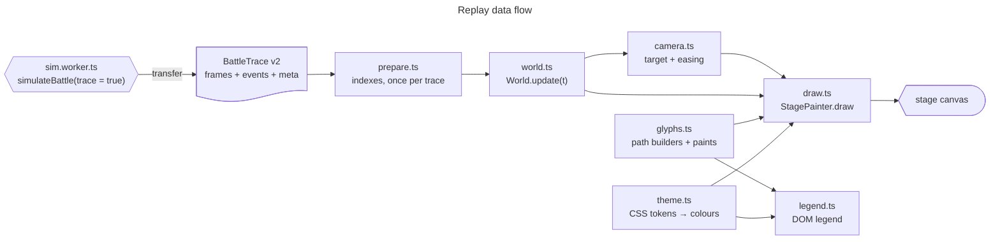

# Battle replay renderer

The replay re-simulates one battle with `trace = true` in a worker and animates it on a canvas. This document describes the renderer: how it turns a trace into positions and states at any time, the visual language, and how to extend it. The trace and its event log are specified in [MODEL.md §2.6](MODEL.md#26-replay-trace-and-event-log); the design research behind every choice is [research/ANIMATION.md](research/ANIMATION.md) (§5–6 and the acceptance criteria in §7).

**Hard rule.** Agents are abstract glyphs only: triangles, dots, diamonds, rings, arrows, crosses, wedges, lines and squares. Nothing animal-like, no faces or limbs, no blood. A kill is a grey cross.

Status (issue #26): stage 2 of the rollout (ANIMATION.md §8) is in place: event-exact states, Catmull-Rom motion, latched riding, the v2 glyphs, HP gauge, LOD, colour tokens, bite cones and the DOM legend. The camera is still the simple eased bounding box from version 1. The cached timeline, skip-to-contact and keyboard controls (stage 3), trails, the other event effects and adaptive quality (stage 4), and the reduced-motion overview and DPR test (stage 5) come later.

## Contents

- [1. Architecture](#1-architecture)
- [2. prepare()](#2-prepare)
- [3. World: states and motion](#3-world-states-and-motion)
- [4. Visual language](#4-visual-language)
- [5. Colour tokens](#5-colour-tokens)
- [6. Layers, batching and LOD](#6-layers-batching-and-lod)
- [7. Legend and notes](#7-legend-and-notes)
- [8. Tests and measurements](#8-tests-and-measurements)
- [9. How to add a glyph](#9-how-to-add-a-glyph)

## 1. Architecture

`src/ui/replay.ts` is the entry the app uses (`ReplayView`, unchanged public API: `el`, `load`, `clear`, `refresh`, `destroy`). Everything else lives in `src/ui/replay/`. Only `replay.ts`, `legend.ts` and `theme.ts#readReplayTheme` touch the DOM; `prepare`, `World`, `interp`, `camera` and `glyphs` are pure and unit-tested in Node.

| Module       | Role                                                                                                                                         |
| ------------ | -------------------------------------------------------------------------------------------------------------------------------------------- |
| `replay.ts`  | `ReplayView`: controls, rAF loop (only while playing and visible), canvas sizing and DPR, notes. Calls `prepare` on `load`.                  |
| `prepare.ts` | `prepare(trace)`: decodes the event log and builds per-agent indexes. Pure; allocates only here.                                             |
| `world.ts`   | `World.update(t)`: every agent's position, heading, state and host at time t, into arrays allocated once. `trexPose` for any T-Rex at any t. |
| `interp.ts`  | Binary searches, shortest-arc angles, centripetal Catmull-Rom (Barry–Goldman form).                                                          |
| `camera.ts`  | Zoom modes (auto bounding box, whole arena, n× on the T-Rex centroid) and frame-rate independent easing.                                     |
| `glyphs.ts`  | Glyph geometry (`GLYPH`), path builders that write to any `PathSink`, and the paint table (`PAINTS`, `BUCKET_ORDER`).                        |
| `draw.ts`    | `StagePainter`: arena, grid, layers, LOD squares, bite cones, scale bar.                                                                     |
| `theme.ts`   | Reads the `--replay-*` tokens, pre-blends translucent paints, contrast helpers.                                                              |
| `legend.ts`  | The DOM legend; each swatch is a small canvas painted by the same builders and paint table as the stage.                                     |

## 2. prepare()

Runs once per trace, linear in events and agents. Measured in Node on the representative runs of the presets: 0.3 ms (10v100, 290 events), 0.2 ms (1v10), 1.2 ms (50v1000, 2,338 events), 1.2 ms (500v5000, 6,921 events), well under the 20 ms budget (ANIMATION.md P2). The browser showed no long task within 2 s of the trace arriving.

It builds, all as typed arrays:

- the decoded events (structure of arrays), plus for each bite the time since the same T-Rex's previous bite (`evGap`, used by the flash limit);
- per-tiger **state transitions** (CSR: `trOff`, `trStep`, `trState`), from `tigerStateAfter` in `events.ts`;
- per-tiger **latch intervals** (`liStart`, `liEnd`, host, angle, ending event), with `liRide` and `liDetach` (§3);
- for each tiger that died or left: the stamp and the position it stays at (`goneStep`, `goneX/Y`);
- T-Rex death times and the frame that holds each final pose;
- the first contact time (first bite or latch attempt), and whether the log stopped early (`reduced`, `completeTime`).

Events with a stamp after `eventsCompleteUntilStep` are ignored for states.

## 3. World: states and motion

`World.update(t)` binary-searches the frame interval [a, b] around t and fills the agent arrays. No allocation.

**States.** A tiger's state is the last transition with stamp ≤ t / dt, so a change shows at its exact event time instead of at the next 0.5 s frame. A T-Rex dies at its `TrexDeath` time. After `completeTime` (log budget reached, ANIMATION.md C5) the state comes from frame a, or from the last event state while frame a is still before the boundary, and the note under the legend says detail is reduced from that time on.

**T-Rex motion.** Position: centripetal Catmull-Rom through frames a−1, a, b, b+1, clamped to the arena. At the first and last frame the missing neighbour is mirrored (2a − b), so the curve keeps its speed instead of easing in and out. Heading: the recorded heading, shortest-arc interpolated (a T-Rex can turn on the spot). HP: linear. A T-Rex that dies inside a frame interval moves straight to its final pose at the death time.

**Latched tigers ride their host.** Position = host's interpolated pose + (bodyRadius + tigerRadius) at the recorded latch angle, clamped to the arena like the engine clamps it. A tether is drawn to the host's centre. The timing follows the engine's tick order (MODEL.md §2.6, Reconstruction):

- Riding starts at `liRide` = one tick after the `Latch` event: the engine pins a tiger to its host in the tick after it latches, and on the latch tick it is still at its contact point (up to bodyRadius away from the ride position). During that tick the diamond moves onto the host along a straight line.
- Riding ends at `liDetach`. A `Throw` or a stamina `Release` happens after the latched position update, so riding lasts until the event's time; a thrown tiger is then anchored 3 m farther out on the same bearing (the one intended jump). A `Rout`, a `BiteHit` or a `Release` because the host died happens before that update, so riding ends one tick earlier and the event's tick is spent moving off.
- An interval that ends before `liRide` (latched, then bitten on the next tick) never rides; the tiger stays at its frame positions.

**Free tigers** (approaching, recovering, routed) move between anchors: frame samples, plus exact anchors where a tiger leaves a host (`liDetach`), starts riding one (`liRide`), or stops for good (death or exit, at the `goneX/Y` position). With no anchor and no state change anywhere in frames a−1 … b+1 they follow the centripetal Catmull-Rom curve, otherwise a straight line between the anchors. Non-routed tigers are clamped to the arena. The heading (approach tick, rout arrow) is the curve's tangent (finite difference), or the anchor-to-anchor direction.

**Dead tigers** stay where they died: the frame position, or, if they were killed while riding, the position they were drawn at when riding ended (at most one host tick away from the engine's).

Known approximations, all within one simulation tick (0.1 s): the latch-tick move onto the host, the death mark of a tiger killed while riding, and the latch angle quantised to 1/256 turn (≤ 4 cm at the ride radius). Catmull-Rom speed varies inside a segment; the largest effect seen in the test matrix was a tiger shown at about 1.3× its frame-to-frame speed between two samples.

## 4. Visual language

Rule: **hue = side, shape = state, grey = out of the fight.** r = tiger radius on screen = max(2.2 px, 0.8 m × scale); len = T-Rex length = max(11 px, 7 m × scale). Sizes are `GLYPH` in `glyphs.ts`.

| Entity or state    | Glyph                                            | Size                                                       | Paint                                                                   |
| ------------------ | ------------------------------------------------ | ---------------------------------------------------------- | ----------------------------------------------------------------------- |
| T-Rex, full HP     | Isosceles triangle, nose along the heading       | len long, base 0.64·len (nose 0.6·len ahead of the centre) | `--replay-trex`; 1.25 px surface outline when ≤ 50 T-Rex or len ≥ 18 px |
| T-Rex, damaged     | Same triangle, hollow, with an HP gauge          | gauge fills tail → nose, **area = HP** (h = 1 − √(1 − HP)) | 16 % tint, 1.5 px `--replay-trex` outline, gauge in `--replay-trex`     |
| T-Rex, dead        | Outline triangle                                 | same                                                       | `--muted` at 60 %                                                       |
| Tiger, approaching | Dot plus heading tick                            | dot 0.8r; tick from r to 2.3r along the motion             | `--replay-tiger`, tick 1.2 px                                           |
| Tiger, latched     | **Diamond** plus tether to the host's centre     | half-diagonal 1.6r                                         | `--replay-tiger`, 1.2 px surface halo outside; tether 1.25 px at 85 %   |
| Tiger, recovering  | Ring                                             | radius 0.9r                                                | 1.4 px `--replay-tiger`                                                 |
| Tiger, routed      | Hollow-backed chevron along the flight direction | tip 1.6r ahead, wings 0.96r back and 1.1r out, notch 0.32r | `--replay-out`                                                          |
| Tiger, dead        | ×                                                | half-size 0.8r                                             | 1.2 px `--replay-dead` at 50 %                                          |
| Tiger, left        | not drawn                                        |                                                            |                                                                         |
| Bite (event)       | Wedge: reach × ±half-arc around the biting T-Rex | per-T-Rex `meta.reach` and `meta.arc`                      | hit: fill `--replay-trex` at 20 % + outline; miss: outline only (55 %)  |

Bite cones are timed in real seconds (hit 320 ms, miss 220 ms) so they stay readable at 16×, and follow the biting T-Rex. Flash safety (WCAG 2.3.1, ANIMATION.md §3.4): a hit is filled only if the same T-Rex's previous bite was at least 0.34 s of real time earlier (≤ 3 fills per second), at speeds up to 4×, for wedges up to 4,000 px², and while the frame's filled area stays under 20,000 CSS px². Otherwise it is an outline.

Deviations from the ANIMATION.md §6.2 sizes, chosen to pass the V1 shape test with margin (pairwise mask IoU ≤ 0.50, limit 0.6): the approach dot is 0.8r instead of r, the diamond 1.6r instead of 1.35r with its halo drawn outside the fill, and the chevron's notch sits 0.32r ahead of the centre so it no longer covers the dot's pixels. Latched diamonds are drawn above the T-Rex so riders stay visible.

## 5. Colour tokens

The replay has its own tokens in `src/ui/styles.css` (`:root` and the dark-scheme block), so the brand colours (`--c-trex`, `--c-tiger`, used by the charts, the OG cards and `src/pages/site.css`) stay unchanged. Agent colours come from the Okabe-Ito colour-blind-safe set, except the dark-theme T-Rex blue, which is the brand blue: Okabe-Ito sky blue has the same lightness as the dark-theme orange and would merge with it in greyscale.

| Token             | Light     | Dark      | Contrast vs arena (light / dark) | Use                                          |
| ----------------- | --------- | --------- | -------------------------------- | -------------------------------------------- |
| `--replay-arena`  | `#f3f2ee` | `#252523` | —                                | Arena floor, legend swatch background        |
| `--replay-grid`   | `#e4e3de` | `#30302d` | —                                | Grid lines                                   |
| `--replay-border` | `#b9b8b2` | `#4a4a46` | —                                | Arena border                                 |
| `--replay-trex`   | `#0072b2` | `#3987e5` | 4.63 / 4.22                      | T-Rex glyphs, HP gauge, bite cones           |
| `--replay-tiger`  | `#d55e00` | `#e69f00` | 3.45 / 6.82                      | Approaching, latched and recovering tigers   |
| `--replay-out`    | `#767676` | `#9a9993` | 4.05 / 5.38                      | Routed tigers                                |
| `--replay-dead`   | `#8d8c87` | `#8d8c87` | 3.01 / 4.56                      | Dead-tiger crosses, drawn at 50 % on purpose |

T-Rex vs tiger lightness contrast is 1.34 (light) and 1.62 (dark), so the sides stay apart under achromatopsia. Translucent paints (hollow tint, tether, bite outline, dead marks, LOD tones) are pre-blended over the arena once per theme (`deriveTheme`), so drawing never builds colour strings. The theme is re-read when the colour scheme changes.

## 6. Layers, batching and LOD

One stage canvas (`alpha: false`), drawn back to front:

1. Surface, arena floor, adaptive grid (10/25/50/100/250/500 m, the finest with cells ≥ 48 px), border; lines snapped to device pixels.
2. Dead tigers (×) and dead T-Rex (outlines).
3. Tethers.
4. Tigers: routed → recovering → approaching (dot, then tick).
5. T-Rex: hollow tint → HP gauge → hollow outline → solid triangles (with halo).
6. Latched diamonds.
7. Bite cones.
8. Scale bar (canvas text in `--font-sans`, Pretendard).

Each layer is one or two buckets in `BUCKET_ORDER`; every bucket is one `Path2D` per frame painted with its entry in `PAINTS`. Agents outside the view are culled. `draw()` allocates no typed arrays.

**LOD.** When r < 3 CSS px, tigers are drawn as `fillRect` squares grouped by state and snapped to device pixels (the fastest primitive on CPU raster, ANIMATION.md §3.6): side 1.6r (at least 2 device px); latched 1.2× in `--replay-tiger` (drawn above the T-Rex), recovering in tiger orange at 45 %, routed 0.8× in grey at 75 %, dead as 2-device-px grey dots. Shape coding then degrades to tone and size, and the note under the legend says so.

**Backing store.** `round(css × min(devicePixelRatio, cap))` with cap 3, or 2 when the battle has more than 2,000 agents (raster cost grows about 1.4× from DPR 2 to 3). A `matchMedia('(resolution: …dppx)')` listener redraws on zoom or a move to another screen. The stage keeps its 1:1 aspect ratio, so nothing shifts when a trace loads.

## 7. Legend and notes

The legend is a DOM list (translatable, crisp, CSP-safe) with labels from the `replay.*` and `state.*` i18n keys. Each swatch is a 30 × 18 px canvas painted by the stage's own builders and `PAINTS` on an arena-coloured background (`LEGEND_ITEMS` in `legend.ts`), so legend and stage cannot drift apart. Under it, one paragraph with two reserved lines shows the LOD hint and, for a trace whose event log stopped early, from which time detail is reduced; reserving the space keeps the page from shifting when a note appears.

## 8. Tests and measurements

| Criterion (ANIMATION.md §7) | Where                                                                                                                                                                                                                                                                         |
| --------------------------- | ----------------------------------------------------------------------------------------------------------------------------------------------------------------------------------------------------------------------------------------------------------------------------- |
| V1 shape separability       | `tests/replay-glyphs.test.ts`: each tiger state rendered alone into a 32 × 32 mask by a small Node rasterizer (`tests/glyph-raster.ts`, background-coloured paint excluded) at r = 3, 4, 6, 8 px and three headings; every pairwise IoU < 0.6 (worst 0.50).                   |
| V2 contrast                 | `tests/replay-theme.test.ts` parses both theme blocks of `styles.css`: every agent token ≥ 3:1 against the arena; T-Rex vs tiger ≥ 1.3:1.                                                                                                                                     |
| V4 no teleports             | `tests/replay-world.test.ts` samples `World` at 60 Hz and 2× (5 px per metre) over whole battles (1v1, 1v10, 10v100, 1v100 direct, 50v1000): per-agent displacement ≤ max(4 px, 3 × that agent's median), throws exempt. The same check fails on the version 1 interpolation. |
| V5 latched riding           | Same sampling: every riding tiger is bodyRadius + tigerRadius from its host's centre within ±1 % (measured relative error < 1e-13), unless its ride position lies outside the arena and was clamped.                                                                          |
| prepare / World             | Hand-built trace with known answers (exact state times, ride start and detach, throw anchor, never-riding latch, deaths, fallback), plus agreement with every frame sample of real traces.                                                                                    |

Browser check (headless Chromium, software raster, production CSP injected, `vite preview`): no console, CSP or page errors; fps measured like the prototype (5 s at 2× from first contact − 1 s, every rAF callback timed):

| Scenario | Profile                | View  | fps  | JS p50 / p95 (ms) | frames > 33 ms |
| -------- | ---------------------- | ----- | ---- | ----------------- | -------------- |
| 10v100   | 1280 × 900, DPR 2      | auto  | 59.8 | 1.1 / 1.5         | 0              |
| 10v100   | 1280 × 900, DPR 2      | arena | 60.0 | 0.8 / 1.1         | 0              |
| 10v100   | 390 × 844, DPR 3       | auto  | 60.0 | 0.9 / 1.1         | 0              |
| 500v5000 | 1280 × 900, DPR 2      | auto  | 59.8 | 4.3 / 6.5         | 0              |
| 500v5000 | 1280 × 900, DPR 2      | arena | 60.0 | 4.3 / 6.1         | 0              |
| 500v5000 | 390 × 844, DPR 3 (→ 2) | auto  | 60.0 | 4.2 / 6.4         | 0              |

## 9. How to add a glyph

1. **Geometry.** Add its sizes to `GLYPH` and a builder to `glyphs.ts` that only calls `moveTo`, `lineTo`, `arc` and `closePath` on a `PathSink`. Keep it abstract (see the hard rule above).
2. **Paint.** Add a bucket to `PAINTS` (fill or stroke, colour role, width; `alpha` only for paint that must show what is underneath) and put it in `BUCKET_ORDER` at its layer. New colours go in `REPLAY_TOKENS` / `FALLBACK_COLORS` and both theme blocks of `styles.css` (`--replay-*`), or in `BLEND` if they are a pre-blended tone of an existing token.
3. **State.** If it shows a tiger state, extend `tigerGlyph`; the stage, the legend and the V1 test all go through it. Add the state to the `STATES` list in `tests/replay-glyphs.test.ts` and keep every pairwise IoU below 0.6.
4. **Stage.** Feed it in `StagePainter.draw` (or `collectBites` for an event effect, timed in real seconds and counted against the flash limits), and decide its LOD form.
5. **Legend.** Add a row to `LEGEND_ITEMS` with a `replay.*` (or `state.*`) key in both dictionaries of `src/ui/i18n.ts`.
6. Check it in light and dark, and under deuteranopia, protanopia and achromatopsia emulation.
