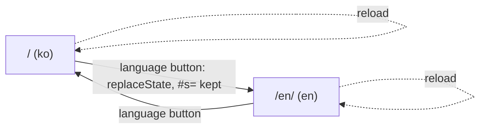
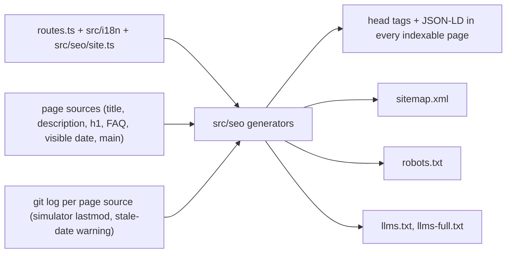

# SEO, AI answers and the site shell

> **한국어 요약**
>
> - 언어마다 별도 URL을 씁니다. 시뮬레이터는 한국어 `/`, 영어 `/en/`이고 안내 페이지는 `/<page>/`, `/en/<page>/`입니다. 언어는 URL이 정하며 저장하지 않고, 브라우저 언어로 자동 이동시키지 않습니다.
> - 사이트 이름은 한국어 **티렉스 대 호랑이**, 영어 **T-Rex vs Tiger**로 통일합니다(한국어 별칭 "티라노사우루스 vs 호랑이").
> - 페이지 원본 HTML에는 제목·설명·아이콘·매니페스트 링크만 직접 씁니다. canonical, hreflang(`x-default`는 **영어**), Open Graph(언어별 1200×630 카드), Twitter `summary_large_image`, JSON-LD는 빌드할 때 `vite.seo.ts`가 하나의 레지스트리와 각 페이지 본문에서 만들어 넣습니다. FAQPage는 화면에 보이는 FAQ가 있는 페이지(`/`, `/en/`, 사용 방법)에만, 보이는 문장 그대로 넣습니다.
> - `sitemap.xml`, `robots.txt`, `llms.txt`, `llms-full.txt`도 빌드 때 생성합니다. 안내 페이지의 `lastmod`와 JSON-LD `dateModified`는 화면에 보이는 "최종 수정" 날짜 그 자체이고, 날짜를 표시하지 않는 시뮬레이터만 원본을 마지막으로 바꾼 커밋 날짜를 씁니다. 날짜를 올리지 않고 페이지를 커밋하면 빌드가 경고합니다. Cloudflare Pages는 깊이 1로 클론하므로 빌드가 먼저 `git fetch --unshallow`를 실행합니다.
> - 시뮬레이터 페이지도 정적 HTML에 `<h1>`과 다른 언어 링크를 담고 있어, JavaScript를 실행하지 않는 크롤러도 제목을 읽습니다. 안내 페이지에는 JSON-LD와 같은 이동 경로(breadcrumb)를 화면에 표시합니다.
> - 알 수 없는 주소는 `404.html`(영어 경로는 `en/404.html`)이 상태 코드 404로 응답합니다.
> - 릴리스가 나오면 IndexNow 워크플로가 프로덕션에 새 버전이 올라온 것을 확인한 뒤 사이트맵의 URL을 제출합니다.
> - 대시보드에서만 할 수 있는 일(Cloudflare AI 봇 정책, Search Console, 네이버, 다음, Bing)은 [소유자 작업](#owner-actions)에 정리했습니다.

The research behind these decisions, with sources, is [docs/research/SEO_GEO.md](research/SEO_GEO.md) (cited below as SEO_GEO §n). This document records what the site implements and how it is tested: issues [#28](https://github.com/VinylStage/trex_vs_tiger_sim/issues/28) (site shell, sitemap) and [#30](https://github.com/VinylStage/trex_vs_tiger_sim/issues/30) (SEO, AIEO, GEO).

## Contents

- [URLs and languages](#urls-and-languages)
- [Names](#names)
- [Titles and descriptions](#titles-and-descriptions)
- [Crawlable content on the simulator pages](#crawlable-content-on-the-simulator-pages)
- [Footer and owner links](#footer-and-owner-links)
- [How the SEO files are generated](#how-the-seo-files-are-generated)
- [Head tags](#head-tags)
- [Structured data (JSON-LD)](#structured-data-json-ld)
- [Sitemap and lastmod](#sitemap-and-lastmod)
- [robots.txt](#robotstxt)
- [llms.txt and llms-full.txt](#llmstxt-and-llms-fulltxt)
- [404 pages](#404-pages)
- [IndexNow](#indexnow)
- [Validation checklist](#validation-checklist)
- [Owner actions](#owner-actions)
- [Tests](#tests)

## URLs and languages

| Page       | Korean         | English           |
| ---------- | -------------- | ----------------- |
| Simulator  | `/`            | `/en/`            |
| Guide      | `/guide/`      | `/en/guide/`      |
| Model      | `/model/`      | `/en/model/`      |
| Parameters | `/parameters/` | `/en/parameters/` |
| About      | `/about/`      | `/en/about/`      |
| Privacy    | `/privacy/`    | `/en/privacy/`    |
| License    | `/license/`    | `/en/license/`    |
| Not found  | `/404.html`    | `/en/404.html`    |

- One URL per language (SEO_GEO §1.1): Googlebot sends no `Accept-Language` and ignores cookies and storage, so a single URL that switches language client-side cannot be targeted. Each file has a static `<html lang>`.
- The app takes its language from the URL (`pageLang` in `src/pages/routes.ts`), never from storage, and never redirects by browser language.
- The language button switches in place and rewrites the URL to the counterpart (`/#s=…` ↔ `/en/#s=…`), keeping the scenario fragment. Details: [PAGES.md](PAGES.md#url-scheme-and-languages).
- The shared scenario stays in the fragment (`#s=…`), which search engines ignore, so `/` and `/en/` remain the canonical pages for every scenario. `?tour=1` is canonicalised to the page without it.



## Names

| Where                                    | Korean                                                                  | English                                                     |
| ---------------------------------------- | ----------------------------------------------------------------------- | ----------------------------------------------------------- |
| Site name (`og:site_name`, header brand) | 티렉스 대 호랑이 (`app.shortTitle`)                                     | T-Rex vs Tiger (`app.shortTitle`)                           |
| App heading (`h1`), WebApplication name  | 티렉스 대 호랑이 시뮬레이터 (`app.title`)                               | T-Rex vs Tiger Simulator (`app.title`)                      |
| Tagline                                  | 티라노사우루스 vs 호랑이 · 몬테카를로 방법으로 배우는 교육용 시뮬레이션 | Tyrannosaurus rex vs tigers · learn the Monte Carlo method… |
| `WebSite` JSON-LD (one node, all pages)  | name 티렉스 대 호랑이                                                   | alternateName T-Rex vs Tiger, 티라노사우루스 vs 호랑이      |

The web app manifest uses 티렉스 대 호랑이 ([BRANDING.md](BRANDING.md)). The `llms.txt` H1 is "티렉스 대 호랑이 (T-Rex vs Tiger)".

## Titles and descriptions

Pattern: `<topic> – <site name>`. Titles are at most 60 characters, descriptions 50–165 characters, every one unique; English titles are shorter. They are written once, in each page's own `<title>` and `<meta name="description">`; `og:title`, `twitter:title`, `og:description`, `twitter:description`, the JSON-LD `name`/`description`, `llms.txt` and `llms-full.txt` are all read from there at build time.

| Page        | Korean title                                                         | English title                                               |
| ----------- | -------------------------------------------------------------------- | ----------------------------------------------------------- |
| `/`, `/en/` | 티렉스 대 호랑이 시뮬레이터 – 티라노사우루스 vs 호랑이, 누가 이길까? | T-Rex vs Tiger Simulator – who wins, T. rex or tigers?      |
| guide       | 사용 방법: 단계별 가이드와 튜토리얼 – 티렉스 대 호랑이               | How to use the simulator – T-Rex vs Tiger                   |
| model       | 모델 설명: 몬테카를로 에이전트 기반 전투 모델 – 티렉스 대 호랑이     | Model explained (Monte Carlo, agent-based) – T-Rex vs Tiger |
| parameters  | 파라미터와 출처: 22개 능력치와 시나리오 설정 – 티렉스 대 호랑이      | Parameters and sources – T-Rex vs Tiger                     |
| about       | 소개 · 문의: 오픈 소스 교육용 시뮬레이터 – 티렉스 대 호랑이          | About and contact – T-Rex vs Tiger                          |
| privacy     | 개인정보처리방침 – 티렉스 대 호랑이                                  | Privacy policy – T-Rex vs Tiger                             |
| license     | 라이선스: MIT와 오픈 소스 고지 – 티렉스 대 호랑이                    | License (MIT) and notices – T-Rex vs Tiger                  |
| 404         | 페이지를 찾을 수 없습니다 (404) – 티렉스 대 호랑이                   | Page not found (404) – T-Rex vs Tiger                       |

The simulator's `<title>` is also the dictionary string `app.documentTitle`; the app sets `document.title` from it, so the rendered title Google indexes equals the static one.

## Crawlable content on the simulator pages

AI crawlers such as GPTBot and ClaudeBot do not run JavaScript, and Naver indexes the static HTML first (SEO_GEO §1.5).

- **Static header inside `#app`.** `<header class="app-header app-static-head">` holds the logo, the page's only `<h1>` (`app.title`, 티렉스 대 호랑이 시뮬레이터 / T-Rex vs Tiger Simulator) and a link to the other language (`<a data-lang-switch hreflang lang>`, text `lang.switch`). It uses the app header's own classes, so it looks like the header before the app mounts. `startApp` moves that `<h1>` element into its header and removes the rest; the language button replaces the link. Without JavaScript `#app` loses its viewport-high reservation and shows just this header, followed by the `<noscript>` note.
- **Outside `#app`**, `/` and `/en/` carry an answer-first intro (what, how in four steps, what you learn, links to the guide, the model's preliminary results, the parameters and the tour), a visible FAQ with four questions, and the site footer. The intro states no simulation results; the one number it states (22 parameters) is pinned to `PARAMS.length` by a test. Wording follows the content framing rules in [CONTRIBUTING.md](../CONTRIBUTING.md#content-framing-rules). Layout and CLS: [PAGES.md](PAGES.md#the-simulator-pages--en).

## Footer and owner links

Every page links, in static HTML: about, privacy, license, the source code, the blog (`https://vinylims.com`) and Linktree (`https://link.vinylims.com`), plus the release notes with the running version. Blog and Linktree carry `rel="me noopener"`. The registry is `FOOTER_LINKS` in `src/pages/routes.ts`. The same three profiles are the `sameAs` of the `Person` node.

## How the SEO files are generated

Everything below is produced by one Vite plugin, `vite.seo.ts` (`trexsim:seo`), from pure generators in `src/seo/`. Nothing is hand-maintained twice.

| Source of truth            | What it provides                                                                                |
| -------------------------- | ----------------------------------------------------------------------------------------------- |
| `src/pages/routes.ts`      | Page ids, URLs (`canonicalUrl`), `SITE_ORIGIN`, `NAV_LABEL_KEYS`, owner URLs                    |
| `src/i18n/dictionaries.ts` | Site names, page short names (breadcrumbs, `llms.txt`), the disclaimer                          |
| each page's HTML           | `<title>`, meta description, `<h1>` (article headline), visible FAQ, main text                  |
| `src/seo/site.ts`          | Indexable pages, x-default language, OG images and alt texts, Person, schema types, topics      |
| each page's HTML           | Visible "last updated" date (`<p class="page-meta"><time datetime>`): `dateModified`, `lastmod` |
| git history                | `lastmod` of the simulator pages (no visible date); stale-date warning on content pages         |
| `package.json`             | `softwareVersion`                                                                               |

| File                 | Role                                                                                                                                         |
| -------------------- | -------------------------------------------------------------------------------------------------------------------------------------------- |
| `src/seo/html.ts`    | Tiny HTML readers (entities, visible text, first element, meta content)                                                                      |
| `src/seo/extract.ts` | `extractPageFacts`: title, description, h1, FAQ items, visible update date (`extractUpdated`)                                                |
| `src/seo/head.ts`    | `headTags`, `structuredData`, `injectHead` (inserts the block after `</title>`)                                                              |
| `src/seo/sitemap.ts` | `sitemapXml(lastmod)`, `pageLastmod` (visible date, else git), `visibleDateIsStale`                                                          |
| `src/seo/robots.ts`  | `robotsTxt()`, the named crawlers, disallowed paths, Daum line                                                                               |
| `src/seo/llms.ts`    | `llmsTxt`, `llmsFullTxt`, `htmlToText`                                                                                                       |
| `vite.seo.ts`        | Plugin: `transformIndexHtml` (order `post`, also in dev), `generateBundle` (emits the text files, fixes 404 URLs), git dates, dev middleware |



In `npm run dev` the same head is injected and the four text files are served by a middleware, so `http://localhost:5173/sitemap.xml` works.

## Head tags

Generated for every indexable page (the 14 URLs in the sitemap), inserted right after `</title>`:

| Tag                                                                                          | Value                                                                                                            |
| -------------------------------------------------------------------------------------------- | ---------------------------------------------------------------------------------------------------------------- |
| `link rel="canonical"`                                                                       | Absolute production URL of the page itself                                                                       |
| `link rel="alternate" hreflang="ko" / "en" / "x-default"`                                    | Both language URLs; `x-default` = the **English** URL (SEO_GEO §1.4)                                             |
| `og:type`                                                                                    | `website` on `/`, `/en/`; `article` on content pages                                                             |
| `og:site_name`, `og:locale`, `og:locale:alternate`                                           | 티렉스 대 호랑이 / T-Rex vs Tiger; `ko_KR` / `en_US` and the other one                                           |
| `og:url`, `og:title`, `og:description`                                                       | Canonical URL, the page's `<title>` and description                                                              |
| `og:image`, `og:image:type`, `og:image:width`, `og:image:height`, `og:image:alt`             | `https://trex-vs-tiger.vinylims.com/og-image-ko.png` or `-en.png`, `image/png`, 1200, 630, alt text per language |
| `twitter:card`, `twitter:title`, `twitter:description`, `twitter:image`, `twitter:image:alt` | `summary_large_image` and the same values                                                                        |
| `meta name="naver-site-verification"`, `msvalidate.01`                                       | Only on `/`, only when set in `SITE_VERIFICATION` ([owner actions](#owner-actions))                              |
| `script type="application/ld+json"`                                                          | One JSON-LD graph, see below                                                                                     |

Static in each source (not generated, checked by `tests/pages.test.ts`): charset, viewport, title, description, `color-scheme`, two `theme-color`s, `link rel="icon"` (`/favicon.svg`), `link rel="apple-touch-icon"` (`/apple-touch-icon.png`), `link rel="manifest"` (`/site.webmanifest`). The 404 pages and `/reset/` get no generated tags.

If the OG image changes, give it a new file name: Facebook and Kakao cache by image URL (SEO_GEO §3.3).

## Structured data (JSON-LD)

One `<script type="application/ld+json">` per indexable page with an `@graph`:

| Node                    | Pages                       | Content                                                                                                                                                                                                                                                                                                                                                             |
| ----------------------- | --------------------------- | ------------------------------------------------------------------------------------------------------------------------------------------------------------------------------------------------------------------------------------------------------------------------------------------------------------------------------------------------------------------- |
| `WebSite`               | all                         | `@id` `…/#website`, url `/`, name 티렉스 대 호랑이, alternateName [T-Rex vs Tiger, 티라노사우루스 vs 호랑이], inLanguage [ko, en], publisher → Person                                                                                                                                                                                                               |
| `Person`                | all                         | `@id` `https://link.vinylims.com/#person`, name VinylStage, url `https://github.com/VinylStage`, sameAs Linktree, blog, GitHub                                                                                                                                                                                                                                      |
| `WebApplication`        | `/`, `/en/`                 | name/alternateName, url, description, inLanguage, applicationCategory `EducationalApplication`, applicationSubCategory `Simulation`, operatingSystem `Any`, browserRequirements, `isAccessibleForFree`, offers price 0 (KRW/USD), softwareVersion, license page, image, `about` Wikidata topics (Tyrannosaurus, Tiger, Monte Carlo method). **No** rating or review |
| `TechArticle`           | guide, model, parameters    | headline = the page's `<h1>`, name = title, description, inLanguage, image, author (Person with name and url), publisher, isPartOf WebSite, about → the app, `mainEntityOfPage`, `dateModified` (the page's visible "last updated" date, the same value as its `lastmod`)                                                                                           |
| `AboutPage` / `WebPage` | about / privacy, license    | Same properties as the article node; an article type would misdescribe a privacy policy or a license text                                                                                                                                                                                                                                                           |
| `BreadcrumbList`        | every content page          | 1 = site short name → the app of that language, 2 = the page's nav label → the page. The page shows the same trail above its `<h1>` (`<nav class="eyebrow breadcrumb">`, tested against this node)                                                                                                                                                                  |
| `FAQPage`               | `/`, `/en/`, guide (ko, en) | Only where a visible `<section id="faq">` exists. Questions = its `<h3>`s, answers = the visible text up to the next `<h3>`, character for character. Google no longer shows FAQ rich results (SEO_GEO §2.1); the value is for other consumers                                                                                                                      |

CSP: a `<script>` whose type is not JavaScript is a data block and is never executed, so `script-src 'self'` does not apply and no hash or nonce is needed (SEO_GEO §2.2, verified in Chromium; the browser check below shows zero CSP violations). `jsonForScript` writes `<`, `>`, `&` as `<` etc., so the JSON can never contain `</script`. `tests/seo.test.ts` fails on any other inline script.

## Sitemap and lastmod

`/sitemap.xml` lists every indexable URL: 7 pages × 2 languages, never `/reset/` or a 404 page. Each `<url>` has its three `xhtml:link` alternates (x-default = English) and, when known, `<lastmod>`. No `<priority>`/`<changefreq>` (Google ignores them).

**lastmod.** One date per page, shared by the sitemap `<lastmod>`, the JSON-LD `dateModified` and `llms-full.txt` (`pageLastmod` in `src/seo/sitemap.ts`), so structured data always matches what the reader sees:

- **Content pages:** the visible "최종 수정 / Last updated" (privacy: "시행일 / Effective") date, read from the `datetime` of the `<time>` in `<p class="page-meta">` (`extractUpdated`; a malformed value fails the build). Every content page must show one (`tests/seo.test.ts`). Bump it by hand when the content changes, in both languages.
- **Stale-date warning:** when a content page's source was committed on a later calendar day than its visible date, the build prints `<file>: committed … but shows "last updated" …` (`visibleDateIsStale`). Markup-only commits can ignore it; content changes should bump the date.
- **Simulator pages** (`/`, `/en/`), which show no date: the git date below. They have no `dateModified` (WebApplication carries `softwareVersion` instead).

The git date is the committer date (ISO 8601) of the last commit that touched the page's source file (`index.html`, `en/index.html`), via `git log -1 --format=%cI -- <file>`. It is omitted when git cannot tell:

- no git repository;
- the file has uncommitted changes (local builds of a dirty tree);
- the commit found is a **shallow-clone boundary**: in a shallow clone the oldest commit looks as if it added every file, so its date says nothing.

**Cloudflare Pages history (measured on the branch preview, 2026-10-20):** the build runs with `CF_PAGES=1` in a **depth-1 clone** (`git rev-parse --is-shallow-repository` = true, `git rev-list --count HEAD` = 1, the shallow boundary = HEAD), git 2.34.1. Without help every page would have looked changed at HEAD, so lastmod was omitted everywhere. The plugin therefore runs `git fetch --quiet --unshallow origin` first when `CF_PAGES=1` (`deepen` option in `vite.config.ts`, 2 min timeout). On the preview this worked (history 22 commits afterwards). If the fetch fails, the simulator's lastmod is omitted rather than guessed and the stale-date warning is skipped; the build log line `[plugin trexsim:seo] lastmod for N/14 pages (12 from the visible date, 2 from git; git: …, shallow: …, unshallow: done|failed)` shows which case happened. The fetch never runs on a developer machine or in CI.

Caveat: for the simulator a commit that changes only markup also moves its date. That is accurate for "last modified" of the HTML, and the simulator shows no date that could contradict it.

## robots.txt

Generated by `src/seo/robots.ts`:

```text
# https://trex-vs-tiger.vinylims.com/robots.txt
# All content is public. …
User-agent: *
User-agent: Googlebot
User-agent: Google-Extended
… (19 named crawlers)
Content-Signal: search=yes, ai-input=yes, ai-train=yes
Allow: /
Disallow: /reset/

Sitemap: https://trex-vs-tiger.vinylims.com/sitemap.xml
```

- One group: `*` plus the search and AI crawlers of SEO_GEO §5.6 (Googlebot, Google-Extended, Bingbot, Yeti, Daum, DuckDuckBot, Applebot, Applebot-Extended, OAI-SearchBot, ChatGPT-User, GPTBot, Claude-SearchBot, Claude-User, ClaudeBot, PerplexityBot, Perplexity-User, Amazonbot, meta-externalagent, CCBot). Listing them in the `*` group changes nothing for them (RFC 9309 groups) but states the policy and keeps them on the same rules if a bot-specific group is ever added.
- `Content-Signal` is Cloudflare's vocabulary for search / AI input / AI training preferences. Google's robots.txt report may show it as "not understood"; that has no effect.
- `/reset/` is a cache-clearing utility page (noindex); nothing else is disallowed.
- Pages serves `.txt` as `text/plain; charset=utf-8` (checked on the preview), so Korean text and Naver's "robots.txt must be plain text" rule are fine without a `_headers` rule.
- The robots policy must match the Cloudflare edge settings ([owner actions](#owner-actions)); otherwise crawlers get 403 while robots.txt says "allowed".

## llms.txt and llms-full.txt

- `/llms.txt` (llmstxt.org format): H1 site name; a blockquote with the Korean and English simulator descriptions; notes (the disclaimer in both languages, "runs in your browser", author and source, a pointer to `llms-full.txt`); then `## 한국어 페이지` and `## English pages`, each linking all 7 pages as `- [nav label](URL): meta description`.
- `/llms-full.txt`: every indexable page's readable text, Korean first, each with URL, language, last modified (when known) and description. Content pages contribute their `<main>` (navigation, the breadcrumb and the table of contents dropped, headings as `#`, lists as `-`, tables as Markdown tables, `<pre>` as fenced code, links as `[text](absolute URL)` resolved against the page's canonical URL); the simulator pages contribute the static intro and FAQ. About 140 KB.
- Google Search ignores both files (SEO_GEO §5.2); other agents and Lighthouse's agentic audit use them. Markdown copies per page (`/model/index.md`) are not generated.

## 404 pages

- `404.html` (Korean) and `en/404.html` (English) are build entries (`findHtmlEntries` returns every `404.html`). Cloudflare Pages serves the **nearest** `404.html` up the directory tree with status 404, and the presence of a top-level `404.html` turns off the single-page-app fallback.
- Content: noindex, the site header and nav, links to the five main pages and to the other language, the shared footer. No canonical, no hreflang, no JSON-LD.
- Asset URLs: with `base: './'` Vite writes `./assets/…` and `../favicon.svg`, which would resolve against the requested path (`/a/b/c` → `/a/b/assets/…`). The plugin rewrites every relative `src`/`href` to the root-absolute path (`absolutizeUrls`). Since #82 step 2 it does this for **every** built HTML page, not just the two 404 files: the app moves between `/` and `/en/` with `history.pushState`, which made `./favicon.svg` resolve to `/en/favicon.svg` (404), and the `/r/` pages are served through a Pages Function under `/r/*`.

Measured on the branch preview (commit 4509af6):

| Request               | Status       | Body             | Content-Type               | Cache-Control             |
| --------------------- | ------------ | ---------------- | -------------------------- | ------------------------- |
| `/nope`, `/a/b/c/`    | 404          | Korean 404 page  | `text/html; charset=utf-8` | `no-store` (set by Pages) |
| `/en/nope`, `/en/x/y` | 404          | English 404 page | `text/html; charset=utf-8` | `no-store`                |
| `/404.html`           | 308 → `/404` | —                | —                          | —                         |
| `/404`, `/en/404`     | **200**      | the 404 page     | `text/html; charset=utf-8` | —                         |

**`/404` and `/en/404` answer 200.** Pages serves every built HTML file at its slash-less name, so the error pages themselves are reachable with status 200 (a "soft 404" that crawl tools may list). Accepted: nothing links to these URLs, they are not in the sitemap and they carry `noindex`. They are deliberately **not** disallowed in robots.txt, because a crawler that may not fetch a URL never sees its `noindex`.

**Bot Fight Mode on 404 responses.** A slash-less unknown path such as `/nope` matches only the `/*` rule of `_headers`, so the response has no `Cache-Control: no-transform`. The preview cannot show the effect, because `*.pages.dev` is not in the `vinylims.com` zone where Bot Fight Mode runs (preview `/nope`: 0 `challenge-platform` matches). Production today, where `/nope` still gets the SPA fallback under the same header rules, shows the injection: `curl -s https://trex-vs-tiger.vinylims.com/nope | grep -c challenge-platform` = 1, and 0 for `/a/b/c/` (matches `/*/`, so it has `no-transform`). Expected outcome after release: slash-less 404 responses on the custom domain carry the inline JavaScript Detections bootstrap, the CSP blocks it, and the console shows one "Refused to execute inline script" error. The page itself renders and works; it is noindex.

Options, in order of preference:

1. **Accept it** (current choice). Only 404 pages are affected; nothing functional depends on JSD there.
2. **Owner: Cloudflare Response Header Transform Rule** on the zone: when `http.host eq "trex-vs-tiger.vinylims.com" and http.response.code eq 404`, set `Cache-Control: no-store, no-transform`. Untested whether it takes effect before the JSD injection; verify with the `curl … | grep -c challenge-platform` check.
3. **Owner: turn off Bot Fight Mode** for the zone (affects every hostname).
4. Not done: a blanket `no-transform` on `/*` would also disable Cloudflare's compression of every asset and HTML response; Pages has no status-based `_headers` rule.

## IndexNow

- Key: `8111615caa0a39ec8beafbcc8c5c960a` (32 lowercase hex), hosted as `public/8111615caa0a39ec8beafbcc8c5c960a.txt` whose content is the key; served as `text/plain`. The key is public by design.
- `.github/workflows/indexnow.yml`, triggers `release: published`, `workflow_dispatch` (optional input `version`) and `workflow_call` (input `version`). Steps, bash + curl only, no actions, `permissions: contents: read`:
  1. Extract the semver from the version or tag (`trex-vs-tiger-sim-v0.2.0` → `0.2.0`) and poll `https://trex-vs-tiger.vinylims.com/version.json` every 30 s for up to 15 minutes until it reports that version. Without a version it submits at once.
  2. Check that the live key file contains the key.
  3. Read the live `sitemap.xml`, take every `<loc>` (all must be `https://trex-vs-tiger.vinylims.com/…`), POST `{host, key, keyLocation, urlList}` to `https://api.indexnow.org/indexnow`. 200 or 202 passes. One submission reaches Bing, Naver, Yandex, Seznam, Yep and others (SEO_GEO §4.4). Google does not take part.
- **Why release-please calls it.** release-please creates the GitHub Release with `GITHUB_TOKEN`, and events created by `GITHUB_TOKEN` do not start other workflows, so `release: published` alone would never fire. `release-please.yml` therefore has an `indexnow` job that calls the workflow (`uses: ./.github/workflows/indexnow.yml`) with `version` when `release_created` is true. `release: published` stays for releases created by hand; if both ever fire, the second submission is harmless.
- Manual run: Actions → IndexNow → Run workflow (leave `version` empty to submit now). Local dry run of the URL extraction: `curl -s https://trex-vs-tiger.vinylims.com/sitemap.xml | grep -oE '<loc>[^<]+</loc>'`.
- To rotate the key: add a new `public/<key>.txt`, change `INDEXNOW_KEY` in the workflow, delete the old file. `tests/seo.test.ts` requires exactly one key file and the same key in the workflow.

## Validation checklist

Local, before pushing:

```bash
npm run check                  # typecheck, lint, format, tests (tests/seo.test.ts, tests/pages.test.ts)
npm run build                  # log: [plugin trexsim:seo] lastmod for 14/14 pages (12 from the visible date, 2 from git; …)
ls dist/404.html dist/en/404.html dist/sitemap.xml dist/robots.txt dist/llms.txt dist/llms-full.txt
node -e "for (const f of process.argv.slice(1)) { const h = require('fs').readFileSync(f, 'utf8'); const m = [...h.matchAll(/<script type=\"application\/ld\+json\">(.*?)<\/script>/g)]; m.forEach((x) => JSON.parse(x[1])); console.log(f, m.length) }" dist/index.html dist/en/guide/index.html
```

After the deploy (preview alias or production):

```bash
H=https://trex-vs-tiger.vinylims.com
for p in / /en/ /guide/ /license/ /nope /en/nope /robots.txt /sitemap.xml /llms.txt /8111615caa0a39ec8beafbcc8c5c960a.txt /reset/; do
  curl -s -o /dev/null -w "$p %{http_code} %{content_type}\n" "$H$p"
done
# every sitemap URL answers 200
curl -s $H/sitemap.xml | grep -oE '<loc>[^<]+' | cut -c6- | xargs -n1 curl -s -o /dev/null -w '%{http_code} %{url_effective}\n'
```

Expected: 200 `text/html` for pages, 404 `text/html` for `/nope` (Korean) and `/en/nope` (English), `text/plain; charset=utf-8` for the `.txt` files, `application/xml` for the sitemap, 200 for every `<loc>`.

External tools (SEO_GEO §7): Google Rich Results Test (BreadcrumbList and Article detected; WebApplication "not eligible" without ratings is expected, never add fake ratings), Schema Markup Validator, Search Console URL Inspection → live test for `/`, `/en/`, `/model/`, Facebook Sharing Debugger and the Kakao share debugger (1200×630 card), Naver 사이트 간단 체크.

## Owner actions

These need dashboards and cannot be done in code. 코드로 할 수 없고 대시보드에서 소유자가 해야 하는 작업입니다.

### Cloudflare (zone `vinylims.com`)

| Step | English                                                                                                                                                                                                                                                                                                                                                                                      | 한국어                                                                                                                                                                                                                                                                                     |
| ---- | -------------------------------------------------------------------------------------------------------------------------------------------------------------------------------------------------------------------------------------------------------------------------------------------------------------------------------------------------------------------------------------------- | ------------------------------------------------------------------------------------------------------------------------------------------------------------------------------------------------------------------------------------------------------------------------------------------ |
| 1    | **Security → Settings → Bot traffic → Configure AI bot policies**: Search = **Allow**, Agent = **Allow**, Training = **Allow** (maximum visibility) or **Disallow AI Training**. **Never "Block"** for Training: since 2026-09-15 it also blocks Googlebot, Bingbot and Applebot. On 2026-10-19 GPTBot, ClaudeBot, CCBot and Bytespider got 403, which contradicts the generated robots.txt. | **보안 → 설정 → 봇 트래픽 → AI 봇 정책 구성**에서 Search = **허용**, Agent = **허용**, Training = **허용**(노출 최대) 또는 **AI 학습 금지(Disallow AI Training)**로 둡니다. Training을 **차단(Block)으로 두면 안 됩니다**. 2026-09-15부터 Block은 Googlebot·Bingbot·Applebot까지 막습니다. |
| 2    | **AI Crawl Control → Crawlers**: every crawler on Allow; check **Security → WAF → Custom rules** for a rule AI Crawl Control created and remove its blocks.                                                                                                                                                                                                                                  | **AI Crawl Control → Crawlers**에서 모든 크롤러를 허용으로 두고, **보안 → WAF → 사용자 지정 규칙**에 AI Crawl Control이 만든 차단 규칙이 있으면 지웁니다.                                                                                                                                  |
| 3    | Verify: `curl -s -o /dev/null -w '%{http_code}' -A GPTBot https://trex-vs-tiger.vinylims.com/` (and ClaudeBot, OAI-SearchBot, PerplexityBot) → 200.                                                                                                                                                                                                                                          | 확인: 위 `curl` 명령으로 각 봇 이름에 200이 나와야 합니다.                                                                                                                                                                                                                                 |
| 4    | **Bulk Redirects**: list item `trex-vs-tiger-sim.pages.dev` → `https://trex-vs-tiger.vinylims.com`, 301, preserve path suffix and query string. **Do not tick "Include subdomains"**, so preview URLs keep working.                                                                                                                                                                          | **Bulk Redirects**로 `trex-vs-tiger-sim.pages.dev` → `https://trex-vs-tiger.vinylims.com` 301 리디렉트를 만들고 경로와 쿼리를 유지합니다. **"Include subdomains"는 체크하지 않습니다**(프리뷰 주소가 계속 동작해야 함).                                                                    |
| 5    | Keep `Cache-Control: no-transform` on HTML (already in `_headers`). It keeps Bot Fight Mode's inline script out of HTML; the cost is that Cloudflare does not compress those HTML responses. Do not add it to `/*` (that would also stop compression of all assets). 404 pages: see [404 pages](#404-pages).                                                                                 | HTML의 `no-transform`은 Bot Fight Mode 인라인 스크립트를 막는 대신 그 HTML의 Cloudflare 압축을 끕니다. 모든 경로(`/*`)에 넣으면 자산 압축까지 꺼지므로 넣지 않습니다.                                                                                                                      |

### Search engines

| Step | English                                                                                                                                                                                                                                                                                                                                                                                                                                                                                                                                                         | 한국어                                                                                                                                                                                                                                                                                                                                                                                                        |
| ---- | --------------------------------------------------------------------------------------------------------------------------------------------------------------------------------------------------------------------------------------------------------------------------------------------------------------------------------------------------------------------------------------------------------------------------------------------------------------------------------------------------------------------------------------------------------------- | ------------------------------------------------------------------------------------------------------------------------------------------------------------------------------------------------------------------------------------------------------------------------------------------------------------------------------------------------------------------------------------------------------------- |
| 1    | **Google Search Console**: add a **Domain property** `vinylims.com`, verify with the DNS **TXT** record it shows (Cloudflare DNS → Add record → TXT, name `@`). Then Sitemaps → submit `https://trex-vs-tiger.vinylims.com/sitemap.xml`. Settings → Search generative AI: keep **Include**. URL Inspection → live test `/`, `/en/`, `/model/`.                                                                                                                                                                                                                  | **Google Search Console**에서 **도메인 속성** `vinylims.com`을 추가하고, 안내하는 **TXT** 레코드를 Cloudflare DNS에 추가해 인증합니다(이름 `@`). 사이트맵에 `https://trex-vs-tiger.vinylims.com/sitemap.xml`을 제출하고, 설정 → 생성형 AI 검색은 **포함**으로 둡니다.                                                                                                                                         |
| 2    | **Naver Search Advisor** (searchadvisor.naver.com): add `https://trex-vs-tiger.vinylims.com`, choose **HTML 태그** (meta tag). Naver shows `<meta name="naver-site-verification" content="XXXX" />`: copy only the `content` value into `SITE_VERIFICATION['naver-site-verification']` in `src/seo/site.ts`, commit, wait for the production deploy, then press 소유확인. The build puts the tag on `/` only. Do not use the HTML-file method (Pages redirects `/naverXXXX.html` → `/naverXXXX`). Then 요청 → 사이트맵 제출 (sitemap) and robots.txt 수집 요청. | **네이버 서치어드바이저**에서 사이트를 추가하고 **HTML 태그** 방식을 고릅니다. 네이버가 보여 주는 태그의 `content` 값만 `src/seo/site.ts`의 `SITE_VERIFICATION['naver-site-verification']`에 넣어 커밋하고, 프로덕션 배포가 끝나면 소유확인을 누릅니다. 태그는 빌드가 `/`에만 넣습니다. HTML 파일 방식은 Pages의 `.html` 리디렉트 때문에 쓰지 않습니다. 이어서 사이트맵 제출과 robots.txt 수집 요청을 합니다. |
| 3    | **Daum webmaster tool** (webmaster.daum.net): register the site; Daum issues a PIN line `#DaumWebMasterTool:<hash>:<pin>`. Paste the whole line into `DAUM_WEBMASTER_LINE` in `src/seo/robots.ts`, deploy, then verify. It is a comment, other crawlers ignore it.                                                                                                                                                                                                                                                                                              | **다음 웹마스터도구**에서 사이트를 등록하면 `#DaumWebMasterTool:<hash>:<pin>` 형태의 줄을 줍니다. 그 줄 전체를 `src/seo/robots.ts`의 `DAUM_WEBMASTER_LINE`에 넣고 배포한 뒤 인증합니다.                                                                                                                                                                                                                       |
| 4    | **Bing Webmaster Tools**: "Import from Google Search Console" (auto-verifies and imports the sitemap). Alternative: put the `msvalidate.01` code into `SITE_VERIFICATION`. Check URL Inspection and the AI Performance report later.                                                                                                                                                                                                                                                                                                                            | **Bing 웹마스터 도구**에서 "Google Search Console에서 가져오기"를 쓰면 인증과 사이트맵이 함께 넘어옵니다. 대안으로 `msvalidate.01` 값을 `SITE_VERIFICATION`에 넣어도 됩니다.                                                                                                                                                                                                                                  |
| 5    | **IndexNow** needs no account. After the first release with this change, check the workflow run (HTTP 200/202).                                                                                                                                                                                                                                                                                                                                                                                                                                                 | **IndexNow**는 계정이 필요 없습니다. 이 변경이 들어간 첫 릴리스 뒤 워크플로 결과(HTTP 200/202)를 확인합니다.                                                                                                                                                                                                                                                                                                  |
| 6    | Optional: add the same `Person` (`@id https://link.vinylims.com/#person`) and a link back to the site on Linktree, the blog and the GitHub profile/repo "Website" field.                                                                                                                                                                                                                                                                                                                                                                                        | 선택: Linktree, 블로그, GitHub 프로필·저장소 Website 칸에서 이 사이트로 링크를 걸어 두면 작성자 엔터티가 일관됩니다.                                                                                                                                                                                                                                                                                          |

## Tests

| Test                  | Checks                                                                                                                                                                                                                                                                                                                                                                                                                                                                                                                                                                                                                                                                                                                                                                                                                                                                                                                                                                                                                                                                                            |
| --------------------- | ------------------------------------------------------------------------------------------------------------------------------------------------------------------------------------------------------------------------------------------------------------------------------------------------------------------------------------------------------------------------------------------------------------------------------------------------------------------------------------------------------------------------------------------------------------------------------------------------------------------------------------------------------------------------------------------------------------------------------------------------------------------------------------------------------------------------------------------------------------------------------------------------------------------------------------------------------------------------------------------------------------------------------------------------------------------------------------------------- |
| `tests/seo.test.ts`   | For all 14 pages, the generated head (canonical, hreflang with x-default = en, OG, OG image 1200×630 with alt, Twitter, manifest/icons kept); only JSON-LD inline scripts, JSON parses, no `</script`; WebSite and Person on every page; WebApplication (no rating) on the app; BreadcrumbList equal to the visible breadcrumb; article node with headline = `<h1>` and dateModified = the visible page-meta date, which every content page must show; sitemap lastmod = that same date (`pageLastmod`), stale-date detection (`visibleDateIsStale`); FAQPage exactly where a visible FAQ exists, equal to the visible text and, on the app, to the `faq.*` dictionary strings; verification tags on `/` only; sitemap URL set = registry = build entries, alternates, lastmod present/omitted; robots.txt rules; llms.txt layout and links; llms-full.txt with absolute Markdown links; HTML-to-text; 404 path detection and URL rewriting; git dates in a real repository, a shallow clone and after `unshallow`; IndexNow key file, workflow triggers, permissions and the release-please call |
| `tests/pages.test.ts` | Title/description length and uniqueness; sources hand-write no canonical/hreflang/og/twitter; static head (icon, apple-touch-icon, manifest, theme colours); 404 pages (noindex, nav, links, root-absolute URLs); `_headers` CSP on unknown paths; content pages: visible breadcrumb named like the nav; simulator pages: exactly one static `<h1>` (`app.title`) in the static header, a static link to the other language, every text node in the static header, intro, FAQ and footer bound to a message key, the same ordered key list in `index.html` and `en/index.html`, every `intro.*`/`faq.*` message used once; privacy pages name `trexsim.lang` (deleted on load) and `trexsim.tour`; the rest as in [PAGES.md](PAGES.md#drift-guard)                                                                                                                                                                                                                                                                                                                                                |
| `tests/site.test.ts`  | Path helpers, `pageLang`, footer links, `findHtmlEntries` including `404.html`, `dropLegacyStorage`                                                                                                                                                                                                                                                                                                                                                                                                                                                                                                                                                                                                                                                                                                                                                                                                                                                                                                                                                                                               |
