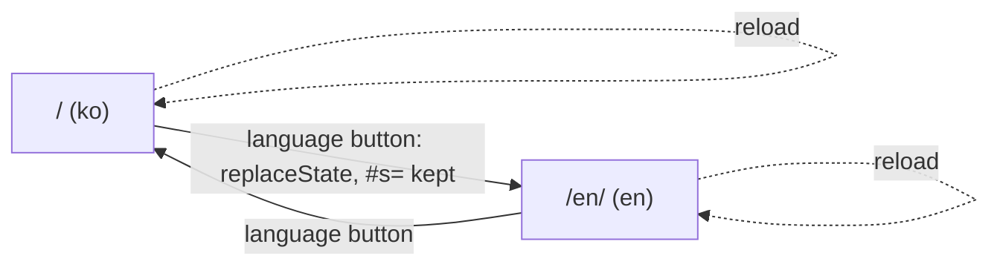

# SEO, AI answers and the site shell

> **한국어 요약**
>
> - 언어마다 별도 URL을 씁니다. 시뮬레이터는 한국어 `/`, 영어 `/en/`이고 안내 페이지는 `/<page>/`, `/en/<page>/`입니다. 언어는 URL이 정하며 `localStorage`에 저장하지 않고, 브라우저 언어로 자동 이동시키지 않습니다.
> - 사이트 이름은 한국어 **티렉스 대 호랑이**, 영어 **T-Rex vs Tiger** 하나로 통일합니다(한국어 별칭 "티라노사우루스 vs 호랑이"). `<title>`, `og:site_name`, 헤더 브랜드, 앱 제목, `document.title`이 모두 같은 이름을 씁니다.
> - 모든 페이지는 고유한 제목(60자 이하)과 설명(약 160자 이하)을 가집니다. 앱이 설정하는 `document.title`은 그 언어 페이지의 정적 `<title>`과 같습니다.
> - JavaScript를 실행하지 않는 크롤러(대부분의 AI 크롤러, 네이버의 1차 수집)를 위해 `/`와 `/en/`의 `#app` 바깥에 정적 소개 · FAQ · 푸터를 둡니다. 결과 숫자는 쓰지 않고 모델 설명의 예비 결과로 연결합니다.
> - 모든 페이지의 정적 푸터에 소스 코드, 라이선스, 블로그, Linktree(`rel="me"`), 개인정보처리방침, 소개, 버전 링크가 있습니다.
> - 다음 단계(2단계)에서 JSON-LD, OG 이미지, 사이트맵 자동 생성, 404 페이지, `x-default` 조정 등을 다룹니다.

The research behind these decisions, with sources, is [docs/research/SEO_GEO.md](research/SEO_GEO.md). This document records what the site implements and how it is tested. Stage 1 (issues [#28](https://github.com/VinylStage/trex_vs_tiger_sim/issues/28) and the language/content parts of [#30](https://github.com/VinylStage/trex_vs_tiger_sim/issues/30)) is the site shell described here.

## Contents

- [URLs and languages](#urls-and-languages)
- [Names](#names)
- [Titles and descriptions](#titles-and-descriptions)
- [Crawlable content on the simulator pages](#crawlable-content-on-the-simulator-pages)
- [Footer and owner links](#footer-and-owner-links)
- [Canonical, hreflang and sitemap](#canonical-hreflang-and-sitemap)
- [What is not done yet](#what-is-not-done-yet)
- [Tests](#tests)

## URLs and languages

| Page       | Korean         | English           |
| ---------- | -------------- | ----------------- |
| Simulator  | `/`            | `/en/`            |
| Guide      | `/guide/`      | `/en/guide/`      |
| Model      | `/model/`      | `/en/model/`      |
| Parameters | `/parameters/` | `/en/parameters/` |
| About      | `/about/`      | `/en/about/`      |
| Privacy    | `/privacy/`    | `/en/privacy/`    |
| License    | `/license/`    | `/en/license/`    |

- One URL per language (SEO_GEO §1.1): Googlebot sends no `Accept-Language` and ignores cookies and storage, so a single URL that switches language client-side cannot be targeted. Each file has a static `<html lang>`.
- The app takes its language from the URL (`pageLang` in `src/pages/routes.ts`), never from storage, and never redirects by browser language.
- The language button switches in place and rewrites the URL to the counterpart (`/#s=…` ↔ `/en/#s=…`), keeping the scenario fragment, so a copied or bookmarked link opens in the language it was copied in. Details: [PAGES.md](PAGES.md#url-scheme-and-languages).
- The shared scenario stays in the fragment (`#s=…`), which search engines ignore, so `/` and `/en/` remain the canonical pages for every scenario.

## Names

| Where                                    | Korean                                                                  | English                                                     |
| ---------------------------------------- | ----------------------------------------------------------------------- | ----------------------------------------------------------- |
| Site name (`og:site_name`, header brand) | 티렉스 대 호랑이 (`app.shortTitle`)                                     | T-Rex vs Tiger (`app.shortTitle`)                           |
| App heading (`h1`)                       | 티렉스 대 호랑이 시뮬레이터 (`app.title`)                               | T-Rex vs Tiger Simulator (`app.title`)                      |
| Tagline                                  | 티라노사우루스 vs 호랑이 · 몬테카를로 방법으로 배우는 교육용 시뮬레이션 | Tyrannosaurus rex vs tigers · learn the Monte Carlo method… |
| Alternate name                           | 티라노사우루스 vs 호랑이 (in the home title, tagline and descriptions)  | —                                                           |

The web app manifest already uses 티렉스 대 호랑이 ([BRANDING.md](BRANDING.md)) and is unchanged. Body text on the Korean pages says "티렉스 대 호랑이 시뮬레이터"; the English pages keep "T-Rex vs Tiger Simulator".

## Titles and descriptions

Pattern: `<topic> – <site name>`. Titles are at most 60 characters, descriptions 50–165 characters (aim: about 160), every one unique; English titles are shorter. Adapted from SEO_GEO §1.2.

| Page        | Korean title                                                         | English title                                               |
| ----------- | -------------------------------------------------------------------- | ----------------------------------------------------------- |
| `/`, `/en/` | 티렉스 대 호랑이 시뮬레이터 – 티라노사우루스 vs 호랑이, 누가 이길까? | T-Rex vs Tiger Simulator – who wins, T. rex or tigers?      |
| guide       | 사용 방법: 단계별 가이드와 튜토리얼 – 티렉스 대 호랑이               | How to use the simulator – T-Rex vs Tiger                   |
| model       | 모델 설명: 몬테카를로 에이전트 기반 전투 모델 – 티렉스 대 호랑이     | Model explained (Monte Carlo, agent-based) – T-Rex vs Tiger |
| parameters  | 파라미터와 출처: 22개 능력치와 시나리오 설정 – 티렉스 대 호랑이      | Parameters and sources – T-Rex vs Tiger                     |
| about       | 소개 · 문의: 오픈 소스 교육용 시뮬레이터 – 티렉스 대 호랑이          | About and contact – T-Rex vs Tiger                          |
| privacy     | 개인정보처리방침 – 티렉스 대 호랑이                                  | Privacy policy – T-Rex vs Tiger                             |
| license     | 라이선스: MIT와 오픈 소스 고지 – 티렉스 대 호랑이                    | License (MIT) and notices – T-Rex vs Tiger                  |

The simulator's `<title>` is also the dictionary string `app.documentTitle`; the app sets `document.title` from it at start-up and on every language switch, so the rendered title Google indexes equals the static one. `og:title` and `twitter:title` repeat the title, `og:description` and `twitter:description` the description.

## Crawlable content on the simulator pages

AI crawlers such as GPTBot and ClaudeBot do not run JavaScript, and Naver indexes the static HTML first (SEO_GEO §1.5). `/` and `/en/` therefore carry, outside `#app`:

- an answer-first intro: what the simulator is, how it works (four steps), what you can learn (Monte Carlo, confidence intervals, sensitivity), and links to the guide, the model's preliminary results, the parameters and the tour;
- a visible FAQ with four questions (did they ever meet, who wins, what Monte Carlo is, sharing and reproducing);
- the site footer.

The intro states no simulation results: those depend on the model version and live, with their seed and run count, on the model page (`/model/#results`). The one number it does state (22 parameters) is pinned to `PARAMS.length` by a test. Wording follows the content framing rules in [CONTRIBUTING.md](../CONTRIBUTING.md#content-framing-rules): the method is the subject, vocabulary is neutral, and nothing claims "no tracking" or "no ads". Layout and CLS: [PAGES.md](PAGES.md#the-simulator-pages--en).

## Footer and owner links

Every page links, in static HTML: about, privacy, license, the source code (`https://github.com/VinylStage/trex_vs_tiger_sim`), the blog (`https://vinylims.com`, "Vinyl's Log") and Linktree (`https://link.vinylims.com`), plus the release notes with the running version. The blog and Linktree links carry `rel="me noopener"`: they are the owner's own profiles, which helps tie the site to its author entity (SEO_GEO §5.4). The registry is `FOOTER_LINKS` in `src/pages/routes.ts`; [PAGES.md](PAGES.md#footer) describes the markup.

## Canonical, hreflang and sitemap

- Every page, the two simulator pages included, has a self-referencing canonical on `https://trex-vs-tiger.vinylims.com` and `hreflang` alternates `ko`, `en` and `x-default`. `x-default` currently points at the Korean page, as on the existing content pages; SEO_GEO §1.4 suggests English, which stage 2 decides together with the sitemap generator.
- `public/sitemap.xml` is still a static file. It now lists `/en/` and the license pages, each with its alternates. `tests/pages.test.ts` fails if a page is missing.
- `public/_headers`: `/en/` and `/license/`, `/en/license/` are covered by the existing `/*/` rule (`Cache-Control: no-cache, no-transform` plus the CSP).

## What is not done yet

Planned for stage 2 (SEO_GEO §0.2, §2, §3, §5): JSON-LD (`WebSite`, `WebApplication`, `Person`, `BreadcrumbList`, `TechArticle`, optionally `FAQPage`), `og:image` with the 1200×630 cards and `summary_large_image`, `<link rel="manifest">`, a generated sitemap with `lastmod`, a top-level `404.html`, `llms.txt`, IndexNow, and the webmaster-tool verifications (owner actions).

## Tests

| Test                    | Checks                                                                                                                                                                                                                                     |
| ----------------------- | ------------------------------------------------------------------------------------------------------------------------------------------------------------------------------------------------------------------------------------------ |
| `tests/site.test.ts`    | `pagePath`/`parsePagePath`/`counterpartPath` with `/en/`; `pageLang` (URL first, then `<html lang>`, then Korean); `switchedAppUrl` keeps query and fragment; `FOOTER_LINKS` order, hrefs and `rel="me"`; `relocalizeLinks`; build entries |
| `tests/i18n.test.ts`    | `initLang(lang)`; switching never reads or writes `localStorage`                                                                                                                                                                           |
| `tests/pages.test.ts`   | Title/description length and uniqueness on all pages; simulator `<title>` = `app.documentTitle`; intro/FAQ/footer outside and after `#app`; every `data-i18n` text = dictionary; footers = `footerItems`; license texts; privacy keys      |
| `tests/version.test.ts` | The reset round-trip returns to `/en/` from the English app and only ever to `/` or `/en/`                                                                                                                                                 |
