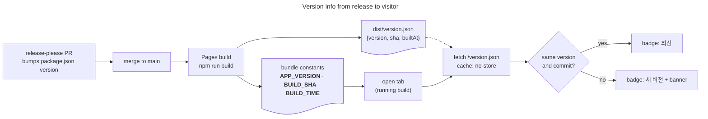
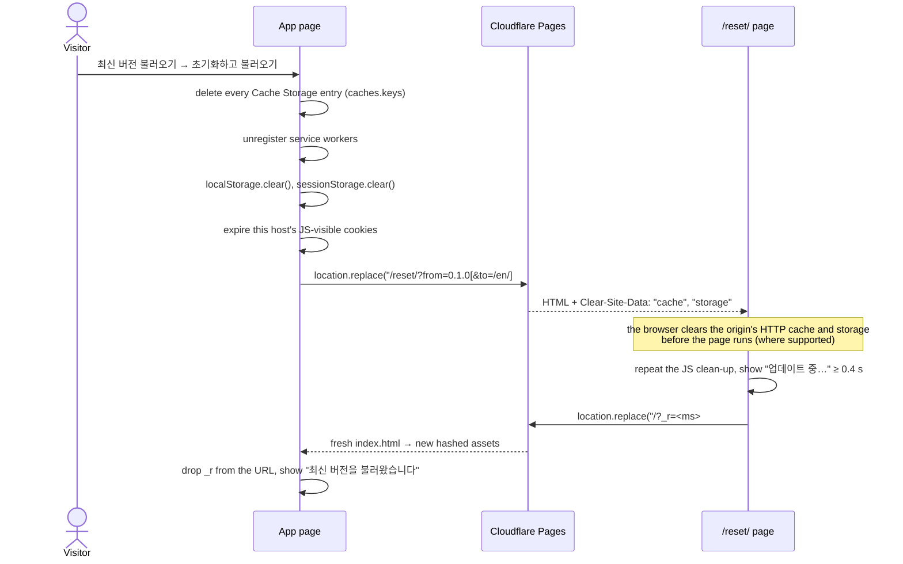

# Versioning, update detection and cache reset

> **한국어 요약**
>
> - 헤더의 배지가 지금 실행 중인 릴리스 버전(`v0.1.0`)과 상태(**확인 중 / 최신 / 새 버전 / 새 빌드 / 변경됨 / 확인 불가**)를 보여 줍니다. 상태 문구는 고정된 짧은 목록이라 배지 폭이 바뀌지 않고(레이아웃 이동 없음), 배포된 버전 번호는 배너·대화상자와 스크린 리더용 텍스트에 나옵니다. 모든 페이지의 정적 푸터에 릴리스 노트 링크가 있고, 앱은 그 자리에 `버전 v0.1.0 (커밋 7자리)`를, 안내 페이지는 `버전 v0.1.0`을 채웁니다.
> - 버전은 빌드 시점에 `package.json`의 `version`(release-please가 올림)과 커밋 SHA(`CF_PAGES_COMMIT_SHA`, 없으면 `git rev-parse HEAD`)에서 가져와 번들에 넣고, 같은 내용을 `dist/version.json`으로도 내보냅니다.
> - 페이지는 로드 직후, 탭이 다시 보일 때(10분 간격 제한), 보이는 동안 30분마다 `/version.json`을 `no-store`로 받아 자기 버전과 비교합니다. 버전이 더 높거나, 버전이 같아도 커밋이 다르면 새 배포로 봅니다.
> - 새 배포가 있으면 화면 아래쪽에 고정 배너가 뜹니다(넓은 화면은 오른쪽 아래, 좁은 화면은 실행 버튼 막대 바로 위). 레이아웃을 밀지 않고, 헤더를 가리지 않으며, 배너가 떠 있는 동안 포커스된 요소는 배너 위로 스크롤되고, Esc로 닫을 수 있습니다. 배지를 누르면 버전 정보 대화상자가 열립니다. **최신 버전 불러오기 (캐시·저장소 초기화)** 를 확인하면 Cache Storage, 서비스 워커, localStorage, sessionStorage, 이 호스트의 JS 쿠키를 지운 뒤 `/reset/`으로 이동합니다. `/reset/` 응답의 `Clear-Site-Data: "cache", "storage"` 헤더가 브라우저 캐시와 저장소를 한 번 더 비우고, 페이지는 `/?_r=<시각>`(영어판에서 시작했다면 `/en/?_r=<시각>`)으로 새로 불러옵니다. 시나리오(URL `#s=`)와 언어(URL 경로)는 유지됩니다.
> - 튜토리얼 안내 기록(`trexsim.tour`)은 초기화됩니다(확인 문구에 안내). 언어는 저장하지 않고 URL로 정하므로 그대로입니다.
> - `Clear-Site-Data`에 `"cookies"`는 **넣지 않습니다.** 명세와 MDN에 따르면 이 지시어는 응답 출처의 **등록 도메인 전체**(`vinylims.com`과 모든 `*.vinylims.com` 하위 도메인)의 쿠키를 지우므로, 소유자의 다른 사이트 로그인까지 끊을 수 있습니다. 대신 JS로 이 호스트의 쿠키만 만료시킵니다(HttpOnly 쿠키는 JS로 지울 수 없음).

## Contents

- [What the visitor sees](#what-the-visitor-sees)
- [Data flow](#data-flow)
- [Footer version](#footer-version)
- [Build-time version info](#build-time-version-info)
- [How a release-please version reaches the page](#how-a-release-please-version-reaches-the-page)
- [Update detection](#update-detection)
- [Reset and reload](#reset-and-reload)
- [Response headers](#response-headers)
- [Clear-Site-Data: browser support](#clear-site-data-browser-support)
- [Why `"cookies"` is not used](#why-cookies-is-not-used)
- [What is not cleared](#what-is-not-cleared)
- [Files](#files)
- [Verify](#verify)
- [Sources](#sources)

## What the visitor sees

| Element           | Where                                   | Content                                                                                                                                                                                                                                                                                                                                                   |
| ----------------- | --------------------------------------- | --------------------------------------------------------------------------------------------------------------------------------------------------------------------------------------------------------------------------------------------------------------------------------------------------------------------------------------------------------- |
| Version badge     | Header, right of the title              | `v0.1.0` and a status: **확인 중 / Checking**, **최신 / Latest**, **새 버전 / New version**, **새 빌드 / New build** (same version, newer commit), **변경됨 / Changed** (lower version, e.g. a rollback), **확인 불가 / Can't check**. Screen readers also hear the deployed version ("새 버전 v0.2.0")                                                   |
| Version dialog    | Opens from the badge (modal `<dialog>`) | Current version + short SHA, build time, latest deployed version, last check time, **패치노트 보기 / Patch notes** (the running version's card on [/patch-notes/](PAGES.md#patch-notes)), link to the [release notes](https://github.com/VinylStage/trex_vs_tiger_sim/releases), **다시 확인 / Check again**, **최신 버전 불러오기 (캐시·저장소 초기화)** |
| Update banner     | Fixed to the bottom edge (see below)    | "새 버전이 배포되었습니다: v0.2.0" with **바뀐 점 보기 / What’s new** (the deployed version’s patch notes card), **업데이트** (opens the dialog at the confirmation step) and **나중에** (hides it for this deployment); Esc also hides it                                                                                                                |
| Post-reset notice | Same place as the banner, 6 s           | "최신 버전을 불러왔습니다 (v0.2.0)." with **닫기**                                                                                                                                                                                                                                                                                                        |
| Footer            | Static footer of every page             | `버전 v0.1.0 (21c02f5)` in the app, `버전 v0.1.0` on the content pages; a static link to the release notes whose number is filled in by script (see [below](#footer-version))                                                                                                                                                                             |
| `/reset/` page    | Shown for about half a second           | "업데이트 중… / Updating…" with a spinner, then the app reloads                                                                                                                                                                                                                                                                                           |

Design notes:

- **No layout shift: the badge keeps one width.** The badge is in the header from the first paint. Its visible status comes from a fixed set of short labels, and all six are rendered in the same grid cell with only the current one visible (`visibility: hidden` on the others, which also keeps them out of the accessible name). The slot is therefore as wide as the longest label of the current language from the start, and no status change can resize the badge or re-wrap the header, whatever the deployed version string. The deployed version is not part of the visible label (a version such as `v0.10.0-beta.12` would otherwise widen the badge); it is in a visually hidden span, in the banner and in the dialog. Only switching the language changes the width, which is user input and does not count towards Cumulative Layout Shift.
- **No layout shift: the banner is an overlay.** It is `position: fixed`, its text is in place before it is revealed (so it does not grow after its first frame), and its lift above the run bar (below) is a `translate`, which the Layout Instability API does not count.
- **The banner never hides the header, the Run button or a focused control** (WCAG 2.2 SC 2.4.11 Focus Not Obscured).
  - It is docked to the bottom edge at every width, so it never covers the header and the badge. On the two-column layout (≥ 1000 px) it sits bottom right, over the results column. Below 1000 px it is centred, and while the config panel's sticky run bar is stuck to the bottom edge it rises just above that bar (`src/ui/version.ts` measures the bar into `--update-banner-lift` on scroll, resize and `ResizeObserver` callbacks); once the bar scrolls away, it drops back to the edge.
  - While it is shown, `document.documentElement.style.scrollPaddingBottom` is set to the band from the banner's top edge down (plus 8 px), so the browser scrolls a control that receives focus above the banner, and `body` gets bottom padding equal to the banner's height plus its offset from the edge and the same gap, so the end of the page (the footer links, where the run bar is no longer stuck) can scroll above it. Adding space after the last element moves nothing on screen. Both are removed when the banner hides. They are set through the CSSOM, which the CSP allows.
  - **Esc** dismisses the banner wherever the focus is (unless a modal dialog is open, which handles its own Esc), so a covered control can also be revealed without moving focus.
- **Accessibility.** The badge is a `<button aria-haspopup="dialog">` whose name is its visible text plus the deployed version ("v0.1.0 새 버전 v0.2.0"). The dialog is a native modal `<dialog>` (focus is contained, Esc closes, focus returns to the badge), labelled by its heading; a backdrop click also closes it. The confirmation step moves focus to its heading so screen readers read the explanation before the buttons. Banner and dialog messages are `role="status"` live regions; the banner's visible text is `aria-hidden` and a visually hidden live region next to it is filled 50 ms after the banner appears, so the message is announced once. Animations and the lift transition stop under `prefers-reduced-motion`.
- **Contrast.** All new text is at least 4.5:1 in both colour schemes. The update state marks the badge with the accent on its border and dot only; its label uses the text colour (`--accent` as label colour was 4.42:1 on white and 3.87:1 on hover). The dialog's release-notes link uses `#1f62b8` in the light scheme (6.0:1; `--accent` is 4.42:1 there) and `--accent` in the dark one (4.64:1).
- **Performance.** The first check waits for the `load` event and an idle callback, so it never competes with the app's own resources. `version.json` is ~110 bytes.

## Data flow



## Footer version

Every page (`index.html`, `en/index.html`, the content and license pages) has the same static footer ([PAGES.md](PAGES.md#footer)). Its last line holds

```html
<a class="version-footer" href="https://github.com/VinylStage/trex_vs_tiger_sim/releases" …>
  <span data-i18n="version.footer">버전</span>
  <span class="version-footer-num" data-app-version></span>
</a>
```

The link exists without JavaScript, so crawlers and no-JS visitors can reach the release notes. The number is filled in at run time from the same build `define`: the app calls `fillVersionFooter()` (`src/ui/version.ts`, `v<version> (<short sha>)`), the content pages run `src/pages/site.ts` (`v${__APP_VERSION__}`). `.version-footer-num` reserves `5ch` so filling it in does not reflow the line.

## Build-time version info

`vite.config.ts` computes one `BuildInfo` per build and uses it twice. The config file carries no comments (project rule), so it is explained here.

| Constant / file     | Value                                                                                                                                                          |
| ------------------- | -------------------------------------------------------------------------------------------------------------------------------------------------------------- |
| `__APP_VERSION__`   | `version` from `package.json`, e.g. `"0.1.0"`.                                                                                                                 |
| `__BUILD_SHA__`     | `CF_PAGES_COMMIT_SHA` (set by the Cloudflare Pages build), otherwise `git rev-parse HEAD`, otherwise `"dev"`. Only 7–40 hex characters are accepted.           |
| `__BUILD_TIME__`    | ISO 8601 time at which the build started.                                                                                                                      |
| `dist/version.json` | `{"version":"0.1.0","sha":"<40 hex>","builtAt":"<ISO>"}` — the same three values, emitted by a small inline plugin (`trexsim:version-json`, `generateBundle`). |

- The constants are Vite `define` replacements; their TypeScript declarations are in `src/env.d.ts`.
- `npm run dev` serves the same JSON at `/version.json` from a dev-server middleware, so the badge reads "최신" in development as well.
- `vite.config.ts` uses `node:child_process`, `node:fs`, `node:process` and `node:url`, so `@types/node` is a dev dependency, pinned to `~24.x` to match `.node-version`. It is a type package only; the runtime bundle still has zero dependencies ([ADR-0004](adr/0004-no-runtime-dependencies.md)).
- `reset/index.html` is a second HTML entry. Vite 8 names the option `build.rolldownOptions.input` (`build.rollupOptions` is its deprecated alias). The entry keys are `index`, `en` (the English app, same `src/main.ts`), `reset` and the content pages. Because `index` and `en` share the app module, the bundler emits it as a shared chunk named after `src/main.ts` (`assets/main-<hash>.js` / `.css`); the name may change. Code shared by both entries (`version-model.ts`, `site-data.ts`) lands in a small common chunk.

## How a release-please version reaches the page

1. Conventional Commits land on `main` through squash merges. Each push to `main` deploys to production with the **same** `package.json` version and a **new** commit SHA. Open tabs see "새 빌드".
2. release-please keeps a release PR open that bumps `package.json` `version`, `.release-please-manifest.json` and `CHANGELOG.md`.
3. Merging the release PR deploys a build whose `__APP_VERSION__` and `version.json` carry the new version. Open tabs see "새 버전 v0.2.0". The GitHub Release and tag (`trex-vs-tiger-sim-v0.2.0`) are created by the same workflow.
4. Nothing else needs to change: the version is never hard-coded in the source.
5. When release-please reports `release_created`, its `indexnow` job calls `.github/workflows/indexnow.yml`, which waits until `version.json` on production reports the new version and then submits the sitemap URLs to IndexNow ([SEO.md](SEO.md#indexnow)). The build also writes the version into the simulator's JSON-LD (`WebApplication.softwareVersion`).

Preview deployments work the same way: the branch alias `https://<branch>.trex-vs-tiger-sim.pages.dev` moves with every push, so an open preview tab notices the next push.

## Update detection

The logic is in `src/ui/version-model.ts` (DOM-free, covered by `tests/version.test.ts`); `src/ui/version.ts` wires it to the DOM.

**When the page checks.**

| Trigger                                  | Rule                                                                       |
| ---------------------------------------- | -------------------------------------------------------------------------- |
| Page load                                | Always, after `load` + idle callback                                       |
| Tab becomes visible (`visibilitychange`) | Only if the last attempt is ≥ 10 min old                                   |
| Timer, every 30 min                      | Only while the tab is visible, and only if ≥ 10 min since the last attempt |
| Dialog opened                            | If the last attempt is ≥ 1 min old                                         |
| **다시 확인** button                     | Always                                                                     |

Checks never overlap. `fetch('/version.json', { cache: 'no-store' })` bypasses the HTTP cache, and the response is validated (semver version ≤ 64 characters, hex SHA or `dev`) before use.

**Comparison** (`compareBuilds`):

| Deployed vs running                         | Result     | Badge (screen readers also hear) |
| ------------------------------------------- | ---------- | -------------------------------- |
| Same version, same commit (or either `dev`) | up to date | 최신                             |
| Higher version (SemVer 2.0.0 precedence)    | `newer`    | 새 버전 (`v0.2.0`)               |
| Same version, different commit              | `rebuild`  | 새 빌드 (short SHA, `(bbbbbbb)`) |
| Lower version (e.g. a dashboard rollback)   | `changed`  | 변경됨 (`v0.0.9`)                |

`statusLabel` and `statusDetail` (also in `version-model.ts`) map a status to the visible label and to that screen-reader detail.

**Status reducer** (`reduceStatus`). The badge starts at "확인 중". A failed first check shows "확인 불가". Once a check has succeeded, later background checks keep showing the last known result while they run and when they fail (offline laptop, flaky network), so the badge never flickers.

**Banner.** It appears when the status becomes an update and stays until the visitor dismisses it. A dismissal is remembered in memory for that deployment (`version+sha`) only, so an even newer deployment shows the banner again, and a reload starts fresh.

## Reset and reload



- **Confirmation.** The action asks first, inside the dialog, and says that the tutorial record (`trexsim.tour` in `localStorage`, the only key the site writes; the v0.1.0 key `trexsim.lang` is deleted on every load, `src/pages/legacy-storage.ts`) is reset. The scenario and the language are kept: the scenario lives in the URL fragment (`#s=…`), which both redirects carry along, and the language is the URL path.
- **Language round-trip.** The app passes its own path to `resetUrl()`; from the English app the reset URL gets `&to=%2Fen%2F`. `src/reset.ts` reads it with `returnPathFromSearch()`, which accepts only `/` and `/en/` (anything else falls back to `/`, so the parameter cannot redirect off-site), and `reloadUrl()` sends the visitor back to `/en/?_r=…#s=…`.
- **`location.replace`** is used for both hops, so Back does not return to the old page or to `/reset/`.
- **`?_r=<timestamp>`** gives `index.html` a URL that no cache has seen. `index.html` is already `no-cache`, and assets are content-hashed, so this is a belt-and-braces measure for intermediaries and for Chrome's partial `"cache"` support (see below). The app removes `_r` with `history.replaceState` right away, so shared links stay clean; other query parameters are kept.
- **Opening `/reset/` directly** works too: it is a support link that fixes a stuck client (`https://trex-vs-tiger.vinylims.com/reset/`). The page repeats the JavaScript clean-up for browsers without `Clear-Site-Data`.
- **Fallback link.** If the hand-off has not happened after 3 s (also without JavaScript), the reset page shows a "Continue" link. It is revealed with a CSS animation of `visibility`, not `opacity`, so it stays out of the tab order while it is invisible. `src/reset.ts` points it at the same `/?_r=<ms>#s=…` (or `/en/…`) URL as the automatic hand-off, so it keeps the scenario too; without JavaScript it is a plain `/`, since HTML alone cannot carry the current fragment. Its colour (`--link` in `src/reset.css`, `#1f62b8` light) is 5.56:1 on the light background and 5.07:1 on the dark one.
- Every async step has a 5 s ceiling, so an unresponsive browser API cannot strand the visitor.

## Response headers

`public/_headers` (no comments allowed in the file) gains two rules:

```text
/version.json
  Cache-Control: no-store

/reset/*
  Cache-Control: no-store
  Clear-Site-Data: "cache", "storage"
```

The site-wide `/*/` rule ([DEPLOYMENT.md](DEPLOYMENT.md)) also matches `/reset/` and sets `Cache-Control: no-cache, no-transform`. Pages joins a header set by two matching rules with a comma, so `/reset/` is served with `Cache-Control: no-cache, no-transform, no-store`; `no-store` takes precedence over `no-cache` ([RFC 9111 §5.2.2.5](https://www.rfc-editor.org/rfc/rfc9111#section-5.2.2.5)). `tests/pages.test.ts` asserts the combined headers.

| Rule            | Header                                | Why                                                                                                                                                                                                                                                             |
| --------------- | ------------------------------------- | --------------------------------------------------------------------------------------------------------------------------------------------------------------------------------------------------------------------------------------------------------------- |
| `/version.json` | `Cache-Control: no-store`             | Neither the browser nor any intermediary may keep a copy; every check sees the current deployment. The client also sends `cache: 'no-store'`.                                                                                                                   |
| `/reset/*`      | `Cache-Control: no-store`             | The reset page must always come from the network, otherwise the browser would not see the `Clear-Site-Data` header again.                                                                                                                                       |
| `/*/`           | `no-transform`                        | `/reset/` is HTML. On the custom domain, Bot Fight Mode would otherwise inject its inline JavaScript Detections script, which the strict CSP blocks ([DEPLOYMENT.md](DEPLOYMENT.md#bot-fight-mode-and-javascript-detections)).                                  |
| `/reset/*`      | `Clear-Site-Data: "cache", "storage"` | Server-side complement to the JavaScript clean-up: clears the origin's HTTP cache (which JavaScript cannot touch) and DOM storage — localStorage, sessionStorage, IndexedDB, service worker registrations and Cache Storage. Directives must be quoted strings. |

The splat in `/reset/*` matches the empty string, so the rule applies to `/reset/` itself (verified on the branch preview: `clear-site-data: "cache", "storage"` on `GET /reset/`, and Chrome logs `Cleared data types: "cache", "storage".`). Pages answers `/reset` and `/reset/index.html` with a `308` to `/reset/`; the second also matches the rule, so its redirect carries the header as well, which only repeats the clearing. The app always links to `/reset/`. The CSP and other headers of the `/*` rule apply as usual. `vite preview` and `npm run dev` do not apply `_headers`; check them on a Pages preview (see [Verify](#verify)).

## Clear-Site-Data: browser support

From MDN browser-compat-data (2026-10). The header needs a secure context (HTTPS), which every Pages URL is.

| Directive   | Chrome / Edge               | Firefox                        | Safari |
| ----------- | --------------------------- | ------------------------------ | ------ |
| `"storage"` | 61                          | 63                             | 17     |
| `"cache"`   | 61, **partial** (see below) | 63–93, removed; again from 138 | 17     |
| `"cookies"` | 61                          | 63                             | 17     |

Chrome caveats for `"cache"` (from the same data): some requests may still be served from cache until the tab reloads or the page opens in a new tab ([crbug 364634040](https://crbug.com/364634040)), and clearing can take seconds ([crbug 40233601](https://crbug.com/40233601)). The flow copes with both: the reset page is a fresh navigation, `index.html` is reloaded under a new `?_r=` URL, and the old page shows "초기화하는 중…" while Chrome holds the `/reset/` response until clearing completes. Browsers that ignore the header still get the JavaScript clean-up; only their HTTP cache stays, which `no-cache` HTML plus hashed assets make harmless.

## Why `"cookies"` is not used

- The spec's `"cookies"` type clears cookies "associated with the origin … as well as cookies on any origin in the same registered domain". MDN: it "affects the entire registered domain, including subdomains", e.g. `https://example.com` and `https://stage.example.com`.
- The production host is `trex-vs-tiger.vinylims.com`. Its registered domain is `vinylims.com`, so `"cookies"` would also delete the cookies of every other `*.vinylims.com` site of the owner (log-in sessions, preferences) and clear HTTP authentication credentials for them — far beyond what "reload this simulator" should do.
- This app sets no cookies of its own. So the reset only expires the cookies that **this host** exposes to JavaScript (`document.cookie`): each name is set to `Max-Age=0` with `Path=/`, once host-only and once with `Domain=<this host>`, plus `Secure` on HTTPS. It never names a parent domain.

## What is not cleared

| Data                                                         | Why                                                                                                                                                     |
| ------------------------------------------------------------ | ------------------------------------------------------------------------------------------------------------------------------------------------------- |
| `HttpOnly` cookies (e.g. Cloudflare's `__cf_bm`)             | Invisible to JavaScript by design, and `"cookies"` is deliberately not sent. They are set by the edge, not by the app, and hold no app state.           |
| Cookies scoped to `vinylims.com` or to a path other than `/` | Out of scope on purpose (see above); the app never sets any.                                                                                            |
| HTTP cache, in browsers without `"cache"` support            | JavaScript cannot clear it. HTML is `no-cache` and assets are content-hashed, so a normal load already gets the new build.                              |
| IndexedDB, in browsers without `Clear-Site-Data`             | The app does not use IndexedDB.                                                                                                                         |
| Other tabs of the site                                       | They keep running the old build until they reload; their own badge shows the update. (`"executionContexts"` would reload them but is barely supported.) |

## Files

| File                                                | Role                                                                                                                                    |
| --------------------------------------------------- | --------------------------------------------------------------------------------------------------------------------------------------- |
| `vite.config.ts`                                    | `define` constants, `version.json` plugin and dev middleware, second HTML entry                                                         |
| `src/env.d.ts`                                      | Type declarations for the three constants                                                                                               |
| `src/ui/version-model.ts`                           | Pure logic: semver, `version.json` validation, comparison, status reducer, throttle, badge labels, banner placement, cookie names, URLs |
| `src/ui/version.ts` / `src/ui/version.css`          | Badge, dialog, banner, `fillVersionFooter()` for the static footer                                                                      |
| `src/ui/site-data.ts`                               | JavaScript clean-up shared by the dialog and `/reset/`                                                                                  |
| `reset/index.html`, `src/reset.ts`, `src/reset.css` | The `/reset/` page                                                                                                                      |
| `public/_headers`                                   | `/version.json` and `/reset/*` rules                                                                                                    |
| `tests/version.test.ts`                             | Unit tests for `version-model.ts`                                                                                                       |

## Verify

```bash
# Build output
npm run build && cat dist/version.json && ls dist/reset/index.html

# Headers on a deployment (production or a preview alias)
host=https://trex-vs-tiger.vinylims.com
curl -sSI "$host/version.json" | grep -iE '^(content-type|cache-control):'
curl -sSI "$host/reset/" | grep -iE '^(cache-control|clear-site-data|content-security-policy):'
curl -s "$host/version.json"
```

Expected: `version.json` has `cache-control: no-store` and the deployed version and SHA; `/reset/` has `cache-control: no-cache, no-transform, no-store` and `clear-site-data: "cache", "storage"`, plus the site CSP.

In the browser: the badge shows "최신" a moment after load. To see the update path without a new release, block or override `/version.json` in DevTools (Network → right-click → **Override content**) with a higher version: the badge and banner change at the next check (switch tabs away for 10 min, or open the dialog and press **다시 확인**).

Browser checks run for this feature (Playwright, Chromium, production CSP injected, `/version.json` intercepted):

| Check                                                                                                                                                                         | Result                                                                                                                          |
| ----------------------------------------------------------------------------------------------------------------------------------------------------------------------------- | ------------------------------------------------------------------------------------------------------------------------------- |
| Tab through the whole page with the banner shown, at 320, 390, 820, 1024 and 1366 px, before and after a run                                                                  | No focused control is hidden by the banner (9 sample points per control); the badge is never under it                           |
| Esc with the focus outside the banner, inside it, and with the dialog open                                                                                                    | Hides the banner, keeps the focus (moves it to the badge if it was in the banner); with the dialog open, only the dialog closes |
| Layout shift caused by the status change (`/version.json` answered 4 s late), ko and en, 320–1366 px, for `0.2.0`, `0.10.0-beta.12`, a rebuild, a rollback and a failed check | CLS 0 in every case (before: up to 0.56 at 760 px, when the header buttons wrapped)                                             |
| Scrolling at 390 px with the banner shown                                                                                                                                     | The banner rides above the stuck run bar and drops to the edge when the bar scrolls away; CLS 0                                 |

## Sources

- Clear-Site-Data specification (W3C WebAppSec): <https://w3c.github.io/webappsec-clear-site-data/>
- MDN, `Clear-Site-Data`: <https://developer.mozilla.org/en-US/docs/Web/HTTP/Reference/Headers/Clear-Site-Data>
- MDN browser-compat-data, `http.headers.Clear-Site-Data`: <https://github.com/mdn/browser-compat-data/blob/main/http/headers/Clear-Site-Data.json>
- Cloudflare Pages `_headers` (splats, merging, limits): <https://developers.cloudflare.com/pages/configuration/headers/>
- Cloudflare Pages build environment variables (`CF_PAGES_COMMIT_SHA`): <https://developers.cloudflare.com/pages/configuration/build-configuration/#environment-variables>
- Vite `define`: <https://vite.dev/config/shared-options#define>; multi-page builds: <https://vite.dev/guide/build#multi-page-app>
- SemVer 2.0.0 precedence: <https://semver.org/#spec-item-11>
- WCAG 2.2, Understanding SC 2.4.11 Focus Not Obscured (Minimum): <https://www.w3.org/WAI/WCAG22/Understanding/focus-not-obscured-minimum.html>; technique C43, CSS `scroll-padding`: <https://www.w3.org/WAI/WCAG22/Techniques/css/C43>
- Cumulative Layout Shift (transforms do not cause layout shifts; shifts within 500 ms of user input are excluded): <https://web.dev/articles/cls>
- release-please: <https://github.com/googleapis/release-please>
